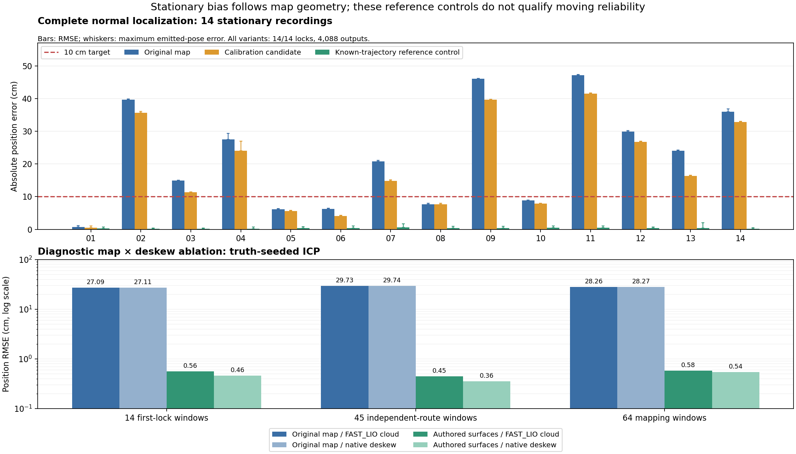
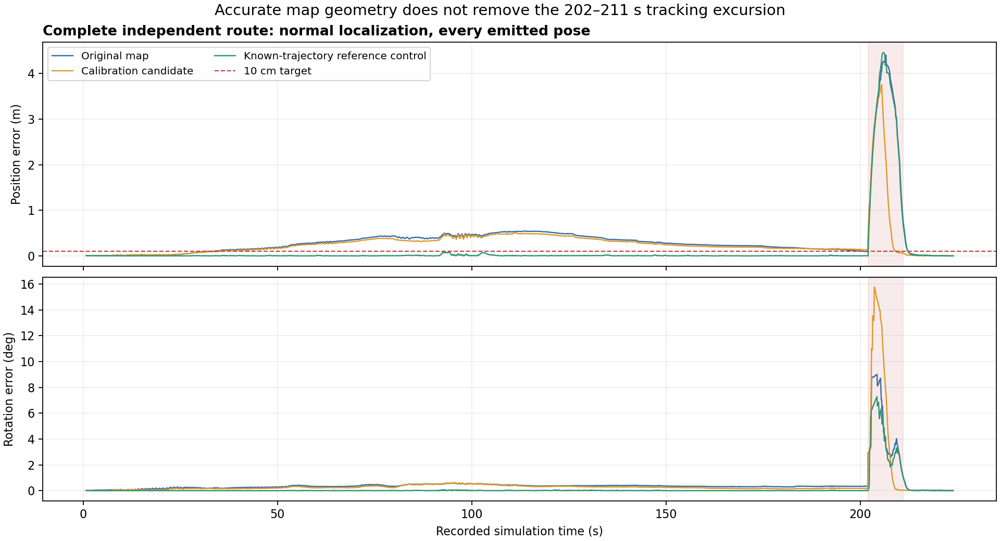
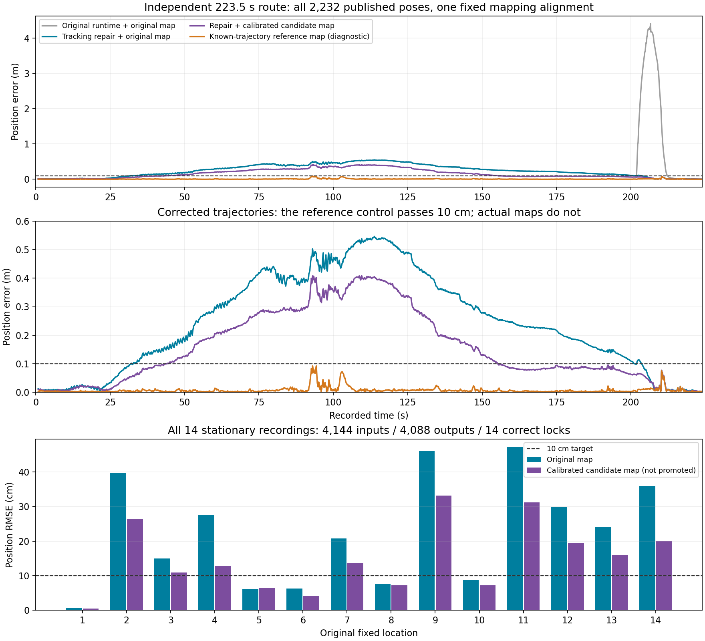
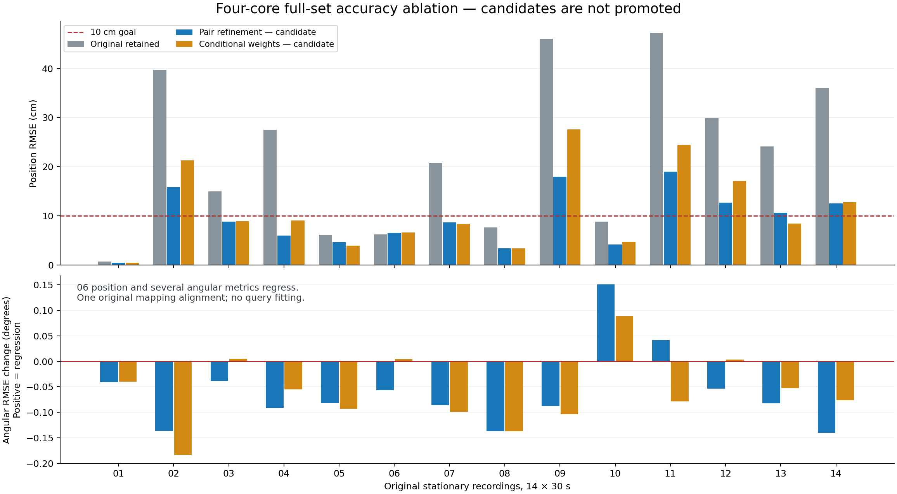
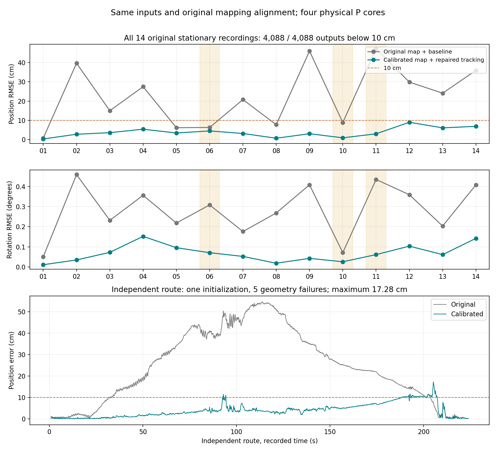
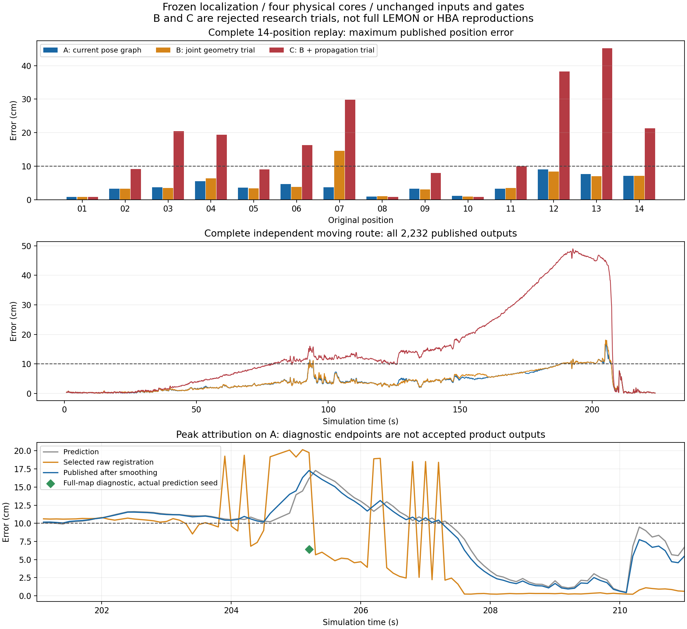
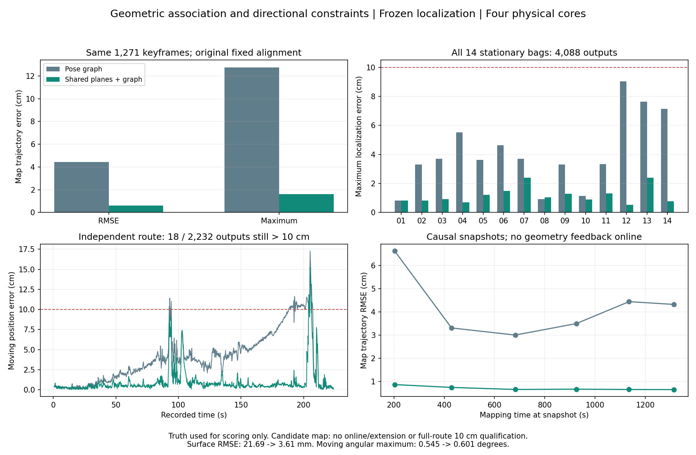
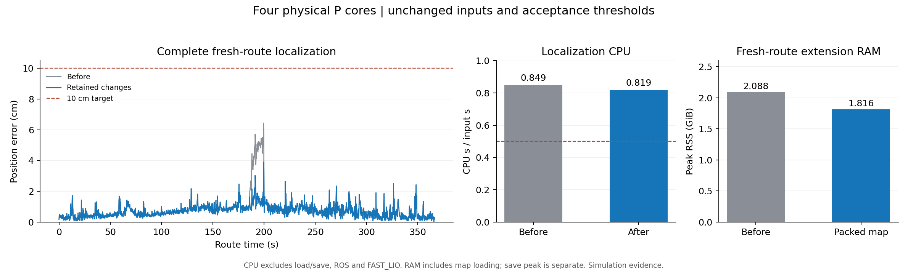
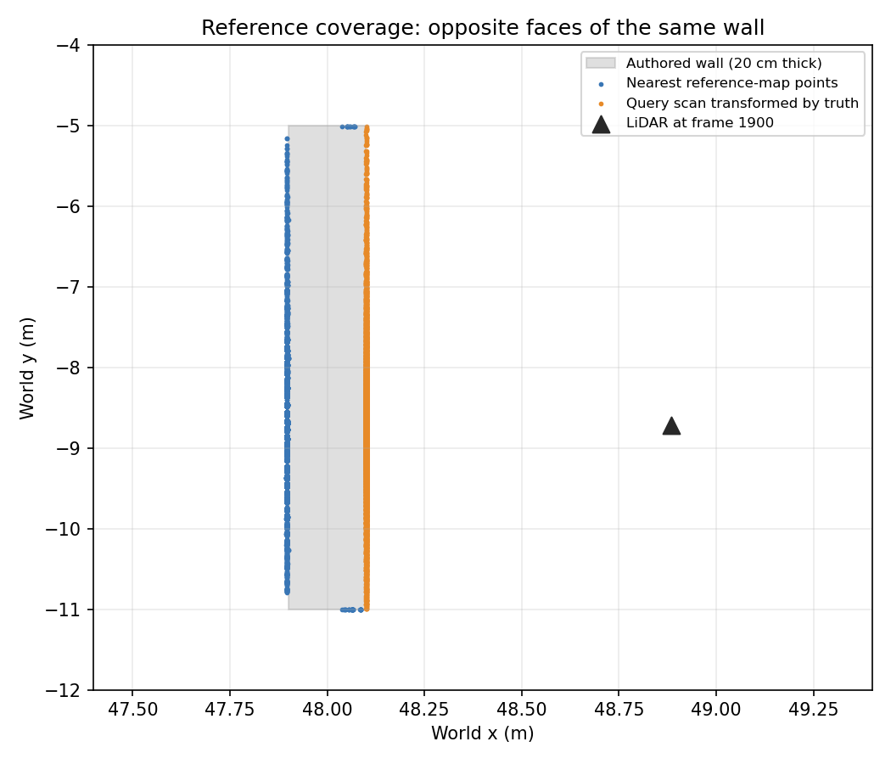

# Runtime CPU and relocalization measurements — 2026-10-17

Initial-stage baseline: `45f4a171fcab1d9742ab7d575f41a632c7d75073`, branch
`dev/n3mapping-realtime-pipeline`. In that stage the Product V1 configuration remained unchanged
(SHA-256 `1b603a0a180330857aac150e0450cb5e94e284a84934e9b6ee387000f3f254d4`).
These are Release/Humble development builds with **UNVERIFIED** build identity;
they do not constitute a Product Bundle or hardware qualification.

Current task order and acceptance boundaries are maintained in the
[project TODO](../../../README.md#todo). The dated sections below preserve the
scope and evidence of each completed experiment.

Current stage: [extension recovery and asynchronous online loops](#extension-recovery-and-asynchronous-online-loops--2026-10-20)
repairs strict tracking recovery, shares immutable loaded-map preparation and
separates mapping-loop geometry/graph work from the owner. Recorded replays
verify the delivered behavior. The [maintenance release 1.0.1](#maintenance-release-closeout--2026-10-20)
stationary-search work remains unchanged; further static-search performance
research is paused. Local repeat-visit consistency improves with existing
loops, while 10 cm absolute accuracy, difficult average half core, moving
aliases and full-node/hardware timing remain unqualified. Earlier rejected
trials retain their dated scope below; they are not pending implementation tasks.

## Measurement boundaries

Historical ROS measurements use process CPU time divided by elapsed wall time.
The newer SpRobo direct-core replays explicitly use **original input duration**;
when replay falls behind, that ratio measures demand at the original input rate,
not how many cores the four-core process simultaneously occupies. All threads
are included. Map loading precedes the measurement;
initial relocalization is included. First-path latency starts with the first
input, after map loading. Unless separately labeled as current RSS, memory is the process high-water
mark, not live retained memory. The cost-only runtime optimizations use no CPU quota, input reduction,
frequency reduction, or acceptance changes. The separate October 19 reliability
repair adds an absolute directional witness before accepting a lock. The earlier occlusion-aware scoring and hypothesis-elimination prototypes
remain unadopted. The adopted half-turn shortlist correction and its separate
October 18 measurements are documented below.
OpenMP has four configured threads and the existing launch default
`OMP_WAIT_POLICY=PASSIVE`; an isolated comparison also tests the unset policy.

The ROS probe puts the production node, replay publisher, and output subscribers
in one process. DDS subscriptions, exact message synchronization, the normal
backend loop, both live callback workers, cloud conversion, TF/output publication,
and complete path publication all execute. CPU includes the replay and subscriber
helpers as well. The initial runs used same-process Fast DDS with restricted
UDP/interface access; the latest stage uses authorized host execution.
**Cross-process DDS, physical MID360 input,
RK3588, and RViz rendering were not measured.** The independent LIO recordings
have no ground truth and do not independently establish their sensor model.

The older direct-callback/headless measurements are retained in the evidence but
are not used as the full ROS result. That driver can admit fewer startup frames;
the actual DDS runs processed every input pair.

## Data and results

`floor7_710toMeeting.bag` is an independent historical LIO scan/odometry recording:
1,848 paired scans, 184.8 seconds, approximately 97.6 m of odometry travel, with a
50 × 59 m map containing 152,116 global points. Four additional independent room
recordings contribute 1,796 frames. Their poses, states, identifiers and decisions
are compared with the frozen baseline; this is a behavioral regression check,
not a new absolute-accuracy claim.

Xian's `map_091426_20261010_212025.zip` contains a 66.9 × 95.0 m map with 266,304
global points and 250 keyframes. No matching independent recording was found.
The cost probe preserves saved scans and reconstructs 1,800 views along 180 seconds
of the saved trajectory, beginning at offset 360 seconds (about 118.7 m of motion).
These same-map views do **not** validate accuracy, visibility realism or recall.
Original files were read without modification; raw maps/scans are not published.

| Same-process ROS, 10 Hz | Baseline | Visibility/sorting/path candidate |
| --- | ---: | ---: |
| Independent floor7: average CPU cores | 0.271 | 0.267 |
| Independent floor7: first path | 1.192 s | 0.934 s |
| Independent floor7: peak RSS | 470.1 MiB | 473.3 MiB |
| Saved-map moving workload: average CPU cores | 0.259 | 0.256 |
| Saved-map moving workload: first path | 1.380 s | 1.076 s |
| Saved-map moving workload: peak RSS | 620.7 MiB | 631.1 MiB |

All 1,848 and 1,800 pairs were processed respectively; all compared backend
behavior fields agree. RSS did not improve consistently. Average CPU below half
a core is not a hard ceiling on short bursts, especially during relocalization.

The Product launcher previously omitted the wait-policy default already applied
by the ROS launch files. With the **same candidate algorithm**, a 600-frame,
59.93-second ROS run used 0.674 cores when the policy was unset and 0.340 cores
with `PASSIVE`. After the first ten seconds, these were 0.614 and 0.294 cores.
Both processed 600 frames with identical decisions and received output counts;
first-path latency was 0.946 and 0.925 seconds. The launcher now supplies the
existing default before exec and preserves explicit user overrides, including
`GOMP_SPINCOUNT`. This removes waiting CPU work; it is not a CPU limit.

## Changes and ablations

- Visibility bin lookup uses conservative angular intervals. A lookup result is
  used only when the whole interval lies in one original output bin; boundary
  cases fall back to the original `atan2`/`hypot` expression. Range, occlusion,
  point order and evidence calculations remain unchanged. No approximate bin is
  accepted. Random/extreme coordinates and every tested bin boundary are checked.
- Residual percentiles share one sort, and the query median no longer copies its
  input. This removes work without changing the interpolation formula.
- The Humble node retains the complete native path message, avoiding a history
  copy before each publication. Three alternating runs at 180,000 poses (five
  hours at 10 Hz) reduced CPU per publication from a median 9.22 to 7.41 ms.
  Message contents, timestamps, cadence and historical snapshots are preserved.
- The path timer previously accumulated into an initial NaN. Assignment now
  records the actual duration. This diagnostic does not affect localization.
- Fixed-size feature-neighbor buffers improved a microbenchmark by about 7%, but
  full replay CPU increased about 0.5–0.7%; the candidate was removed.
- Additional spatial bounds in feature search were slower and were rejected.
- Worker-local registration reduction saved about 1.4% on a prefix replay. It
  was not adopted: the limited gain did not justify copying upstream reduction
  machinery into production.

With four P-cores pinned only for controlled comparisons, visibility optimization
reduced first-lock processing by about 26% on both main datasets. The additional
room runs preserve the original lock frame (4, 4, 9 and 54); the hardest run fell
from 18.635 to 14.233 seconds of unpaced processing to lock. This is not a claim
that the physical evidence arrives sooner. Production CPU affinity is unchanged.

The full CTest suite passed 61/61. The updated launcher separately passed its six
end-to-end cases, including actual child environment inheritance. Frozen
six-scenario localization episodes preserve all 52 non-timing rows exactly in
legacy, atlas, and atlas-plus-kill configurations. The four-thread episode variant
also passes. Detailed samples, hashes, exclusions and scope are in [results.json](results.json).

## Atlas memory and difficult-recording follow-up

The follow-up starts from published commit
`bcba7f2167c49ba0135c1c872794c77473f4a4e2`. Atlas loading now releases each
serialized array after its values have been validated and copied into the final
cloud, before building its KD-tree or decoding the next level. Map files,
prepared geometry, feature values, runtime configuration and acceptance rules
remain unchanged. The existing round-trip test compares every stored point,
normal and covariance exactly.

| Peak process RSS | Before | After |
| --- | ---: | ---: |
| Floor7 loading plus 30 frames, median of three alternating runs | 287.5 MiB | 268.5 MiB |
| Saved-map loading plus 30 frames, median of three alternating runs | 493.0 MiB | 429.2 MiB |
| Full floor7 ROS replay, 1,848 pairs | 473.5 MiB | 464.9 MiB |
| Full saved-map ROS workload, 1,800 pairs | 626.0 MiB | 622.6 MiB |

Startup savings are larger than the full-run savings, where caches and allocator
reuse also determine the peak. Both full ROS runs preserve every processed pair,
backend decision and received output count. CPU was 0.268 cores before/after on
floor7 and 0.256/0.258 on the saved-map workload; the latter difference is 0.30
CPU seconds over 180 wall seconds. This change establishes a memory benefit,
without claiming an additional runtime CPU improvement.

The independent `floor7_outside_713_room.bag` also ran through actual same-process
DDS, comparing the original `45f4a17` baseline with the final combination. It
preserves all 448 input pairs and backend behavior fields. Both accept the 55th
observation after the same ambiguity checks, but the first path arrives in
**13.820 / 10.524 seconds**. CPU after that first path averages **0.174 / 0.162
cores**. The entire 44.7-second recording, including prolonged initial search,
averages **1.286 / 1.193 cores**. Thus the half-core result applies to normal
tracking; relocalization search and short bursts can exceed it. Earlier locking
also starts authoritative live output sooner (309 / 342 odometry messages).

Two scheduling experiments were rejected. Parallelizing only hypotheses with
the same target increased first-lock latency about 12%. Parallelizing across
targets saved about 4% on the easy prefix and 2% on the difficult recording,
while increasing the latter's peak RSS by 27–39 MiB. The original scheduler is
retained. Samples and rejected source/library hashes are in
[followup_results.json](followup_results.json).

The final full suite passes **61/61 CTest targets**. Frozen complete localization
episodes remain identical in all 52 non-timing rows for legacy, atlas and
atlas-plus-kill configurations.

The existing out-of-map/reentry episode was also run three times per version and
mode, alternating the original `45f4a17` baseline and final library. Every run
requires the same three return observations and preserves all non-timing fields.
Median backend processing across those observations falls from 504.8 to 472.9 ms
in legacy mode, 494.6 to 462.6 ms with atlas, and 398.9 to 377.3 ms with
atlas-plus-kill (5.4–6.5%). These are synthetic recovery computation measurements,
with one registration thread per call and four P-cores pinned for both versions;
they exclude the physical time required to acquire the observations.

## RHPD heading ablation and equivalent descriptor work reduction

This historical stage compares against `682f5af6b7848d7959d1e9e66f32e313a5ce8ce6`
and was published as `4c9c436`.
**That fusion prototype was rejected; this stage retained independent SC.**
It retained the 3037-value RHPD, map format, Product configuration and acceptance
thresholds. The subsequent fusion and sparse-storage stage is described below.

The prototype shared RHPD polar statistics with a heading histogram. There were
22 settings across five independent recordings, each using the first 100 frames:
[110 observations](rhpd_heading_ablation.csv). They cover histogram resolution,
linear/log radial bins, global/sector normalization, heading peaks, uniform and
cardinal coverage, explicit opposite headings, and angular reranking. These
are exploratory ablations without independent ground truth. Some runs overlapped
compilation; their timings are not deployment measurements.

The four-ring/four-layer/60-sector peak-only version accepted the difficult
recording at observation 10, versus 55 previously. Adding back the existing
cardinal coverage exposed a competing registration mode and moved acceptance
to observation 60. Other settings delayed the outside710 recording from 10 to
30 observations. A missing competitor cannot establish better disambiguation;
none of these changes qualified for the requested no-regression default switch.
The prototype and its map-format change were absent from `4c9c436`.

The retained changes remove redundant work while preserving descriptor scores:

- SC generation runs once per added keyframe. The detector stores one descriptor
  matrix and the ring keys used by its eligible-prefix search; its unused second
  descriptor store, sector-key cache and persistent tree are no longer built.
- Pair matching reuses column norms across shifts and reads circularly indexed
  column views. It avoids shifted descriptor matrices, copied column vectors and
  the two input-matrix copies. Coarse search order and weighted scoring stay the
  same.
- Explicitly disabling SC yaw no longer copies SC matrices for RHPD candidates.
  Missing SC scores contribute zero rather than overflowing the finite sentinel
  to infinity. The default option stays enabled.
- RHPD planar projection, polar statistics and index management have separate
  implementation files (392, 169 and 191 lines); moved method bodies are unchanged.

The new E2E cases check four unknown initial headings and rejection of a known
180-degree symmetric scene. Existing out-of-map/reentry, repeated-place, map
lifecycle and extension scenarios remain part of the suite. These checks compare
behavior and known synthetic poses; they do not establish real-world accuracy.

Measured against the frozen baseline, 8,640 SC pairs repeated three times have
**identical scores and yaw shifts**. Median matching thread CPU falls from
**769.123 to 143.513 ms (81.3%)**. This is the SC pair-matching component, not an
81% reduction in localization CPU.

Final full core replays preserve all decision, candidate, alignment, lock and
output-availability fields. Maximum pose-matrix component difference is
`2.78e-13`. Each workload below is one paired, unpaced run; CPU differences of
about 0.4–1.6% do not establish a stable whole-process speedup. RSS includes
startup, allocator high-water marks and caches.

| Workload | Frames | First accepted observation, before / after | Peak RSS before / after |
| --- | ---: | ---: | ---: |
| Floor7 moving recording | 1,848 | 5 / 5 | 413.7 / 389.6 MiB |
| Outside713 difficult recording | 448 | 55 / 55 | 288.0 / 268.9 MiB |
| Inside710 recording | 452 | 5 / 5 | 265.9 / 246.9 MiB |
| Outside707 recording | 448 | 5 / 5 | 264.2 / 245.3 MiB |
| Outside710 recording | 448 | 10 / 10 | 289.1 / 270.0 MiB |
| Saved-map moving cost fixture | 1,800 | 5 / 5 | 548.2 / 510.5 MiB |

The final build passes **61/61 CTest targets, zero skipped**. All eight E2E
scenarios also pass separately against both libraries in legacy, atlas and
atlas-plus-kill modes. Each mode preserves all 70 non-timing trace rows exactly,
including poses. Source/library hashes, raw aggregate samples and comparison
fields are in [descriptor_results.json](descriptor_results.json).
At this stage, relocalization latency and repeated initialization remained
unresolved, and SC removal had not qualified for the default path.

## RHPD fusion, channel ablation and sparse storage — 2026-10-18

Baseline: `4c9c43664c219016d66f6d4c0570e9e70b30c87c`. RHPD now owns both place
and heading features. The seven angular channels and circular matching formerly
implemented by Hybrid Scan Context are integrated into RHPD. Query generation
shares the polar traversal and PCA eigensolve; planar and polar temporary grids
use fixed or contiguous buffers. Independent SC classes, duplicate keyframe
descriptor storage and unused cache APIs have been removed. Place generation,
place matching, heading matching and index management have separate implementation
files. ROS topics and the existing heading-related configuration names remain.

The 64-value vertical-token block and its configuration have been removed after
[20 channel ablations across five recording prefixes](rhpd_channel_ablation.csv).
The remaining place grid has 2973 logical values and a 53-value coarse key.
[17 further grid/channel variants](rhpd_compaction_ablation.csv) did not qualify:
10/8/6-bin planar grids failed to lock the difficult recording within 100 frames;
the four-bin grid delayed acceptance and increased registrations. Area reweighting
could preserve lock frames but increased total registrations. Several smaller
heading grids either failed or changed the resulting pose; no independent GT was
available to establish their accuracy. Removing a planar channel that worked
alone also failed when combined with token removal. Ablations must be validated
in combination. Their exploratory timings are not deployment measurements.

Instead of reducing resolution further, absent zero cells are omitted from
storage and matching. The 60 default-query samples retain an average **505.5
place values** (range 325–637), while the logical grid remains 2973. Combined
place/heading storage averages **24.6 KiB**, including cell indices, object sizes,
vector capacity and cached norms/keys, versus **88.9 KiB** for the equivalent
2973+8400 dense doubles alone. Allocator headers and shared-pointer control blocks
are excluded; these samples are not a whole-map memory estimate. Heading objects
are immutable and shared by the index and its readers.

New pbstream files save geometry and use version **2.8.0**. Loading always rebuilds
place features from causal submaps with saved optimized poses, and heading from
each saved scan, using the active configuration. Old descriptor caches are ignored;
their protobuf fields remain only for resource limits and to prevent tag reuse.
This removes descriptor-schema compatibility paths. Older readers reject new
2.8.0 maps. Rebuilding has a startup cost: the saved-map fixture's map/Atlas setup
was 0.290 / 0.622 seconds before/after; the floor7 pair was 0.354 / 0.352 seconds.
These setup times precede the runtime measurements below.

Generation preserves all **2,588,400 surviving values exactly** across 240 samples
(15 recorded clouds, four yaw angles, V1/V2/V3 and a custom grid/range setting).
Three alternating runs, with ten repetitions per sample, reduce median generation
thread CPU from **1475.45 to 967.02 ms (34.5%)**. This is descriptor generation,
not whole-process CPU. Against the dense fused intermediate version, 3600 pair
comparisons have maximum place/heading score differences of `1.78e-15`/`2.22e-16`
and zero changed yaw selections. Place-pair CPU falls from 6.227 to 3.123 ms;
heading-pair CPU rises from 59.80 to 61.00 ms. The production heading API did not
reproduce an earlier prototype's speedup, and that prototype result is not counted.

All **61 CTest targets pass**. Eight E2E scenarios pass for both libraries in
legacy, Atlas and Atlas-plus-kill modes: 48 scenario passes, with all 70 non-timing
trace rows per mode identical. The suite covers unknown headings, symmetric-scene
rejection, out-of-map/reentry and map lifecycle. Map tests verify cache-free save,
ignored old caches, active descriptor configuration and optimized causal geometry.
No native Noetic build was run; its existing static wrapper check passed.

The six final complete core replays preserve lock frames, decisions, states,
matched/seed/support identifiers and output availability. Maximum pose-matrix
component difference is `2.42e-13`. Token removal changes some candidate and
registration counts; sparse storage alone preserves those counts against the
dense fused intermediate version. Each row is one paired unpaced run, including
all process threads but excluding map loading. RSS is the process high-water mark.

| Workload | Frames | First accepted observation | Process CPU before / after | Peak RSS before / after |
| --- | ---: | ---: | ---: | ---: |
| Floor7 moving recording | 1848 | 5 / 5 | 44.43 / 44.45 s | 391.6 / 366.8 MiB |
| Outside713 difficult recording | 448 | 55 / 55 | 46.81 / 43.19 s | 268.9 / 247.1 MiB |
| Inside710 recording | 452 | 5 / 5 | 8.93 / 8.57 s | 246.7 / 223.4 MiB |
| Outside707 recording | 448 | 5 / 5 | 9.64 / 9.58 s | 245.1 / 222.9 MiB |
| Outside710 recording | 448 | 10 / 10 | 16.15 / 14.50 s | 270.1 / 235.6 MiB |
| Saved-map moving cost fixture | 1800 | 5 / 5 | 41.06 / 41.01 s | 507.0 / 467.5 MiB |

Normal whole-core CPU is essentially unchanged. Difficult-recording CPU falls
7.7%; CPU through first acceptance falls from 42.12 to 38.48 seconds, while the
required observation remains 55. This does not resolve repeated initialization
or demonstrate earlier disambiguation. Independent real-world GT, physical MID360
and RK3588 validation remain outstanding. Raw aggregates, ablation proxy recall,
comparison fields and source/library fingerprints are in
[rhpd_compaction_results.json](rhpd_compaction_results.json).

Host ROS/DDS validation also completed, using the production callbacks and
publication workers at the recorded 10 Hz cadence, with all helper threads
included. The normal 600-frame prefix ran twice per version in alternating order;
the full difficult recording and saved-map 600-frame cost prefix each ran once
per version. Both wrapper executables use the unchanged `4c9c436` node source,
built with the matching version's headers and core library.

| Same-process DDS workload | Average CPU cores before / after | First path before / after | Peak RSS before / after |
| --- | ---: | ---: | ---: |
| Normal, 600 frames, median of two | 0.347 / 0.349 | 0.911 / 0.903 s | 452.3 / 428.2 MiB |
| Difficult, all 448 frames | 1.181 / 1.087 | 10.351 / 9.617 s | 330.9 / 318.9 MiB |
| Saved-map cost fixture, 600 frames | 0.282 / 0.275 | 1.049 / 0.920 s | 585.4 / 551.9 MiB |

Every input pair was processed. All 2248 compared backend rows agree on input
timestamp/point count, state, decision, matched identifier, lock, tracking and
backend publication flags. Normal CPU remains essentially unchanged; after ten
seconds it is 0.300 / 0.302 cores. The difficult recording's CPU after first path
is 0.160 / 0.158 cores, but its initial search still takes more than half a core.
Earlier first path starts authoritative live output sooner on that run (344 / 351
odometry outputs). Live callback counts depend on wall-clock activation and
scheduling; raw received counts are retained separately from backend equivalence.
These results support the local average-half-core normal-operation target on
the measured inputs, not a hard burst limit or RK3588/physical-sensor guarantee.

## Reproduce

Build the normal Release/Humble workspace first with `BUILD_TESTING=ON`; research
tools need not be on.
Build the evidence probes against its generated include/link configuration:

```bash
python3 docs/evidence/runtime_cpu_20261017/build_probes.py \
  /path/to/workspace/build/n3mapping /tmp/n3m_probes
```

Build each probe with its version's matching headers, library and wrapper source;
this stage changes internal C++ types and old/new probes are not ABI interchangeable.
Freeze each compared `libn3mapping_core.so` in its own directory and select it via
`LD_LIBRARY_PATH`, ahead of the normal dependency paths. Use `--node-source` when
building the ROS probe against a frozen wrapper source. The core probe arguments
are `MAP ATLAS MANIFEST OUTPUT_CSV RATE MAX_FRAMES`; rate `1` preserves recorded
timing, `0` runs as fast as possible, and max frames `0` means all frames.
Extract independent scan/odometry pairs with the existing
`tools/extract_ros1_relocalization_manifest.py`; use a compatible compiled Atlas.

For the actual DDS path, convert the original ROS1 bag to ROS2 sqlite/CDR without
changing its messages (the measured conversion used the Humble typestore):

```bash
N3M_DDS_REPLAY=1 OMP_WAIT_POLICY=PASSIVE ROS_LOCALHOST_ONLY=1 \
ROS_DOMAIN_ID=186 ROS_LOG_DIR=/tmp/n3m_ros_logs \
/tmp/n3m_probes/humble_replay_probe \
  /path/to/converted/bag.db3 /tmp/n3m_run 0 --ros-args \
  -p product_profile_v1:=true -p map_path:=/path/to/n3map.pbstream \
  -p reloc_atlas_path:=/path/to/atlas.pb --log-level warn
```

`N3M_PATH_PROBE=1` selects the isolated path-publication experiment. It creates
no external subscriber. Without either flag, inputs are directly injected into
the existing test seam; this mode must not be reported as DDS reception.

For the same-map cost input, generate `n3map_pb2.py` from `proto/n3map.proto`, put
it on `PYTHONPATH`, and run `make_saved_map_replay.py MAP OUTPUT --offset 360
--frames 1800`. Then run `make_callback_database.py MANIFEST OUTPUT_DB
TEMPLATE_ROS2_BAG_DIRECTORY`. The template supplies the original 48-byte
XYZINormal message layout; unused normals/curvature are zero. The database is
explicitly a cost fixture, not an independent sensor recording.

For the descriptor-only comparison, run the new probe with the same saved map
and PCD inputs for both frozen libraries:

```bash
/tmp/n3m_probes/sc_equivalence_probe MAP OUTPUT_CSV QUERY_PCD...
```

It rotates each query by 0, 42, 137 and 180 degrees and compares it with every
loaded heading descriptor. Compare `(query, keyframe, distance, shift)` rows;
`MATCH_CPU_MS` excludes generation, loading and CSV output. The recorded corpus
uses observations 1, 50 and 100 from each of the five recordings.

For generation, `rhpd_generation_probe OUTPUT_BIN REPETITIONS QUERY_PCD...`
emits the surviving place values followed by heading values for four rotations
and four parameter settings per input; the accompanying CSV reports actual
storage. Generation timing excludes dense expansion and file output. The current
builder defines `N3M_FUSED`; the `4c9c436` reference is compiled without it and
with that commit's headers/library. With the same 15 input PCDs, the binary has
240 samples and can be passed to `rhpd_pair_probe INPUT_BIN OUTPUT_CSV`, which
compares the 60 default-setting descriptors in all 3600 pairs. The dense fused
intermediate reference was a local experiment, identified by its library hash
in the results; it was not a separately published product version.

## Reseeding experiments — not enabled in Product (2026-10-18)

Baseline runtime: `114937a`. These experiments change candidate selection while
keeping the numeric acceptance thresholds, input clouds and input frequency.
**Production code and Product defaults remain unchanged.** Their performance
numbers describe isolated prototypes, not the version currently deployed.
Sources, input/output fingerprints and individual results are recorded in
[reseed_results.json](reseed_results.json).

**Promotion rejected on independent SpRobo input:** the guarded/occlusion
combination locks approximately 32 m from truth in the corridor counterexample
below, while baseline abstains. The historical speedups do not meet the
accuracy-preservation requirement. The experiment sources remain available to
reproduce this failure.

The difficult recording spends its first 55 observations in eleven independent
five-observation windows. A failed window clears its hypotheses. Initial seed
registration accounts for 462 of its 773 alignments; the remaining 311 update
existing hypotheses. Retaining hypotheses alone fails to lock within 100
observations: a plausible reverse-heading competitor survives. Odometry-based
warm starts move acceptance from observation 55 to 65 and increase CPU. Limiting
OpenMP to one thread saves only about 5% process CPU and increases processing to
first lock to 36.68 seconds. None of these alternatives qualifies.

Unconditional free-space elimination accepts at observation five and saves most
of that work, but outside710 then differs from baseline by up to 14.45 metres
and consumes more CPU. Rebuilding free rays from their actual saved keyframe
origins, instead of the nearest-origin approximation, does not remove that
counterexample. Neither variant is accepted.

The guarded prototype waits for the complete temporal window, the previous
winner streak, sufficient converged updates, log likelihood and moving-visibility
checks. Visibility and free-space evidence must favour the same physical pose
before elimination; final acceptance still retains the free-space veto. The
previous streak makes this deliberately conservative for windows as short as
the streak requirement. This is evidence-based candidate elimination, not exact
reuse of an unchanged computation, and changes acceptance behavior.

| Complete core replay | Baseline | Guarded prototype |
| --- | ---: | ---: |
| Difficult recording: first accepted observation | 55 | 5 |
| Initializations / registration calls | 11 / 773 | 1 / 68 |
| Total process CPU | 43.19 s | 7.97 s |
| Maximum common-output position / rotation difference | — | 0.01359 m / 0.06930° |

The other five complete inputs retain their lock observations, decisions and
output availability; pose differences are floating-point scale. The unchanged
outside710 acceptance at observation ten is an important counterexample to the
unconditional elimination variant. These recordings do not have independent GT.

New synthetic E2E probes expose a separate confidence problem. Two copies of a
scene are 20 metres apart. One map copy retains 50%, 75% or 90% of its samples;
the query is the same subset observed at the other copy. Baseline and guarded
prototypes abstain at 50%, but choose the wrong copy at 75% and 90%, approximately
20 metres from the supplied synthetic truth. This is an existing failure too,
not evidence that the guarded prototype alone introduced it. Five identical-copy
separations of 20.05–20.30 metres remain ambiguous in both versions.

A subsequent combination uses the existing occlusion-aware range matcher and
refuses elimination when the two visibility scores tie under the existing score
comparator. It passes all ten E2E scenarios, including all three sparse-copy
cases and all five fractional-grid cases. Across the six full core replays it
retains acceptance observations 5/5/5/5/10/5, with one initialization on the hard
recording. However, its real trajectories change: maximum differences from the
baseline across those recordings are 0.01359 metres and 0.16082 degrees. They are
regression measurements, not independently established accuracy errors. The
observation model now permits a matching accumulated return behind a nearer map
return; the synthetic improvement does not establish safety for every occlusion
or wrong-map case. Historical raw-sensor/twenty-query qualification was not rerun.

Authorized same-process DDS measurements include every input pair. The
guarded-only prototype uses 0.222 average cores and produces its first path in
0.896 seconds on the difficult recording. The final occlusion combination was
measured separately:

| Same-process DDS | Baseline | Final experimental combination |
| --- | ---: | ---: |
| Normal 600 frames: average cores | 0.348 | 0.345 |
| Normal: first path | 0.893 s | 0.899 s |
| Difficult 448 frames: average cores | 1.113 | 0.219 |
| Difficult: first path | 9.966 s | 0.919 s |
| Difficult: processed inputs | 448 | 448 |

The difficult average includes the entire 44.7-second recording. Initial search
still exceeds half a core; there is no hard CPU ceiling or throttling. These
single paired runs are evidence for the specific workloads, not deployment
qualification or a universal performance guarantee.

The reproducible experiment sources are [reseed_guard_probe.cpp](reseed_guard_probe.cpp),
[reseed_occlusion_probe.cpp](reseed_occlusion_probe.cpp), and
[reseed_alias_probe.cpp](reseed_alias_probe.cpp). Build them with
[build_reseed_probes.py](build_reseed_probes.py) against the baseline runtime.
They are outside the production build. The baseline alias probe deliberately
fails its two sparse-copy assertions; the final combination passes them.
`guarded_product.so` and `guard_occlusion_product.so` explicitly override the
frozen Product factory for DDS measurement and print their active settings.
Ordinary ROS parameter overrides do not modify that frozen factory; an initial
trial that did only that is excluded from candidate performance claims.

Further optimization must preserve competing evidence instead of deriving
certainty from its deletion. Reduced
reseed count on one recording is not proof that repetitive initialization is
solved for all ambiguous observations, nor that difficult search always uses
at most half a core.

## SpRobo simulation integration (2026-10-18)

The local `simple_rbt` project provides the SpRobo console and a MuJoCo C++
simulator. Its existing scene format supports a 100 x 100 m building. The new
[scene generator](../../../tools/n3mapping_sprobo_scene.py) creates 24 repeated
offices, continuous corridors, a floor and ceiling, and distinguishing obstacles
(178 objects in the original recorded fixture; the varied v2 reference below has
220). The original `changed` fixture moves furniture and partially blocks selected doors;
`repetitive` removes the distinguishing obstacles. Both variants were loaded by
the actual CPU simulator; they have not yet undergone localization qualification.

The [smoke runner](../../../tools/n3mapping_sprobo_smoke.py) uses separate host
processes for simulation, the existing Humble adapter, FAST_LIO and n3m. It uses
the standard n3m mapping/localization configuration, not the frozen Product
profile or reseeding prototype. No estimator runtime or SpRobo source was changed.
The simulator checkout had existing uncommitted development; executable hashes,
configuration, logs, bags and poses identify the actual run, not its HEAD alone.

The CPU sensor retains 20,000 rays per 10 Hz rolling scan and 200 Hz IMU. The
actual valid-return count is about 19,900 in this scene. Camera rendering is
disabled. `/livox/imu` uses the simulator's driver-compatible g units, while
FAST_LIO's gravity magnitude is set to 9.80665 m/s². Its existing MID360 extrinsics
are retained. Simulator odometry goes only to `/ground_truth/odom`, with simulator
dynamic odometry TF disabled; n3m receives actual FAST_LIO outputs, never truth.

A 35-second mapping session saved a 10-keyframe pbstream after roughly 7.5 m of
travel. An independent session started 4 m away with 180-degree heading and
successfully localized against that map. Each accepted acquisition contains 350
raw scans, 7,001 IMUs and 347 exact-stamp LIO cloud/odometry pairs. The simulator
generated the same raw counts. **The scene covers 100 x 100 m; the saved map does
not yet cover the whole building.** Results and identities are in
[sprobo_results.json](sprobo_results.json).

The [truth scorer](../../../tools/n3mapping_sprobo_score.py) composes the simulated
base pose with the IMU extrinsic. It fixes the map-to-simulation transform from
the mapping run's first backend pose and never fits the query trajectory. The
two complete query reruns had position RMSE 0.131–0.133 m and rotation RMSE
0.391–0.392 degrees;
these include frontend and mapping errors and are not a hardware accuracy claim.
Injecting a 20 m error into the query estimates remained visible as a 20.04 m
median error, checking that alignment cannot hide a wrong-location lock.

One initial attempt selected an older installed n3m core and failed at startup;
the runner now pairs the node with its build-directory libraries. A preliminary
query recorded only 6,827/7,001 IMUs with best-effort observation. It is excluded
from complete-acquisition evidence. The final recorder requests reliable sensor
delivery and checks received counts against the simulator summary; `/clock`
retains its publisher's best-effort QoS. No input rate or acceptance gate was
relaxed. Raw input completeness does not prove every ROS consumer received every
sample; the recorded LIO pairing is checked separately.

From the repository root, with Humble and the workspace sourced, reproduce on
the authorized host (choose new output directories and an unused ROS domain):

```bash
cmake -S /path/to/simple_rbt/wrappers -B /tmp/n3m-sprobo-adapter \
  -DSIMPLE_RBT_ROS=ROS2 -DCMAKE_BUILD_TYPE=Release
cmake --build /tmp/n3m-sprobo-adapter --target simple-rbt-ros-session -j 4
python3 tools/n3mapping_sprobo_scene.py --output /tmp/n3m-indoor.json
# Optional: open the same scene in the existing desktop console.
sprobo --config /tmp/n3m-indoor.json
python3 tools/n3mapping_sprobo_smoke.py \
  --sim-root /path/to/simple_rbt --workspace /path/to/to_migrate_ws \
  --adapter /tmp/n3m-sprobo-adapter/simple-rbt-ros-session \
  --output /tmp/n3m-sim-mapping --domain-id 181
python3 tools/n3mapping_sprobo_smoke.py \
  --sim-root /path/to/simple_rbt --workspace /path/to/to_migrate_ws \
  --adapter /tmp/n3m-sprobo-adapter/simple-rbt-ros-session \
  --output /tmp/n3m-sim-query --domain-id 181 \
  --map /tmp/n3m-sim-mapping/map/n3map.pbstream --spawn -40 0 0 --yaw 180
python3 tools/n3mapping_sprobo_score.py --mapping /tmp/n3m-sim-mapping \
  --query /tmp/n3m-sim-query --output /tmp/n3m-sim-query/score.json
```

The acquisition runner supports `--route coverage` (default 1,800 s ceiling).
The original recorded route had 79 waypoints and approximately 1,232 m; the
current varied scene uses 133 waypoints and approximately 1,281 m through all
24 rooms and back to the start, stopping two seconds after completion. It stops on stale truth or 30 s
without progress and reports actual distance. The route controller consumes truth only to drive the test vehicle;
estimators still consume actual sensors/LIO. `--input-only` records independent
queries without launching n3m; `--route stationary` permits repeated-room and
occlusion observations. Six separate 35-second queries were acquired, each with
350 raw scans, 7,001 IMUs and 347 exact-stamp LIO pairs. They are inputs for
evaluation, not six successful localizations.

**The full mapping attempt was rejected.** After three of 79 waypoints and
145.09 simulation seconds, frontend and backend estimates had drifted badly
while truth stayed on the floor. The acquired data are complete (1,450 scans,
29,019 IMUs and 1,447 LIO pairs), but the backend's fixed-origin maximum position
error is 16.53 m. The run was stopped and preserved as a negative case. Its
pbstream must not become a localization reference map.

Coverage acquisition now requires both route completion and a gross-drift guard
on frontend and backend poses: maximum fixed-origin error at most 1 m and 5
degrees. These are test-map sanity limits, not Product localization acceptance
thresholds. The guard rejects the bad recorded map and accepts the original
short map. An actual 20-second E2E rerun preserved every raw input and passed
the geometry guard, but correctly failed overall because the route was
incomplete. This rerun does not demonstrate that long-route drift is repaired.
The scorer's `--topic /Odometry` option audits the frontend separately.

Recorded-data diagnosis found a numerical inconsistency in the simulated IMU:
after a native accelerate/stop fixture, velocity returns nearly to zero while
integrated accelerometer velocity retains about 0.304 m/s error at a 5 ms physics
step. The error falls to about 0.035 m/s at 0.5 ms. Sparse ray-to-authored-box
checks agree closely during steady motion. Neither these checks nor the IMU
finding establish the complete cause of frontend drift. Same-input 40-second
replays reproduced it; skipping startup, changing accelerometer/gyro covariance,
reducing voxel size, and a diagnostic acceleration replacement derived from
10 Hz truth did not repair it. The truth-derived replay is diagnostic only and
is excluded from end-to-end qualification. No simulator or FAST_LIO production
source/configuration has been changed to mask the failure.

Next: resolve the reproducible frontend/simulation discrepancy, qualify complete
mapping coverage, and test replacement computation-reuse optimizations against
the independent counterexamples below before expanding to the remaining rooms,
changed furniture and occlusion cases. Exact
symmetry should remain ambiguous until observations distinguish locations.
Measure CPU and RSS by replaying identical recorded inputs with the simulator
stopped; sensor generation and frontend cost must remain separate. Noise/bias,
dynamic objects, outside-map behavior, full-building coverage and RK3588
performance remain unqualified. No prototype has been promoted by these tests.

### Independent corridor counterexample and ablation

Against the accepted short map, a 347-frame independent reverse-heading query
gives 343 outputs in both baseline and the guarded/occlusion prototype. Both
first accept observation five; fixed-map position RMSE is 0.13528/0.13538 m.
This positive control alone would miss the regression.

The independent central-corridor query starts at world x=-10 m, well away from
the mapping trajectory near x=-44..-36.5 m. On its identical first 100 LIO inputs:

| Experiment | Output poses | Registration calls | Result |
| --- | ---: | ---: | --- |
| Product baseline | 0 | 1,227 | Remains ambiguous |
| Guarded + occlusion + elimination | 61 | 492 | Wrong position, RMSE 31.64 m |
| Occlusion + veto (elimination disabled) | 0 | 1,227 | Remains ambiguous |
| Earlier guarded elimination, without occlusion | 0 | 1,227 | Remains ambiguous |
| Occlusion + veto + existing persistence | 0 | 631 | Remains ambiguous in this prefix |

The wrong lock occurs at input stamp 4.299989997 s, before the test vehicle
starts moving. Trace logging shows five of six hypotheses eliminated at that
decision, leaving an infinite margin and no competing basin. The retained
candidate has free-space score 0.398618; a distinct viable candidate has score
0.229653. Their sampling deviations are only 0.004694/0.005452, but the relative
score does not establish that either candidate is the true location. Repeated,
correlated returns and partial map coverage make the five-sigma heuristic
insufficient. Disabling elimination prevents this observed failure without
altering numeric acceptance thresholds. The combination is rejected.

Persistence's lower registration count here is not an accepted fix: the earlier
real difficult recording fails to lock within 100 observations under persistence,
where baseline locks at 55. Work reduction and successful-localization latency
must both be checked. These runs are ROS-free, maximum-speed decision screens;
they do not qualify CPU consumption. The full baseline corridor run timed out
at 240 wall seconds after 314 frames. Only its completed first 100 frames are
used in the table. Additional screening was stopped after finding the concrete
counterexample; six acquired queries must not be described as six completed
baseline/prototype comparisons.

The 100-frame failure fixture is retained locally in the repository's existing
ignored map storage, `map/sprobo_corridor_regression` (about 18 MB), including
the map, body-cloud/odometry manifest, independent truth, output traces and
file fingerprints. It contains no truth pose in the estimator's input manifest.
Its hashes and the actual executable identities are in
[sprobo_results.json](sprobo_results.json). Rebuild the Atlas from `map.pbstream`,
then use the existing core probe and rejected experiment builder with this
manifest. The fixed-map scorer also accepts probe output:

```bash
python3 tools/n3mapping_sprobo_score.py \
  --mapping map/sprobo_corridor_regression/mapping \
  --query map/sprobo_corridor_regression/query \
  --probe-csv map/sprobo_corridor_regression/results/inputs_central_prototype.csv \
  --output /tmp/n3m-corridor-score.json
```

It reports 61 poses with approximately 32 m error; it does not fit the query to
truth. A probe with no output has no accuracy score. A coasted output cannot be
scored from the backend pose alone and is rejected by this scorer.

### Complete coverage, visible drift, and veto-only ablation

The subsequent complete acquisition reached **79/79 waypoints**, travelled
**1,224.86 m**, and stopped at 1,236.085 simulation seconds. It recorded all
12,360 raw scans and 247,218 IMUs, with 12,357 exact-stamp LIO pairs. All acquisition
checks passed; **the geometry check failed**. The saved map has 1,208 keyframes.
Frontend maximum horizontal/Z error is 54.93/17.57 m, with 33.55 degrees maximum
attitude error; backend maximum position error is 56.95 m. This map is a failure
fixture and visualization, not an accepted localization reference.

Local PCL Viewer artifacts are in `map/sprobo_view/full_route/`:

- `n3mapping_map_unqualified.pcd`: 3,898,619 points from optimized n3m keyframes,
  with 10 cm display voxel selection. It visibly retains the drift.
- `sprobo_authored_scene_ceiling_hidden.pcd`: 1,474,373 colored surface samples
  from the original 178-object scene JSON, independent of estimation. Walls are
  blue and furniture yellow; only the ceiling is omitted for viewing. The
  simulation still includes its ceiling at z=3.5 m.
- `simulation_truth_reference.pcd`: 4,559,858 measured returns positioned using
  interpolated simulation truth. This is another reference visualization, not
  an n3m map or a frontend-qualified map. Interpolation introduces small surface
  artifacts during motion.

An earlier 332-second acquisition was interrupted by an audit reading its live
SQLite recorder; the recorder reported `database is locked`. That incomplete
run is excluded from acquisition qualification. Monitor progress logs while a
recorder is active and inspect its database after shutdown. Its closed data are
still useful for diagnosis: maximum frontend horizontal/Z error was 0.255/3.415 m.
A diagnostic whole-trajectory rigid fit reduced position RMSE to 0.129 m,
suggesting a large constant-tilt component **in that run only**. This fit does
not replace the fixed-origin gate or fit independent query estimates.

The ceiling is present in the actual sensor inputs: nine sampled scans contain
4,096–11,609 ceiling returns each. A logging-only FAST_LIO build replayed the
first 40 seconds of the closed recording and reproduced all 397 output positions
exactly. At 40 s, 266 of 526 accepted plane normals have |nz| > 0.8; the unweighted
translation information diagonal is approximately (197, 56, 272). This block
does not establish full coupled LIO observability, but it contradicts an absent
vertical-plane-constraint explanation for this segment. Ground and ceiling
normals constrain the same translation direction; a ground plane alone can
penalize both upward and downward displacement. Attitude, inertial/scan timing
consistency and map deformation still require diagnosis. The later full run
also develops substantial XY/yaw error, so it cannot be described as Z drift only.

Separately, disabling candidate elimination while retaining the existing
occlusion-aware visibility model preserves the earlier real-recording benefit:
the difficult 448-frame case first accepts at observation **5 instead of 55**,
with **68 rather than 773** relocalization registrations. The other five complete
core recordings retain their acceptance observations. Maximum common-pose
position/rotation differences are 0.01359 m / 0.16082 degrees; these recordings
do not provide independent accuracy truth. The ten alias/episode scenarios pass
with occlusion + veto, including the two sparse-copy failures of the baseline.

All seven independent SpRobo queries completed with this ablation: the six
partial-map/repeated-room/changed-scene queries emit no poses over 347 inputs
each; the reverse-heading positive emits 343 poses, with fixed-map position
RMSE 0.13538 m. Thus the earlier 32 m false lock is avoided without eliminating
competing hypotheses. Rejection on these queries is not proof of useful coverage
or general localization success.

The twenty historical raw LiDAR/IMU recordings were also replayed through one
FAST_LIO and paired baseline/candidate Product nodes: 3,956 scans and 79,116 IMUs
were sent completely, and both nodes processed every generated LIO pair.
Both variants lock in all twenty. The previously unaccepted `11-56-10` now locks
in both current variants; its independent location label remains unresolved.
Asynchronous published poses differ transiently by up to 1.050 m around a
relocalization correction, despite much smaller differences at the lock itself
and convergence afterward. This is not a twenty-case absolute-accuracy pass.
One scratch replay timed out because a computed spin timeout could become
negative (an indefinite wait); nonnegative waits repaired the replay and the
incomplete attempt is excluded. No production ROS scheduling code was changed.

The pure Product-factory ablation is reproducible without overriding ranking or
elimination methods:

```bash
python3 docs/evidence/runtime_cpu_20261017/build_reseed_probes.py \
  /path/to/build/n3mapping /tmp/n3m-occlusion-veto --occlusion-veto-only
# LD_PRELOAD=/tmp/n3m-occlusion-veto/occlusion_veto_product.so
```

Its complete difficult replay matches the earlier veto ablation's decisions;
maximum pose-matrix element difference is 4.11e-15. **Production remains
unchanged.** These concurrent runs do not provide a new CPU/RSS qualification.
Next: isolate the first frontend/simulation divergence on the frozen full-route
recording, separate backend corrections from asynchronous output timing, and
resolve the unlabeled raw case before promoting visibility defaults. See the
`coverage_and_veto_followup` entry in [sprobo_results.json](sprobo_results.json)
for identities and measured results.

### Varied reference geometry (v2)

Visual review showed that the original 24 nearly identical rooms were a useful
ambiguity stress case but an inadequate representative indoor scene. The default
`reference` generator now varies room dimensions and offsets, rectangular/L-shaped/
chamfered outlines, 3–5 m door openings and their positions, and office, shelving,
meeting and column layouts (220 objects). `changed` shares this structure and
moves/adds furniture (228 objects). `repetitive` retains repeated room geometry
and furniture as a negative case (174 objects). These are geometric changes;
object IDs and display colors are not localization cues. Original sessions and
the frozen false-lock fixture retain their original JSON and are unchanged.

Scene construction and route generation share `room_layout()`, so door edits no
longer require separately rewriting acquisition waypoints. All 133 route segments
were checked against oriented obstacles inflated by a 0.4 m vehicle radius in
all three variants, with no intersections. This is a static path check, not a
completed dynamic coverage run on v2.

A real 35 s CPU-simulator/ROS run started at (43, -24), facing -90 degrees, and
crossed an offset door into a room. All 350 scans and 7,001 IMUs were recorded,
347 exact-stamp LIO pairs were processed, and the map saved successfully. Maximum
frontend/backend position error was 0.274/0.241 m on this short route. It does
not establish that full-route drift or relocalization ambiguity is repaired.
The current reference PCD is
`map/sprobo_view/varied_scene/sprobo_authored_scene_ceiling_hidden.pcd`
(1,533,889 colored points), shown in PCL Viewer with the title
`SpRobo reference v2 - varied geometry (ceiling hidden)`. It comes directly from
authored scene surfaces; the simulation retains the ceiling. Renderer colors do
not enter the MID360 estimator input. Exact run and source identities are in
`varied_scene_v2` in [sprobo_results.json](sprobo_results.json).

### Serial cost and sensor-consistency follow-up

The veto-only Product-factory ablation was measured through real same-process
DDS with no concurrent simulator/replay job. CPU is process CPU time divided by
wall time, not a cap or a four-worker speedup. Map loading is reported separately.

| Recording / variant | Pairs processed | Average cores | First path (s) | Peak RSS (MiB) |
| --- | ---: | ---: | ---: | ---: |
| Difficult / baseline | 448/448 | 1.087 | 9.659 | 307.6 |
| Difficult / closest-range + veto | 448/448 | 0.212 | 0.885 | 294.8 |
| Normal prefix / baseline | 600/600 | 0.340 | 0.864 | 426.5 |
| Normal prefix / closest-range + veto | 600/600 | 0.338 | 0.901 | 428.0 |

These are one serial run per variant, on this host, with `OMP_WAIT_POLICY=PASSIVE`.
The normal recording is a 59.93 s prefix; the difficult recording is complete
(44.71 s). The candidate's difficult-run gain comes from reaching the existing
lock gate earlier, not from making every registration five times faster.
**The candidate remains disabled:** choosing a matching background return can
hide a nearer opaque surface. The header, source comments and existing
characterization-test name now state this limitation explicitly. No arithmetic,
threshold, assertion or Product default changed.

Two raw recordings with the largest asynchronous output differences were
replayed once to freeze the LIO cloud/odometry pairs, then both backends consumed
those identical pairs without scheduling differences. On `11-49-55` (194 pairs),
the maximum successful-backend position difference was 0.0928 m / 0.346 degrees;
the second lock occurred at zero-based frames 100 / 102. On `11-52-00` (195 pairs),
the corresponding differences were 0.0198 m / 0.145 degrees, and frames 73 / 74.
The earlier published-pose maxima (1.050 / 0.738 m) used different correction
ages: status metadata shows 3.000 vs 1.500 s and 5.000 vs 3.600 s at those stamps.
Thus asynchronous correction delivery amplifies a smaller backend difference;
the algorithms are not identical, and neither comparison establishes absolute
accuracy on these recordings.

Additional ablations were rejected rather than added to production:

- A one-entry per-thread angular-table cache preserved all difficult-recording
  decisions and pose matrix elements within 3.22e-15. Serial DDS used 1.1097 /
  1.1103 cores before/after, with the same 448 processed inputs and 394 paths.
  There is no measured overall saving to justify the extra cache state.
- Retaining nearest-return scoring but reducing the maximum angular bin width
  to 3, 2, 1 and 0.5 degrees did not improve the difficult 100-frame prefix:
  first locks were observation 55, none, 65 and 55. Registration counts were
  773, 1,441, 937 and 797. These unpaced prefix trials are decision ablations,
  not a controlled CPU comparison or independent accuracy validation.
- Registration worker counts of 1, 2 and 4 preserved all decisions on the same
  100-frame prefix (773 registrations, first lock at observation 55; maximum
  pose matrix element difference 4.67e-15). Elapsed time to lock was 25.59,
  14.46 and 9.81 s, while total process CPU time was 39.73, 38.35 and 44.43 s.
  More workers shorten elapsed time without removing the repeated work. These
  single unpaced runs overlapped the simulator owner's work, so they do not
  qualify an isolated performance gain or a half-core result. The worker count
  is not a process-wide CPU cap; the default remains four.

The simulator investigation now has a native-rate reproduction. Replaying the
frozen `command.applied` events through the same Scout Mini physics reproduces
all 1,400 truth poses and 28,001 raw IMU accelerations over the first 140 s with
zero element difference. It therefore avoids differentiating interpolated
10 Hz truth. At 5 ms `implicitfast`, integrating world-frame specific force after
gravity compensation disagrees with the actual IMU-site velocity increment by
`[-0.312476, -0.000571, -0.387392] m/s` over 7–10 s and
`[0.087318, 0.350173, -0.468243] m/s` over 7–40 s; the stationary 2–7 s interval
is consistent to about 1e-8 m/s. MuJoCo documents that forward acceleration and
implicit velocity integration are separate stages; the exact simulator fix
still needs validation ([computation documentation](https://mujoco.readthedocs.io/en/stable/computation/)).

Replacing only acceleration with the central difference of the reproduced
native velocity still leaves 16.61 m maximum frontend position error; delaying
startup to 6 s still leaves 3.61 m. These are failed diagnostic interventions,
not qualified sensor implementations or an identified sole root cause. The
logging-only frontend binary also diverges numerically from the recorded
trajectory on this longer input, so its results must not be presented as a
strict same-binary accuracy A/B. All transforms use the first pose only, with
no whole-trajectory or query fitting. The complete mapping run remains invalid.

Per Xian's request, the simulator defect and reproducer were sent to the original
SpRobo/simple_rbt development session. This repository keeps the n3m experiments
and consumes the eventual repaired simulator as an independently verified input.
See `sensor_and_serial_followup` in [sprobo_results.json](sprobo_results.json) for
measurements, local artifact paths, source hashes and remaining limitations.

### Frontend local-map window defect (2026-10-18)

The SpRobo owner delivered an isolated CPU sensor-consistency build. Its source
manifest and binary hash were verified before use. Its closed `live_centred140`
recording was replayed through the unchanged installed FAST_LIO: all 1,396 pose
timestamps and seven pose components exactly reproduce the reported failure.
A logging-only frontend also reproduces the first 396 poses exactly and receives
20 IMUs per processed scan. Delaying initialization to 6 s still leaves 43.51 m
maximum error. This failure is not explained by missing IMU packets or merely
waiting longer before starting the estimator.

The simulation harness starts the frontend executable directly with the MID360
YAML. That path used `mapping.det_range=100` with the node's default
`cube_side_length=200`; it missed the standard MID360 launch file's explicit
1,000 m override. This was a harness integration omission, not evidence of a
defect in recordings made through that standard launch. The local-map
implementation moves a window whenever a
boundary is within `MOV_THRESHOLD * det_range`, where `MOV_THRESHOLD=1.5`.
There is no stationary interior when the full side length is at most 300 m.
Runtime logging confirms the consequence: in a fixed-scan/fixed-IMU fixture,
the window shifts repeatedly; at 0.5 s it deletes 1,646 points, leaving 100,
and lowers its Z upper boundary to 0.044 m in the estimator frame. Across 97
static frames, 48 frames delete a total of 71,194 point instances (including
points subsequently reinserted). Scene ceilings exist, but the frontend removes
their map support. This is distinct from an absent simulated ceiling.

`FAST_LIO/config/mid360.yaml` now explicitly sets the existing window parameter
to 500 m, exceeding both boundary margins
([FAST_LIO e0a02d5](https://github.com/Killow1998/FAST_LIO/commit/e0a02d53701c3bac72c952fe399f024d3ebb2987)).
No frontend binary, input samples,
registration thresholds or truth inputs change. Each row below uses one fixed
first-pose alignment, with no trajectory fit:

| Frozen 140 s input / window | Poses | Position RMSE (m) | Maximum position (m) | Maximum rotation (deg) |
| --- | ---: | ---: | ---: | ---: |
| Original sensor / recorded 200 m baseline | 1,397 | 9.543 | 20.417 | 16.333 |
| Original sensor / 500 m | 1,397 | 0.174 | 0.375 | 0.543 |
| Corrected sensor / 200 m | 1,396 | 21.320 | 46.047 | 37.370 |
| Corrected sensor / 500 m | 1,396 | 0.147 | 0.317 | 0.338 |

Compare window sizes within each recording. The two sensor recordings have
different live command arrival times, so these are not a controlled accuracy
comparison between sensor implementations. Both 500 m frontend runs pass the
existing 1 m / 5 degree gross mapping guard; they do not yet qualify a complete
route, n3m relocalization, real hardware or the half-core target.

The acquisition tool accepts `--sim-executable` to select the isolated candidate
without replacing the desktop installation. It also allows a successful adapter
exit to precede simulator process exit; the existing native message-count checks
still reject truncated streams. One fully received query exposed this lifecycle
race, and its failed acquisition record is retained.

Four independent 35 s queries subsequently passed acquisition with 350 scans,
7,000 IMUs and 346 matched LIO outputs each: a reverse-facing central corridor,
a changed-furniture south corridor, a north corridor and a repetitive central
corridor. Their respective frontend maximum position errors are 0.0375, 0.0275,
0.0323 and 0.0356 m, with maximum rotation errors 0.0984, 0.0894, 0.0799 and
0.0583 degrees. These are input-quality checks,
not yet loaded-map localization results. The corrected IMU stream starts at
2.5 ms, and its last sample precedes the last scan end; the finite run therefore
does not synthesize an extra IMU to process that final scan.

The other launch overrides were checked: this fixture continues using two-point
subsampling and four iterations (the node defaults used in all preceding
experiments), now stated explicitly in its command. Standard launch uses three
and three respectively. Voxel sizes remain 0.5 m and feature extraction remains
disabled in both paths. The fixture is not claimed to reproduce the standard
launch's complete configuration.

See `frontend_window_followup` in [sprobo_results.json](sprobo_results.json) for
the paired measurements, runtime window trace and artifact fingerprints.

### Corrected full-route mapping (2026-10-18)

The isolated corrected sensor build and explicit 500 m frontend window completed
all 133 route waypoints: 1,272.64 m in 1,379.97 simulated seconds. The closed
recording contains 13,799 scans, 275,994 IMUs, 13,799 truth poses and 13,796
frontend outputs. n3m emits 13,724 poses; the initial difference is its existing
static-start guard (first output at 7.60 s). Acquisition, route completion,
saved-map and mapping-quality checks all pass.

| Output | Position RMSE (m) | Maximum position (m) | Maximum rotation (deg) |
| --- | ---: | ---: | ---: |
| Unchanged FAST_LIO binary | 0.2930 | 0.8123 | 1.2561 |
| n3m mapping output | 0.2640 | 0.8402 | 1.2030 |

Both use a single first-pose alignment and the original 1 m / 5 degree gross
quality guard. No trajectory fitting or estimator truth input is used. The
result qualifies this simulated mapping route; it does not qualify hardware,
independent relocalization or the half-core target. The saved map contains
1,276 keyframes. Original failed recordings remain separate and invalid.

The initial full-map Atlas compilation exceeded its existing 1 GiB load limit.
The subsequent cache-format investigation must preserve all effective prepared
target values and retain that limit; merely loosening it or downsampling the
map would not establish an equal-accuracy optimization.

### Atlas packing and RHPD shortlist symmetry (2026-10-18)

Atlas v2 writes 15 effective doubles per prepared point (xyz, normal xyz and
all nine covariance entries), instead of 24 homogeneous-storage doubles. It
validates the omitted constants and reconstructs them on load. The bit patterns
of all effective components survive the roundtrip; runtime cloud layout and
point counts are unchanged. The full-route cache now occupies 699,390,435 bytes
(667 MiB), with 2,400,842 global points and 5,508,139 prepared points, and reloads
successfully under the unchanged 1 GiB limit. This is a serialized-size saving,
not a corresponding resident-memory reduction or a universal large-map solution.
Old Atlas caches must be rebuilt from their original maps; see the root README.

The valid full-route map exposed a separate retrieval defect. In a reverse-facing
central-corridor query, the baseline accepted an approximately 95 m / 180 degree
alias at observation 225. Closest-range visibility with the existing veto also
accepted that alias, at observation 185; it remains disabled. Faster acceptance
of this wrong answer is not an improvement.

An offline descriptor audit of the first input cloud finds the correct region
ranked first by full place distance and by heading distance. The original coarse
key ranks the first correct region 199th, outside its 100-entry shortlist.
Coarse distance ignored the half-turn sector permutation already supported by
the full descriptor distance. Comparing both orientations puts the correct
region first without enlarging the shortlist. The shared RHPD search now applies
that symmetry in its coarse comparison; descriptor contents, registration and
acceptance thresholds remain unchanged. This also affects RHPD loop retrieval.

| Independent 346-frame query | Baseline first lock | Corrected first lock | Corrected maximum position (m) | Corrected maximum rotation (deg) |
| --- | ---: | ---: | ---: | ---: |
| Central corridor, reverse heading | 225, wrong region | 5 | 0.0296 | 0.1861 |
| South corridor, changed furniture | 15 | 5 | 0.0628 | 0.1594 |
| North corridor | 5 | 5 | 0.5128 | 0.4988 |

These scores use the mapping session's fixed first-pose alignment, without query
fitting. They include frontend and map error. Observation counts are not realtime
latency measurements. The central search performs 60 registrations instead of
2,724. The production library reproduces the prototype's decisions on all three
queries, with pose-matrix differences below 1.5e-14. The old implementation fails
the new shortlist regression; the corrected implementation passes it, all 39
loop-detector cases, and the full 61-test suite. Six existing full replay corpora
retain their first-lock observations, output counts and states; their largest
common-pose differences are 0.075 mm and 0.00166 degrees. Those recordings lack
truth and establish regression behavior, not absolute accuracy.

The repetitive-geometry query exceeded the initial 300 s offline timeout in
both the baseline and the first corrected trial; those incomplete records have
no outputs. A longer production run completes all 346 frames with no lock and no
output: conservative abstention in this case, not successful localization. It
performs 4,886 search registrations and takes 558.14 s unpaced. This difficult
search remains far above the half-core goal. Parallel validation overlaps some
exploratory runs, whose timings are not controlled CPU comparisons.

The final production DDS measurements run serially on the authorized host after
all self-owned simulator, frontend and replay jobs stop. Each replays the full
35 s recording at 10 Hz and processes all 346 input pairs. The stable window
starts after 10 s; all 249 subsequent pairs are processed in every case.
CPU includes the in-process replay publisher, subscribers, serialization and
published-pose logging, and excludes FAST_LIO and the simulator.

| Query | Stable CPU cores | Whole-run CPU cores, including search | First path after map loading (s) | Current RSS (GiB) | Published maximum position (m) | Published maximum rotation (deg) |
| --- | ---: | ---: | ---: | ---: | ---: | ---: |
| Central reverse | 0.299 | 0.773 | 6.420 | 2.487 | 0.0194 | 0.1952 |
| South changed | 0.315 | 0.746 | 5.616 | 2.494 | 0.0636 | 0.1604 |
| North reference | 0.338 | 0.749 | 5.142 | 2.495 | 0.5125 | 0.4985 |

Map/node loading precedes those latency and CPU measurements and takes about
7.0 s per run. Current RSS is externally sampled from `/proc/<pid>/statm`, with
the median after 30 s from process launch shown here; high-water RSS is retained
separately in the JSON. Each case has 342 backend path poses. The live stream
begins only after authority becomes available and publishes 286, 294 and 298
poses respectively, all scored using the fixed mapping alignment. The probe's
`published_poses.csv` records actual subscriber output, including any projected
pose; the score is not inferred from backend success counters.

These three short normal-query tests meet half a core during stable tracking.
Initial search, the full short-run average and repetitive-geometry search do
not. This is not all-scenario, cross-process transport or RK3588 qualification.
The full-route map was acquired before the shortlist edit; shared loop retrieval
passes the existing suite, but a second complete remapping route has not been
run with this edit. See `corrected_localization_followup` in
[sprobo_results.json](sprobo_results.json) for source/artifact fingerprints,
failed trials, complete trajectories, memory samples and reproducible commands.

### Search accounting and exact geometry reuse (2026-10-18)

This stage starts from `7c7ea604c963eeda9a5741634c5c8c463d16be86` and keeps the
Product configuration, descriptor contents, registration algorithm and acceptance
thresholds unchanged. Measurements and artifact fingerprints are in
[search_cost_20261018.json](search_cost_20261018.json).

The localization core previously failed to forward measured search/tracking times
to the runtime logger, leaving those fields null even when the stages ran.
It now forwards both timings and the actual tracking-attempt flag. The shared
search serializer serves `/localization/status` and the optional runtime JSONL.
It records query aggregation, descriptor generation, first-use index rebuilding,
coarse/place/heading matching, target construction, registration, visibility,
fixed-pose reevaluation and free-space work. Counters distinguish executed work
from stages that did not run. The analysis tool exposes `relocalization_search`
and separates first-use rebuilding from warm descriptor samples.

Timing scopes matter: descriptor CPU is the calling thread's CPU; search CPU
is process CPU during the interval, including workers and background activity.
Alignment timings are sums of call wall times and can overlap across parallel
candidates. Descriptor total already contains its component phases. These values
must not be added together as a CPU breakdown. A clock failure is not reported
as a measured zero, and unexecuted descriptor phases have `calls=0`.
Optional motion-shadow retrieval is charged to `diagnostics_ms`, separately
from normal retrieval; enabling that diagnostic can warm the index first.

On the 1,276-keyframe corrected map, the four initial search prefixes give:

| Descriptor work | Warm mean thread CPU per query |
| --- | ---: |
| Generate place and heading | 0.87–1.10 ms |
| Coarse comparisons | 0.22–0.26 ms |
| Full place comparisons | 0.27–0.29 ms |
| Heading comparisons | 1.65–1.69 ms |
| Complete descriptor generation and retrieval | 3.05–3.34 ms |

The first query additionally spends 409–452 ms rebuilding the frame-level index;
this is separate from approximately 7 s of map/node loading. Each query performs
2,552 coarse comparisons across the two indexes, 200 full place comparisons and
50 heading comparisons, returning ten candidates before spatial grouping.

RHPD remains **2,973 place + 8,400 heading = 11,373 logical values**, plus its
53-value coarse key. The direction-preserving channels already incorporate the
SC role; no separate ScanContext descriptor is computed. Occupied cells are
stored sparsely: the observed warm queries retain about 2,896–3,105 numerical
values in total, excluding index/key/norm/container overhead. Logical dimension
is therefore not an allocation count. At ten descriptor queries per second,
the measured warm work would consume about 0.031–0.033 CPU cores on this host;
steady tracking does not necessarily retrieve on every input. Dimension
reduction is deferred because the measured opportunity is small relative to
geometric search and changing information content risks recall.

Two exact changes are retained:

- Cache the ordered indices of an Atlas visibility crop, sharing the immutable
  global points and prepared registration geometry. The sphere, finite-point
  filter, point order, seeds and registration target are unchanged. Reuse the
  existing search LRU, bounded by 128 MiB / eight entries, invalidated by map
  generation/structure/pose revision and cleared at lock. Empty-crop fallback
  remains candidate-only and cannot enter the hypothesis cache. Ordinary local
  targets retain their existing representation. The observed retained index
  working set is 20–32 MiB; it is not permanent tracking storage.
- Defer the terminal free-space veto until the temporal window and all other
  acceptance gates pass. Kill mode still executes before ranking because it
  changes the hypothesis set. Pending/rejected windows need no final veto;
  every otherwise acceptable solution still receives the same check.

Three serial alternating A/B rounds pin both variants to the same four physical
performance cores, with unchanged four-worker configuration and passive OpenMP
waiting. The baseline includes the same instrumentation. Medians are:

| Search workload | Process CPU before → after | Elapsed before → after | Crop builds before → after |
| --- | ---: | ---: | ---: |
| Central reverse, five observations to first lock | 15.680 → 15.206 s (−3.0%) | 6.528 → 6.092 s (−6.7%) | 33 → 12 |
| Repetitive central, first twenty observations | 141.759 → 137.685 s (−2.9%) | 45.706 → 42.020 s (−8.1%) | 119 → 35 |

Decisions match at every observation; the maximum pose-matrix difference is
1.18e-16. Registration counts remain 60 and 295. Crop wall sums fall 81–86%,
but indexed visibility wall sums increase about 13%, so the overall gain is
much smaller. This is a measured total tradeoff, not an 80% search speedup.
A preliminary copied-cloud cache retained roughly 112 MiB yet barely reused
central crops under the same budget; it was replaced by the index representation.
Earlier unpinned, non-interleaved timings are exploratory and are not the basis
for the reported CPU gain.

Early rejection was tested separately and **not adopted**. Stopping after a
coarse scale that failed convergence/fitness/inlier checks preserved several
ordinary replay prefixes, but lost 37 formerly successful results among 315
initial-pose perturbations across three scenes (13 central, five south, nineteen
north). Every lost result had an unconverged coarse stage; finer stages could
recover it. The reference is the baseline accepted pose transported to the
first query, not independent ground truth. A narrower rule, rejecting only an
already-converged coarse stage with excessive fitness error, lost no such cases
but produced no demonstrated end-to-end gain. Neither rule changes production.

The unmodified initial search rejects 7/60, 13/61 and 10/60 completed registrations
in the three positive queries, and 54/295 in the repetitive prefix. This is the
final registration-quality rejection count, not proof that these candidates
could have been identified safely before optimization. Likewise, a repeated
candidate can reuse invariant map geometry while a new scan or changed pose
still requires fresh geometric evidence. Difficult search remains above half
a core; this stage does not claim to solve that target or qualify RK3588.

Complete core replay covers six real recordings and three positive simulated
queries (6,482 frames). Every state, decision, seed/support/matched keyframe,
first-lock observation and output flag matches the instrumented baseline;
maximum pose-matrix difference is 3.98e-13. The full 346-frame repetitive query
also matches its previous production baseline exactly: zero locks/outputs and
4,886 registrations. The latter baseline is from the previous stage, so its
whole-run CPU cannot establish a controlled A/B gain. The controlled negative
CPU claim above is restricted to the twenty-frame prefixes.

Final-source verification passes all 61 CTest entries and serial local DDS
replays of the three positive queries at 10 Hz. Both baseline and selected node
process all 346 pairs per query, including all 249 pairs in the stable window
after ten seconds. The following are individual DDS runs, not repeated medians:

| Query | Stable CPU before → after (cores) | First path before → after (s) | Current RSS before → after (GiB) | Selected maximum position / rotation |
| --- | ---: | ---: | ---: | ---: |
| Central reverse | 0.310 → 0.312 | 6.621 → 6.000 | 2.495 → 2.421 | 0.0187 m / 0.1952° |
| South changed | 0.330 → 0.325 | 5.850 → 5.489 | 2.500 → 2.423 | 0.0636 m / 0.1604° |
| North reference | 0.354 → 0.353 | 5.110 → 5.012 | 2.491 → 2.445 | 0.5125 m / 0.4985° |

The selected whole-run averages, including search, are 0.785 / 0.751 / 0.760
cores. First-path times start after map/node loading, which takes another
7.21–7.25 s in these selected runs. CPU includes the node, in-process replay,
observers and serialization; it excludes simulator and FAST_LIO. RSS is the
external sample median after thirty seconds from process launch. Pose scoring
uses the unchanged mapping first-pose alignment, with no query fitting; the
1 m / 5° gross quality check is not a claim of centimetre-level accuracy.

Each selected runtime JSONL contains five finite, correctly forwarded search
timings and 341 actual tracking attempts with finite tracking timings.
Descriptor subtotals fit within their recorded totals, and all runtime records
pass schema validation. The previous instrumented snapshot still records zero
tracking attempts when only its logger is enabled, reproducing the flag defect;
the final core fixes it. Tests use the explicitly selected build libraries;
the existing installed workspace binaries are not replaced by these experiments.

For local reproduction, build the probes with the existing `build_probes.py`,
source the Humble/workspace setup, and put the corresponding build libraries
first in `LD_LIBRARY_PATH` (do not mix old installed reader/core libraries).
`replay_probe MAP ATLAS MANIFEST OUTPUT_CSV 0 MAX_FRAMES` writes both the normal
CSV and `OUTPUT_CSV.costs.jsonl`. The retained artifact root contains
`pinned_ab.py`, `full_replay.py`, `run_dds.py`, the rejected coarse-gate sources,
the perturbation probe, complete outputs and frozen baseline/selected libraries.
Their hashes, exact DDS arguments and timing audit are in the linked JSON.

### Registration reduction and persistent reacquisition (2026-10-18)

Against `472d5b1`, registration and fixed-pose linearization now accumulate each
worker's Hessian, gradient and error on its own stack, then publish once per
worker. This removes per-point writes to adjacent shared accumulators. Factors,
guided scheduling, optimizer iterations, distance gates and acceptance remain
unchanged. Upstream error evaluation is reused. No descriptor dimensions change.

[Measured results](../registration_reduction_20261018.json) contain three serial,
alternating A/B rounds on CPUs 0, 2, 4, 6 with `OMP_WAIT_POLICY=PASSIVE`:

| Scope | Baseline CPU | Candidate CPU | Change |
| --- | ---: | ---: | ---: |
| Four-thread prepared alignment, sum of four initial offsets | 52.673 ms | 50.336 ms | -4.44% |
| Complete 100-frame repetitive-corridor replay | 267.776 s | 264.481 s | -1.23% |
| 300-frame retained-map-scan replay | 6.706 s | 6.680 s | -0.38% |

The last row and single-thread synthetic episodes show little material change;
the latter vary by about +0.2–0.4%. The prepared-alignment gain is not a whole-node
gain. Across 3,336 replay frames including repetitions, decisions and work counts
match; maximum pose-matrix difference is 1.05e-13. Single-thread optimizer checks
remain exact; four-thread checks allow summation roundoff already present in the
baseline. Release/Humble CTest passes 61/61. These are regression and cost tests,
not new hardware, absolute-accuracy, RAM or difficult-search half-core acceptance.

The reboot removed the previous `/tmp` artifacts. Their committed measurements
remain historical evidence, but those raw files are no longer available. New
frozen libraries, input manifests, runners and outputs live in the workspace's
`build/n3mapping/registration_reduction_20261018`; raw simulation captures live in
`map/sprobo_20261018`. The first replacement adapter omitted the configured truth
topic. The old acquisition checker incorrectly accepted `central` without truth;
that recording is excluded. Startup now requires a truth publisher, and completed
recordings must contain one truth pose per native LiDAR scan. `coverage` verifies
that the old adapter is rejected before simulation begins. An adapter rebuilt in
the workspace, without changing simple_rbt sources, passes these checks in
`central_v2`: 350 scans, 7,000 IMUs, 350 truth poses and 346 LIO pairs; frontend
maximum errors are 0.0337 m / 0.1005 degrees.

Full `coverage_v2` reacquisition now passes: 133/133 waypoints, 1,273.09 m,
1,379.485 simulation seconds, 13,794 scans and truth poses, 275,897 IMUs and
13,791 exact-stamp LIO pairs. The original fixed-first-pose 1 m / 5 degree
mapping guard passes: FAST_LIO maximum 0.7564 m / 1.1391 degrees, n3m maximum
0.6970 m / 1.1023 degrees. This capture uses the `1ccbd63` core. Different live
command arrival times prevent treating old/new acquisition errors as a strict
algorithm A/B. Raw inputs, metadata and hashes are retained in the workspace;
the bag is closed and all acquisition processes have exited.

The map is `map/sprobo_20261018/coverage_v2/map/n3map.pbstream`: 1,271 keyframes.
Its verified Atlas contains 2,356,595 global points and 5,410,379 prepared points,
686,951,283 bytes on disk. `global_map.pcd` in the same directory exports those
global points without additional downsampling, ready for PCL viewing. The
independent `central_v2/manifest/frames.csv` contains 346 cloud/odometry pairs;
truth remains separate in `poses.csv`. This restores one independent query,
not all four historical query conditions or a new DDS/hardware qualification.

### Retained target-tree capacity (2026-10-18)

After its serial or OpenMP builder completes, small_gicp reduces the node count
but keeps a node allocation sized to the input point count. A private builder
wrapper now releases only that unused capacity before the target tree becomes
immutable. The same operation covers freshly prepared targets and decoded
Atlas targets. Point data, node order, search traversal, acceptance and cache
policy remain unchanged; temporary source trees do not incur the extra copy.

Against `1ccbd63`, three serial alternating fresh-process measurements give:

| Atlas-only process | Loaded RSS before → after | Load CPU before → after |
| --- | ---: | ---: |
| Retained real map | 160.74 → 154.88 MiB | 146.51 → 156.25 ms |
| New full simulation map | 1,277.36 → 1,169.48 MiB | 1,790.05 → 1,816.96 ms |

The large-map node allocation falls from 123.83 to 15.00 MiB; process RSS falls
107.87 MiB. Compaction costs a one-time copy: large-map load CPU increases
26.91 ms (1.50%). These are Atlas-only measurements, not full-node RSS or a
steady-state CPU improvement. All prepared values and 30,000 nearest-neighbor
queries per map have identical hashes before/after. Release/Humble CTest again
passes 61/61.

The complete independent central reverse query locks at frame index 4 in both
versions and emits 342 poses. All 346 frame decisions and work counts match;
maximum pose-matrix difference is 4.44e-16. Fixed-map truth scoring gives maximum
0.02054 m / 0.16619 degrees for both. This core/realtime-output replay does not
establish new DDS, repeated-geometry or half-core results. The frozen libraries,
probe, runner, individual measurements and hashes are under the existing
`build/n3mapping/registration_reduction_20261018` root and linked JSON.

An ancestor-bound search prototype was rejected. At the existing 2 m gate it
reduces point-distance evaluations from 3,665,892 to 3,039,952 with 20,000 exact
answers, but median query CPU rises from 12.508 to 13.515 ms (8.05%). Conservative
bound/rounding overhead exceeds the saved distance work; this code remains only
in the experiment directory. Reducing operation counts alone is not evidence
of an overall performance improvement. Difficult-search half-core operation
remains unresolved.

### Target storage locality and changed-scene regression (2026-10-19)

Against `f0a3590`, retained target points are now packed into their existing KD
leaf order during construction. An in-place cycle permutation reuses the tree's
index array; decoded normals and covariances move with their points. Fresh target
features are estimated after packing. This reduces scattered memory reads while
preserving tree traversal, physical tie choices, geometry and acceptance rules.
Source storage, descriptors and public interfaces are unchanged.

[Measurements and counterexample](../target_locality_20261019.json) retain three
serial alternating A/B rounds, CPUs 0, 2, 4, 6 and PASSIVE OpenMP. Each run consumes
the first 100 frames of the same frozen query. CPU includes all process threads.

| Query | Replay CPU median before → after | CPU change | CPU change including load |
| --- | ---: | ---: | ---: |
| Central | 17.068 → 15.664 s | -8.23% | -4.12% |
| Repetitive, changed scene | 24.245 → 22.461 s | -7.36% | -2.53% |

Packing adds roughly 0.6 s to full-core load CPU. Median total wall time including
load is 12.247 → 12.350 s / 14.353 → 14.421 s: cold-start latency has not improved.
Peak replay RSS stays approximately 1.865 GiB. One Atlas-only check also has the
same peak RSS and essentially the same retained RSS; this is not a memory-saving
claim. Complete 346-frame timing has only one pair per case and varies by case,
including a small CPU increase for the south query; no general steady-state or
DDS gain is established by these measurements.

All prepared records have identical unordered record checksums, and 30,000
nearest-neighbor queries return identical coordinates, associated features and
distances. Tests retain bit-for-bit record assertions across Atlas round trips,
comparing complete records independent of storage order. An additional 10,000
queries cover geometry, feature associations and duplicate-point tie choices.
Humble CTest passes 61/61. Three synthetic episode modes, 70 frames each, have
exactly equal non-timing fields and poses. The 1,200 frames in repeated timing
runs and 2,768 frames in complete query A/B runs have equal decisions and work
counts; maximum full-query pose-matrix difference is 1.43e-14.

Three additional 35 s acquisitions are now closed and retained beside
`central_v2`: `south_v2` (changed furniture), `north_v2` (reference geometry),
and `repetitive_v2` (repeated room templates, altered room positions/shapes and
removed landmarks). Each contains 350 scans, 7,000 IMUs, 350 truth poses and
346 exact-stamp LIO pairs. Frontend maximum position errors are respectively
0.0271 / 0.0365 / 0.0357 m. No simple_rbt source or installed binary was changed.
For the full central/south/north localization queries, fixed-map alignment gives
maximum position errors 0.02054 / 0.03019 / 0.51053 m in both versions.

**The changed repetitive scene fails localization safety in both versions.** It
locks at frame index 4 with about 58.8 m / 180 degrees error; the full query
reaches 74.893 m position error. Registration, five-frame confirmation and the
relative free-space veto all accept the wrong solution. This map/query mismatch
does not establish that a correct pose can always be recovered; it does establish
that the current logic fails to abstain. Its faster replay is a cost result for
unchanged incorrect behavior, not a successful difficult-localization result.

An offline first-frame audit finds that floor/ceiling support masks poor support
from walls and objects. Weighting all six pose directions by their weakest
support would also reject the correct central pose, so that proposal is excluded.
Planar position/yaw support separates the three normal accepted poses from this
wrong candidate in the audit, but arbitrary tilt, occlusion, dynamics and map
boundaries remained untested in that audit. No evidence gate was enabled at that
stage. The directional lock witness adopted in the following reliability stage
addresses the reproduced rejection failure; it does not establish universal
scene uniqueness or complete boundary/dynamic-object qualification.

Warm RHPD generation plus retrieval remains 3.10–3.20 ms calling-thread CPU in
these queries; initial frame-index construction is another 406–408 ms. The
2,973 place + 8,400 heading dimensions remain unchanged, with no independent SC
pass. Scheduling, nearest-neighbor certificate, iterative-traversal and prefetch
prototypes were not adopted: exploratory gains were absent or insufficiently
established. Their sources and outputs, the chosen frozen libraries, complete
inputs and runners remain under `build/n3mapping/search_scheduling_20261018`.
Difficult-search half-core operation, repeated-initialization elimination and
out-of-map/re-entry qualification remain open. This stage has no new DDS or
RK3588 qualification and does not replace the installed version.

### Directional lock witness (2026-10-19)

The `ea157e0` baseline could accept the changed repetitive scene because shared
floor and ceiling returns dominated its pooled visibility score. Stationary
five-frame confirmation repeated that evidence; a relative competitor veto
could not establish that the winner itself was plausible.

Before a prospective lock, the localizer now measures support separately in
all combinations of planar translation and yaw. Twenty-neighbor query normals
provide point-to-plane Jacobians at the existing nearest-return angular bins.
The odometry world's Z axis is transformed into the query frame, accounting for
sensor mounting tilt; no simulator pose, authored surface label or query truth
enters this calculation. This follows the existing odometry horizontal-plane
convention, not a new measurement of gravity.

Whitening against all query information makes the smallest eigenvalue of the
matching information equal to the least supported motion direction. It must
exceed one half: geometric support must outweigh non-support in every direction.
Rank-deficient observations cannot pass. This is an additional refusal gate;
ranking, old likelihood/margin/free-space gates and registration parameters
remain intact. Normal estimation occurs only for an otherwise eligible winner,
with the existing query bins and target crop; tracking does not prepare it.
The implementation lives in `visibility_planar_support.cpp`, sharing the
existing visibility projection rather than maintaining another map renderer.

[Reproduction and measurements](../directional_reliability_20261019.json) use the
same closed inputs, fixed CPUs 0/2/4/6 and PASSIVE OpenMP. Four complete queries,
346 frames each, run through the core and `RealtimeOutput` with truth used only
by the fixed-mapping-alignment scorer:

| Query | Accepted outputs before → after | First lock | Maximum position error after |
| --- | ---: | ---: | ---: |
| Central | 342 → 342 | frame index 4, unchanged | 0.02054 m |
| South, changed furniture | 342 → 342 | frame index 4, unchanged | 0.03019 m |
| North | 342 → 342 | frame index 4, unchanged | 0.51053 m |
| Repetitive, changed geometry | 342 → 0 | none after repair | unavailable: abstention |

The three normal traces retain every decision and work count checked, with pose
matrix differences at most 3.56e-15. Their lock witnesses are 0.8977 / 0.8988 /
0.7538. In the negative query, eleven otherwise eligible attempts are refused
with support 0.0339–0.1894; the baseline's maximum error was 74.893 m and almost
180 degrees. No output is a safety result here, not successful localization or
an accuracy score. The map/query geometry change prevents assuming that a true
pose must be recoverable.

The witness takes 16.94–22.36 ms per evaluated lock attempt in these complete
runs. Normal tracking does not execute it. The negative still consumes 1,759.57 s
process CPU and 558.35 s unpaced wall time for the 35 s recording: repeated
initialization and expensive failed searches remain unresolved. Faster
incorrect locking is not a useful CPU baseline for successful localization.
Normal status costs include `directional_checked`, `directional_check_ms` and
`directional_min_support` (null when unavailable). Rejection reasons distinguish
geometric disagreement, unobservable query geometry and unavailable visibility;
warning logs include the reason instead of displaying only the older gates.

Final Humble CTest passes 61/61. Synthetic episodes pass in default, Atlas and
experimental kill modes. The generated saved-map fixture retains all 300 frame
decisions, 296 outputs and its first lock at frame index 4; this is a behavior
regression, not an independent real-world accuracy measurement. Final-build
smoke replays preserve normal acceptance and negative refusal. One old
dense-trajectory test had required accepting a flat map with a different
non-planar query. It now checks refusal without adding keyframes/trajectory,
then uses matching geometry to verify the original mixed-source metadata.

Behavioral tests cover floor-dominated wrong walls, one unsupported horizontal
translation despite agreement in other directions, missing returns with sensor
tilt, and tilted floor-only observations. These checks do not qualify large
dynamic occlusions, arbitrary odometry-world tilt, all repeated environments,
out-of-map/re-entry behavior or RK3588 deployment. Installed programs and
simple_rbt are unchanged; no DDS timing or hardware-performance claim is made.

### Fresh confirmation with reusable seed plans (2026-10-19)

The subsequent **Incremental candidates and current-observation confirmation**
stage below replaces this stage's whole-plan equality requirement.

The next step reduces repeated initialization after a rejected confirmation
window. With the same freshly retrieved keyframe/yaw seeds and map revision,
the localizer keeps pose proposals and competing hypotheses, while clearing
the previous window's likelihoods, update counts, visibility evidence and winner
streak. Every confirmation window therefore needs fresh observations. Changed
seeds, a changed map or no surviving hypothesis still trigger initialization.
If none of the reused poses has acceptable geometry in the current observation,
the localizer retries the full seed plan on that same observation. This recovery
is necessary even when retrieval returns identical seeds: a previously rejected
pose mode may become the supported one as the robot moves.

The candidate initialization code now lives in
`src/world_localizing_initialization.cpp` (275 lines), reducing
`world_localizing_relocalization.cpp` to 771 lines. Preprocessing, registration
objective, numeric acceptance gates, RHPD and tracking are unchanged. Costs
expose `reused_seed_plan` and `retried_seed_plan`; these are diagnostics, not
inputs to the search policy. Reset, map replacement and successful lock release
the stored seed plan. The experimental persistent-evidence mode retains its
existing behavior.

[Measurements, input fingerprints and validation logs](../relocalization_reuse_20261019.json)
record serial, unpaced core + `RealtimeOutput` replays on CPUs 0/2/4/6 with
PASSIVE OpenMP. Process CPU includes all workers and replay overhead after map
load. The budget denominator is the fixed input timestamp span, not the slower
processing wall time; short CPU peaks are allowed. Normal simulation comparisons
use the preceding complete directional-witness replay, whose frozen binary hash
is recorded separately. The real-data comparison uses the frozen `5b64e6a`
baseline. Final timed runs did not overlap this session's builds.

| Input | Frames | Initializations before → after | Alignments before → after | Process CPU before → after |
| --- | ---: | ---: | ---: | ---: |
| Central simulation | 346 | 1 → 1 | 51 → 51 | 22.40 → 22.36 s |
| South simulation | 346 | 1 → 1 | 56 → 56 | 19.97 → 20.11 s |
| North simulation | 346 | 1 → 1 | 68 → 68 | 24.43 → 24.49 s |
| Repetitive changed scene | 346 | 70 → 65 | 4,445 → 4,297 | 1,759.57 → 1,670.06 s |
| Floor 7 outside room 710 | 100 | 20 → 18 | 1,380 → 1,288 | 84.54 → 78.48 s |

The complete negative remains at zero locks and zero authoritative outputs;
this is abstention, not a recovered pose or an accuracy score. Its CPU reduction
is about 5.1% in this single full comparison. The real difficult prefix saves
about 7.2%, also without locking; it has no independent position truth. The
three normal simulations retain their first lock at frame index 4, all 342
outputs, all decisions/work counts and pose matrix agreement within 3.56e-15.
Their whole-episode CPU/input ratios are 0.648 / 0.583 / 0.710; after-lock
tracking alone is 0.269 / 0.268 / 0.297 core. Tracking cost cannot be used to
claim that initial or difficult search meets the budget.

**The difficult-search half-core target is not achieved.** The complete negative
still needs 1,670.06 CPU seconds for 34.5 seconds of input, a required CPU/input
ratio of 48.41. This is a throughput deficit, not measured utilization of 48
physical cores. A small change in the descriptor seed set still rebuilds the
whole initialization plan. Incremental admission of changed seeds and the cost
of continuous hypothesis registration remain open. No input frames were dropped
and no acceptance thresholds were relaxed to obtain the reported reductions.

Original floor-7 bags were recovered from the persistent bag directory and
paired by exact cloud/odometry header timestamps. Their matching map is
`bagfile/n3mapping_test/n3map.pbstream` (SHA256
`a69db12c2476ec1eea2781068fe334415e102bf92d64871d3e707e99a9554d75`),
not the different map shipped in this repository. Exploratory runs using the
wrong pair and timings overlapping a build are excluded. Inside-room and
room-to-meeting prefixes each retain all 100 decisions, 96 outputs and first
lock at index 4. The generated saved-map fixture retains all 300 decisions and
296 outputs; it remains a behavior fixture, not independent accuracy evidence.

Final Humble CTest passes **61/61**. Nine synthetic episodes pass in default,
Atlas and experimental kill modes (94 observations per mode). Five ambiguous
confirmation windows now need one initialization instead of five, publish no
guess, and lock at the same third fresh observation after distinct geometry
appears. A separate episode holds retrieval seeds unchanged while a previously
unsupported place becomes valid; baseline and final pass, while unguarded
proposal reuse fails. The map-extension fixture now models a moving sensor
observing fixed world surfaces and checks known positions; baseline and final
both pass.

Three ablations were rejected: a stationary-endpoint cache saved only 35 of
1,380 registrations and increased CPU from 84.54 to 84.78 s; unguarded proposal
reuse could strand search in old pose modes; a scalar normal-projection objective
reduced some replay costs but failed the physically consistent map-extension
case. Their source/results remain in the build artifact directory, and none of
these rejected implementations or speedups is part of the delivered change.
Installed executables, simple_rbt and remote branches are unchanged. Full
out-of-map/re-entry behavior and RK3588 qualification remain unverified.

### Incremental candidates and current-observation confirmation (2026-10-19)

Baseline: `2c4f1ad`. The final frozen variant is `resumed_progress` in
`build/n3mapping/incremental_search_20261019` under the workspace. See
[incremental_confirmation_20261019.json](../incremental_confirmation_20261019.json)
for source/binary/input fingerprints, complete results, accuracy comparisons and
rejected ablations. The existing `run.py`, `validate_final.py` and `summarize.py`
in that artifact directory reproduce the measurements; these are build artifacts,
not a separate issue workspace or a patch delivery.

Candidate pose proposals now survive changes to individual keyframe/yaw seeds.
The cache retains the current and immediately previous seed plans, and clears on
map revision, reset or successful lock. Angular lookup uses the generator's
existing periodic `1e-6` rad equivalence: neighboring heading sectors previously
missed the cache because float/double expressions differed by roughly
`1e-9`–`1e-7` rad. The regression reproduces four cold registrations before the
fix, versus three freshly evaluated reused seeds and one new registration after.

Cached poses carry no temporal scores, visibility evidence or convergence credit.
Each use evaluates current full prepared geometry with the existing confidence,
fitness and inlier gates; failure retries the original descriptor seed immediately.
A finite, numerically acceptable endpoint that hit the iteration limit may be
retained only as an unfinished proposal: its next use must perform a full current
registration before admission. Failed continuation falls back to the original
seed in the same observation. Explicit geometric rejection invalidates the
affected seed basin; ambiguity alone does not discard other useful proposals.

Intermediate confirmation observations first check the odometry-propagated pose;
failure triggers full registration immediately. The final confirmation observation
still registers fully, and only a winner with current converged registration and
accepted current geometry may publish. Identical geometry checks within that
observation are reused only when pose, source, target and metric agree. New seeds
still receive full registration. Preprocessing, RHPD, registration objectives,
numeric acceptance gates, input selection, ROS interfaces and tracking are unchanged.

All measurements below process every selected input frame, serially, on CPUs
0/2/4/6 with PASSIVE OpenMP. CPU includes all workers and replay overhead after
map loading. These are single complete before/after pairs using the same frozen
inputs, not multi-run medians, DDS real-time measurements or RK3588 qualification.

| Input | Frames | CPU before → after (s) | Full registrations before → after | Final result |
|---|---:|---:|---:|---|
| Central | 346 | 22.36 → 18.19 | 51 → 36 | First lock index 4, 342 outputs |
| South | 346 | 20.11 → 17.24 | 56 → 41 | First lock index 4, 342 outputs |
| North | 346 | 24.49 → 20.98 | 68 → 53 | First lock index 4, 342 outputs |
| Changed repetitive scene | 346 | 1670.06 → 583.44 | 4297 → 1223 | No locks or outputs |
| Real outside-room prefix | 100 | 78.48 → 39.76 | 1288 → 464 | No locks or outputs |
| Real inside-room prefix | 100 | 4.04 → 3.25 | 81 → 54 | First lock index 4, 96 outputs |
| Real room-to-meeting prefix | 100 | 4.80 → 4.03 | 83 → 56 | First lock index 4, 96 outputs |

In the complete difficult simulation, original-seed registrations fall from 2517
to 674, with 84 additional unfinished-solve resumptions; confirmation registrations
fall from 1780 to 465. The total is 1223. Rebuilding lightweight confirmation
metadata is not a cold registration: the number of evaluated seed plans is 70
versus 65 before, while expensive work is substantially lower. The unfinished-solve
ablation reduces CPU a further 13.1% versus the already validated 671.59 s variant.
The real difficult prefix improves only about 2.5% in this final ablation; the
approximately 49% total reduction includes the earlier seed/confirmation changes.

All five positive replay cases retain their lock/publication decisions and first
lock frame. With a single fixed mapping alignment and no query fitting, simulated
maximum position errors are 0.02054 / 0.03019 / 0.51053 m. North's maximum changes
by about 1.9 micrometres and RMSE improves by about 4.9 micrometres; its largest
published-position change is 0.714 mm. This does not fix the pre-existing roughly
half-metre north-map error. The two real positive prefixes have no independent
truth; their largest published-position difference is 5.32 mm, not an accuracy
bound. Negative rejection reasons change as fresh confirmation proceeds; neither
negative produces a lock. Rejection is not recovery of the true pose.

Humble CTest passes **61/61**. All **10** synthetic E2E episodes pass in default,
Atlas and experimental kill modes (97 observations per mode), including unknown
yaw, same-seed new geometry, ambiguous-to-distinct transitions, lifecycle/map
extension, out-of-map projection/re-entry and odometry bias before publication.
An unguarded cache fails the new below-confidence recovery regression. Skipping
full registration of brand-new descriptor seeds fails the unknown-yaw episode
and is excluded. Fine-only continuation did not improve difficult CPU and is
also excluded. A stale-object ABI experiment is excluded entirely; all affected
targets were rebuilt before subsequent measurements.

Logs distinguish `seed_initializations`, `seed_continuations`, `seed_resumptions`,
`seed_retries`, `invalidated_seed_poses`, `confirmation_evaluations` and
`confirmation_registrations`. Resumptions are a subset of continuations, not free
cache hits. All 1684 replay observations satisfy
`alignments = seed_initializations + seed_resumptions + confirmation_registrations`.
Verbose `[RelocSeedReject]` diagnostics include termination, iterations, fitness
and inlier ratio. In the separate 20-frame diagnostic prefixes, all 46 / 29
recorded seed rejections hit the iteration limit; verbose-run timing is excluded.
Per-call stage durations are summed wall times that can overlap across workers,
so they must not be presented as process CPU percentages.

Confirmation is extracted into a 246-line implementation; the main relocalization
file decreases from 771 to 553 lines. Observation preparation and match-quality
evaluation have one shared implementation. Internal C++ layouts changed and
require a complete rebuild. Peak simulation replay RSS is about 1915 MiB versus
1912 MiB before; this stage does not demonstrate a memory reduction.

**The difficult average-half-core goal is still unmet.** The unchanged 34.5 s
input span permits 17.25 CPU s; this version needs 583.44 CPU s. The ratio 16.91
CPU s per input second describes required throughput, not actual utilization of
17 physical cores. New/rejected seeds, non-convergent solves, current geometric
checks and final registration remain substantial costs. Further work must reduce
those computations while preserving recoverable modes and fresh evidence. Full
real out-of-map/re-entry, broad adverse-scene reliability and RK3588 remain open.
No installation, simple_rbt changes or remote push were performed.

### i5-14600KF latency with all CPUs available (2026-10-19)

The host is an i5-14600KF, with 14 physical cores and 20 logical CPUs. The earlier
CPU-budget experiments deliberately used CPUs 0/2/4/6. A follow-up using committed
core `4982862` opens affinity to 0–19 and varies only the benchmark's per-registration
thread count. Product configuration is unchanged. Full settings, fingerprints and
samples are in [relocalization_latency_14600kf_20261019.json](../relocalization_latency_14600kf_20261019.json);
raw artifacts are in `build/n3mapping/incremental_search_20261019/allcore_latency`.

These wall times start with the first replayed LIO observation **after map load**
and end at confirmed lock, with the original 10 Hz pacing and five input frames.
They include replay/PCD overhead and RealtimeOutput, and exclude frontend startup
and DDS transport. Each row below uses all 20 logical CPUs as the allowed affinity,
14 threads per registration, PASSIVE OpenMP, and three fresh-process repetitions.

| Query | Median wall to lock (s) | Observed range (s) |
|---|---:|---:|
| Central simulation | 3.118 | 3.106–3.362 |
| South simulation | 3.055 | 2.934–3.075 |
| North simulation | 3.191 | 3.189–3.354 |
| Real inside room | 0.566 | 0.565–0.567 |
| Real room to meeting | 0.557 | 0.556–0.557 |

All positive samples lock at index 4, with maximum pose-matrix component difference
below `7e-16` from the committed four-CPU reference. This is a five-frame latency
check, not broad thread-count accuracy qualification. The changed repetitive scene
still produces no output in its tested five-frame window; its 1.85 s processing time
is not time to successful relocalization. Failed searches have no promised lock time.

The central three-run median is 3.126 s at 20 threads versus 3.118 s at 14 threads,
while process CPU increases from 12.02 to 13.45 s. A single default-four-thread run
with all CPUs available takes 3.702 s, versus 4.157 s when pinned to four physical
cores. More threads reduce elapsed latency but do not reduce the total CPU budget.
Map loading for this large map adds roughly 6 s in these fresh processes with an
uncontrolled warm filesystem cache; these figures are not complete ROS startup times.

## Four-core fixed-position suite and rigid tracking repair — 2026-10-19

Fourteen **independent, stationary 30 s recordings** now cover the existing 100 × 100 m reference scene: corridors, rooms, furniture types, doorways and different headings. Locations were frozen before evaluating localization. Each closed bag contains 300 raw MID360 scans, 6,000 IMU samples, 300 observer-only truth poses and 296 exact LIO cloud/odometry pairs. The 14 bags retain 4,200 raw scans, 84,000 IMU samples and 4,144 replay frames. The simulator, adapter, installed FAST_LIO and map were unchanged. This is input acquisition coverage, not 14 successful localization tests.

Dataset: `map/sprobo_20261018/fixed14_20261019_v2/`; each position contains `bag/`, `manifest/frames.csv`, point-cloud hashes, session configuration, sensor counts and frontend audit. The fixed plan is [`tools/fixtures/sprobo_fixed14.json`](../../../tools/fixtures/sprobo_fixed14.json). The dataset also contains `positions.png`. Persistent evidence is under the workspace; only transient simulator IPC uses a short temporary path to stay within the Unix socket name limit. The failed initial long-path acquisition remains preserved.

Per Xian, every measured replay uses **only four physical P cores of the i5-14600KF**, affinity `0,2,4,6`, four configured registration threads and `OMP_WAIT_POLICY=PASSIVE`. A/B variants run serially in alternating order. No all-core performance run started. Every pair is replayed at its original 10 Hz due time without dropping frames; overload accumulates backlog. CPU/input-second therefore measures required work per sensor second, not simultaneous occupied cores. Timings exclude map loading, ROS transport and the LIO/simulator process. Loading is separately recorded.

The frozen pre-repair A/B compares `2c4f1ad` with `4982862`: total CPU **2893.95 → 1255.40 s** (56.6% lower), complete alignments **8074 → 2812**. Median first-correct-lock wall time across the 11 intended-location cases is **6.306 → 5.097 s**. This is one paired run per position, not a multi-repeat timing median. Wrong/no-lock positions are excluded from that latency statistic and retained as failures below. These reductions mostly measure the preceding candidate/confirmation optimization, not the new normalization fix.

The new meeting-room input exposed an independent tracking defect, repaired in `9921dba`. Repeated conversion between rotation matrices and non-unit quaternion slerp outputs amplified roundoff until `RealtimeOutput` rejected a nonrigid transform. The existing 1e-6 rigid-pose guard remains unchanged. Tracking now normalizes both input quaternions and the interpolated output; the other correction-interpolation call also normalizes its output. No retrieval or acceptance threshold changed.

An output-aware repeat of `4982862` locked 4 times, produced 23 invalid-rigid frames and 60 odometry-coasted outputs. The normalized core locked **1 time**, with **0 invalid-rigid frames and 0 coasted outputs** through all 296 inputs. CPU **102.98 → 28.26 s**, alignments **306 → 88**; first lock remains frame index 14. Maximum emitted-pose position error **0.06798 → 0.06511 m**. Earlier runs had varying repeat-lock counts because this instability amplifies small numerical differences; their individual records are preserved.

A new end-to-end episode with fresh noisy stationary scans fails against the old frozen library at tracking index 51 (`invalid_nonrigid_pose`) and passes 200 consecutive updates with the normalized library, preserving the lock epoch and rigid output. Humble **61/61** checks passed; default, Atlas and experimental kill configurations each passed all **11** localization episodes. The final normalized library was also replayed across all 14 complete bags.

| Position | First lock after map load | Maximum emitted position error | Total CPU / 29.5 s input | Outcome |
| --- | ---: | ---: | ---: | --- |
| 01_west_corridor | 4.494 s | 0.0119 m | 14.75 s | intended location |
| 02_east_corridor | 10.669 s | 0.3987 m | 38.16 s | intended location |
| 03_south_corridor | 5.510 s | 0.1505 m | 19.32 s | intended location |
| 04_north_corridor | 5.326 s | 0.2941 m | 20.16 s | intended location |
| 05_southwest_office | 4.772 s | 0.0635 m | 16.86 s | intended location |
| 06_south_meeting | 8.340 s | 0.0651 m | 28.26 s | intended location |
| 07_south_pillars | 4.586 s | 0.2109 m | 17.50 s | intended location |
| 08_west_shelves | 3.752 s | 0.0799 m | 18.49 s | intended location |
| 09_east_shelves | — | — | 262.03 s | **NO LOCK** |
| 10_northwest_meeting | 5.470 s | 0.0894 m | 19.24 s | intended location |
| 11_northeast_pillars | 4.500 s | 22.6209 m | 20.83 s | **WRONG ROOM** |
| 12_north_office | 5.701 s | 0.3019 m | 20.92 s | intended location |
| 13_south_door | 5.234 s | 0.2427 m | 19.10 s | intended location |
| 14_north_door | — | — | 664.27 s | **NO LOCK** |

Final outcome: **11 intended-location locks, one wrong-room lock and two failures to lock**. The 1 m / 5° offline audit band separates gross wrong locks; it is not a new product threshold or an accuracy acceptance claim. Correct-position first locks range **3.752–10.669 s**, median **5.326 s** after map loading. Their maximum emitted position error is **0.3987 m**, including pre-existing mapping distortion. There is no demonstrated suite-wide accuracy improvement. All query scores use the same first mapping pose alignment; query estimates are never fitted to truth.

Position 11 is a pre-existing failure in both old versions and the normalized core: about 22.6 m away in a similar room. Detailed first-five-frame diagnostics show that nearby keyframe 759 enters retrieval on query 3, but confirmation only updates hypotheses seeded earlier; the new region is not geometrically introduced before the query-5 lock to 818/819. This identifies a candidate-admission gap, not proof that adding the candidate alone will resolve the ambiguity. The subsequent [incremental-admission stage](#incremental-admission-of-late-regions--2026-10-19) below repairs and verifies this gap; the table above retains the earlier baseline results.

A separate **offline oracle diagnostic**, excluded from success and speed metrics, starts the first five queries at their truth pose. All five registrations converge near keyframe 758 with production registration quality, visibility consistency 0.921–0.958 and final position errors 0.471–0.474 m. A geometrically better nearby solution therefore exists in this map; the remaining map/local-fit error is substantial. This does not establish recovery from descriptor seeds or passing the final temporal/directional lock checks. No truth pose was given to any measured localization run. Raw attempts are retained in `build/n3mapping/fixed14_20261019/11_oracle_diagnostic/`.

Positions 09 and 14 still consume far more than the half-core budget (14.75 CPU s for 29.5 s of input). Descriptor generation/index/retrieval totals only about 1.3–1.5 CPU s in each difficult run; reducing nominal RHPD dimensions would not address the dominant geometry cost. The descriptor remains 2,973 place + 8,400 heading logical values, sparse in storage; no separate Scan Context pass was added.

All 11 intended-location cases remain tracked throughout their final approximately 10 input seconds: whole-process CPU differences over that interval correspond to **0.219–0.377 cores**. This excludes initial search and frontend/DDS costs and does not establish half-core operation for the complete episode. Peak replay RSS is **1,915 MiB** (about 1.87 GiB); no memory reduction is claimed.

The replay probe now records the actual `RealtimeOutput` pose, including odometry-coasted outputs. Older traces with only a failed backend pose cannot score a coasted output and are explicitly marked unscorable, rather than silently substituting the wrong transform. The meeting repeats use the new probe and retain their own timing/accuracy records; they are not spliced into the original run. Detailed debug logging is explicitly disabled by the performance driver.

Reproduce acquisition on the authorized host with the ROS workspace sourced:

```bash
python3 src/n3mapping/tools/n3mapping_sprobo_fixed_suite.py \
  --workspace /home/user/ros_ws/to_migrate_ws \
  --sim-root /home/user/Projects/simple_rbt \
  --sim-executable /home/user/Projects/simple_rbt/build/sensor-consistency/simple-rbt-sim \
  --adapter /home/user/ros_ws/to_migrate_ws/build/n3m_sprobo_adapter/simple-rbt-ros-session \
  --output /home/user/ros_ws/to_migrate_ws/src/n3mapping/map/sprobo_20261018/fixed14_repeat
```

Replay with `tools/n3mapping_sprobo_fixed_eval.py --help`: supply the dataset, mapping run, workspace and one or more frozen library/probe directories; defaults are `--threads 4 --cpus 0,2,4,6 --rate 1`. It refuses to overwrite an output directory. Map load and probe hashes accompany every report. Use matching headers/library ABI when rebuilding a frozen probe.

Compact results: [`fixed14_20261019.json`](../fixed14_20261019.json). Full inputs, frozen binaries, logs, stage timings, source fingerprints and repeat results: `build/n3mapping/fixed14_20261019/`. The old-vs-new E2E failure is retained there as well. This stage does not qualify moving/out-of-map operation, dynamic scenes, RK3588, difficult-search half-core CPU, or all-scene reliable relocalization. Installed binaries and remote branches were not changed.

## Incremental admission of late regions — 2026-10-19

The candidate-admission gap identified by the fixed-position suite is now repaired against `9dcc4ce`. Every observation checks the existing spatial seed plan for newly supported regions. Regions already covered by a surviving hypothesis's seed anchor or propagated pose retain their hypotheses and evidence; only uncovered regions enter seed evaluation. The original basin radius, shortlist, yaw proposals and numerical acceptance gates remain unchanged. A failed region can still be retried through the existing seed cache; preservation does not mean retaining invalid geometry forever.

Each appended hypothesis has its own first observation and odometry origin. Admission already evaluates that scan, so confirmation cannot count the same scan twice. The final registration schedule, temporal window and motion-dependent visibility gate use the hypothesis's own history. Returning to the original window origin therefore cannot make a late, moving hypothesis appear stationary. Final publication still requires current converged registration, directional support and the existing free-space decision. Normal cost logs now distinguish admitted regions/modes and preserved regions; detailed logs expose each hypothesis's observation age.

The final core (`2e8cfbabaacabf7cec097e00fa06cb0eab6e06ca8d010f498241f289e217a7ef`) and baseline (`6d71afa54e133b4099a0c293d945b5a9a31d4e55bac0d3227d8ab72c2077fdf8`) were frozen with matching headers/probes. All 14 unchanged bags were replayed completely: **4,144 frames per variant, 8,288 total**, serial alternating A/B, four physical P cores `0,2,4,6`, four registration threads, passive OpenMP and original 10 Hz due times. Overload accumulates backlog without dropping inputs. Map loading, simulator, frontend and DDS are excluded. Map/atlas hashes were verified again after execution. No query-to-truth fitting or truth input to localization was used.

| Full-suite measure | Baseline | Incremental admission |
| --- | ---: | ---: |
| Intended-location locks | 11 | 12 |
| Wrong-room locks | 1 | 0 |
| Positions without a lock | 2 | 2 |
| Total process CPU | 1183.877 s | 1213.113 s |
| Full registrations | 2583 | 2802 |
| First-lock wall median, same 11 previously correct positions | 5.055 s | 5.640 s |

**This is a reliability repair, not a suite-wide speedup.** This single paired run uses 2.47% more CPU and has a slower paired latency median. Additional competitors must be evaluated; preserving old work does not remove that cost. These are not repeated-run timing statistics.

Position 11 now locks at query **7**, after the true region (seed 759) first appears at query **3**. Maximum emitted position error is **22.6209 → 0.4739 m**; the corrected location still has substantial residual error. At admission it performs **7 new seed solves and preserves two existing regions**. Queries 4–7 perform **zero seed initializations**. Separate diagnostic execution confirms that the new modes have exactly 1, 2, 3, 4 and 5 observations/updates at queries 3–7; those diagnostic timings are excluded. The previous wrong-room query-5 lock is not treated as successful latency.

There are two earlier correct locks: position 02 changes query **10 → 7**, wall **10.862 → 10.417 s**, total CPU **38.954 → 35.854 s**; position 06 changes query **15 → 6**, wall **8.902 → 5.902 s**, total CPU **28.435 → 21.286 s**. All 12 intended-location cases lock once and emit no coasted outputs. Their first correct locks range **4.389–10.417 s** after map loading, with median **5.722 s** over these 12 cases.

Precision is compared at shared timestamps as well as over all emitted outputs. Nine of the previously correct 11 cases retain numerically equivalent output positions (maximum delta below 8e-15 m). Position 02 has up to 15.705 mm output-position difference, but shared-time position RMSE increases only **0.00858 mm**, maximum position error **0.000191 mm**, and maximum rotation error **0.000217°**. Including its three newly emitted early poses raises whole-run maximum position error from **0.398728 to 0.399146 m**; that difference is not hidden. Position 06's shared-time RMSE improves **0.195 mm**, maximum position error improves **0.820 mm**, and maximum rotation error increases **0.000029°**. These measured differences do not establish exact output equivalence or universal/hardware accuracy. The 1 m / 5° reporting band only labels gross wrong-place locks; it is not an accuracy acceptance criterion or a changed product gate.

Positions 09 and 14 still fail to lock. Their CPU costs are **262.587 → 294.226 s** and **667.129 → 657.582 s** for approximately 29.5 s of input, against the half-core budget of **14.75 CPU s**. Descriptor generation/retrieval takes only **1.303 / 1.512 CPU s** in the final runs. Remaining costs are predominantly geometric; neither difficult-search half-core operation nor all-scene recovery is achieved. The 12 tracked cases use **0.217–0.372 cores** over their final approximately 10 input seconds, excluding initial search and frontend/DDS. Final peak RSS is about **1912 MiB**; no memory-reduction claim is made.

The existing changed/repetitive moving negative was also replayed through all **346 frames: zero locks and zero outputs**. This preserves rejection, not successful localization. It uses 693.760 CPU s / 240.282 wall s; this additional run is a functional negative control, not a fresh paired performance comparison. All 61 Humble checks passed, and default/Atlas/experimental-kill modes each passed 12 E2E episodes. The initial ROS live-output check needed the build-directory typesupport library on its test environment path; that failed setup was corrected and the check rerun. A new E2E exercises late-region admission without restarting surviving hypotheses; a motion regression checks the late candidate's own origin. Experimental kill mode may intentionally remove invalid hypotheses, so preservation assertions apply to survivors while confirmation timing and pose checks remain enforced in every mode.

Compact results, shared-time precision, stage counts, validation provenance and source/binary hashes: [`candidate_admission_20261019.json`](../candidate_admission_20261019.json). Full paired traces and separate diagnostics: `build/n3mapping/candidate_admission_20261019/`; final variant is `final`, paired report is `four_core_full_final/results.json`. Use the existing `n3mapping_sprobo_fixed_eval.py` driver with the two frozen variants to reproduce. Missing baseline admission counters are recorded as null, not zero. Full registrations reconcile as seed initializations + seed resumptions + confirmation registrations; `seed_continuations` also includes cheap evaluations and must not be counted as full solves.

Internal C++ state layout changed, so all affected targets were rebuilt together. Installed binaries, ROS interfaces, descriptor dimensions, simulation/FAST_LIO, map data and remote branches were not changed. The next work remains reducing geometric work on positions 09/14 and the moving negative while preserving rejection, and investigating the residual position errors. Moving out-of-map recovery, RK3588 and full live deployment throughput remain outside this validation.

## Exact fused retrieval and corrected heading seeds — 2026-10-19

Against `5ab6fc0`, both remaining fixed-position failures now lock without truth
input. The changes retain the incremental admission/cache/confirmation machinery:
new regions are evaluated without rebuilding surviving regions. Candidate count,
basin limits, registration objectives, temporal confirmation, directional support
and free-space gates retain their existing numerical settings.

### Separating local registration from retrieval

An independent oracle diagnostic starts the first five queries of positions 09 and
14 from the true pose and from two perturbations: `(dx, dy, yaw)` of
`(+0.5 m, +0.5 m, +5 degrees)` and `(-0.5 m, -0.5 m, -5 degrees)`.
All **30/30 actual refined registrations** converge and pass existing registration
quality; none of these results merely keeps the supplied initial pose. Residual
position error is **0.4556–0.4596 m** at 09 and **0.3543–0.3606 m** at 14.
This establishes local convergence from those starts, not temporal confirmation,
global retrieval or centimeter accuracy. Truth is used only by this diagnostic
and the observer/scorer; it never initializes the ordinary measured runs.

Local ICP failure would not by itself prove a descriptor cannot retrieve the
right region. Retrieval, local convergence, map/input consistency and final
publication are distinct checks. Here local geometry is usable, and the retrieval
audit exposes an earlier failure: the first queries' true keyframes 673 and 889
rank **137 and 213** under the coarse key, beyond the old shortlist of 100. Under
complete fused place/heading scoring both rank **1**. Position 09 also ranks 33
under exact place distance, beyond the old place-only top-20/30 cutoff.

Localization now scores the full place descriptors at both submap and single-frame
scales. The scales share one heading per keyframe, so they merge by the smaller
place distance before heading comparison. A nonnegative heading contribution
provides a lower bound: further heading evaluations stop only when they cannot
enter the existing final top ten. This replaces an unsafe heuristic cutoff with
exact fused selection, including deterministic ties. `rhpd_preselect_candidates`
continues to control approximate loop-closure retrieval; it no longer truncates
localization candidates. There is no new configuration flag or descriptor channel.
The place-index implementation shrinks from 332 to 254 lines.

The heading audit also finds a transform-direction error. Polar matching shifts
the reference image into the query image, whereas the pose seed must transform
query points into the reference frame. The seed now uses the inverse angle. The
existing uniform yaw grid is phased to that measured angle, preserving equally
precise opposite-heading competitors with the default four-bin grid. Correcting
the sign alone caused the symmetric-scene E2E to publish an ambiguous heading;
that intermediate version was rejected. The final version again refuses that
scene without changing acceptance gates. The neighboring-sector cache regression
still requires exactly one new full seed registration.

### Complete four-core paired replay

The same 14 frozen bags, map, atlas and input hashes are used, with **4,144 frames
per variant**. Baseline/final processes alternate serially on physical P cores
`0,2,4,6`, four registration threads, `OMP_WAIT_POLICY=PASSIVE`, at the original
10 Hz due times. There is no frame dropping or truth fitting. CPU includes all
process threads after map loading; simulator, frontend and DDS remain excluded.
This is one A/B per position, not repeated-run timing statistics.

| Measure | Baseline | Final |
| --- | ---: | ---: |
| Correct regions / wrong regions / no lock | 12 / 0 / 2 | **14 / 0 / 0** |
| Total CPU, all 14 complete inputs | 1214.097 s | **260.641 s** |
| Full registrations | 2802 | **764** |
| Cold seed solves / resumed solves / confirmation solves | 1487 / 241 / 1074 | **660 / 0 / 104** |
| First-lock wall median, same 12 previously correct cases | 5.699 s | **4.976 s** |
| CPU / total input duration | 2.940 | **0.631** |
| Maximum process RSS | 1912.32 MiB | 1912.36 MiB |

Total CPU falls **78.5%**, full registrations **72.7%**. Every final case locks on
query five, retains one lock epoch, produces 292 outputs and has zero coasted
outputs. First-lock wall time ranges **3.847–7.741 s after map loading**. Resolving
failed searches accounts for much of the total gain: individual CPU rises by
**10.8% at 03** and **4.9% at 07/08**, so this is not a universal per-case speedup.

| Previously failing position | Baseline CPU / lock | Final first-lock wall | Final CPU / 29.5 s input | Mean cores | Maximum emitted position error |
| --- | ---: | ---: | ---: | ---: | ---: |
| 09 east shelves | 294.757 s / none | 3.854 s | 13.157 s | **0.446** | 0.4619 m |
| 14 north door | 658.339 s / none | 7.741 s | 25.682 s | **0.871** | 0.3681 m |

Position 09 meets the **14.75 CPU s** whole-episode half-core budget; position 14
does not. Across all 14 cases the final approximately ten tracked input seconds
use **0.217–0.368 cores**, which excludes initial search. Extending a stationary
recording to dilute startup cost would not establish cheaper difficult search.
The complete-suite average is still above half a core, and no RAM reduction is
demonstrated.

### Precision, negative coverage and rejected ablations

The same fixed mapping-session alignment scores actual RealtimeOutput poses.
On shared timestamps, whole-run maximum position errors remain numerically
equivalent or improve for the previously correct cases. Position RMSE at 13
increases **0.359 mm**, with up to **12.586 mm** change in an emitted position;
its maximum position error is equivalent and maximum rotation error improves
0.02216 degrees. Some rotational errors increase: maximum rotation error at 04
increases **0.001279 degrees**, and rotation RMSE at 11 increases **0.000154
degrees**. These are recorded differences, not exact output equivalence or a
claim that every precision metric improves. Full errors and common-time results
are retained in the linked JSON. The suite's largest position error is **0.4739
m**, at 11. The 1 m / 5 degree offline band only distinguishes gross wrong-place
locks; it is not an accuracy acceptance criterion or a changed product gate.

The changed/repetitive moving negative completes **346 frames with zero locks and
zero outputs**. It still costs **727.271 CPU s**, 263.206 wall s and 1678 full
registrations for 34.5 s of input. This is safe refusal, not successful recovery,
and is far above the half-core budget. It is a functional control, without a
fresh paired timing baseline; the previous stage's 693.760 CPU s must not be
presented as a new paired performance comparison.

RHPD remains **2973 place + 8400 heading = 11373 logical values**, stored sparsely;
heading is already fused and no separate SC pass is added. Complete retrieval
increases per-query work, but the positive suite now stops searching much sooner:
descriptor calling-thread CPU totals **7.923 → 7.660 s** across all 14 runs. On the
full negative it costs **14.143 CPU s** (about 1.9% of total process CPU), so
geometric work still dominates. Descriptor size reduction alone cannot eliminate
the observed remaining cost.

Exact retrieval alone recovered all 14 cases in an exploratory full run, but
required 333.031 CPU s and 916 registrations. This was not the final paired A/B.
Two further cost experiments were excluded: using one registration thread saved
little CPU while increasing 02/09/14 first-lock wall from 4.554/4.350/8.031 s to
7.025/5.677/15.831 s; a mathematically certified nearest-neighbor cache passed
correctness checks but increased CPU on 02 and 14. Its implementation and added
tests were reverted. Neither experiment is counted as a delivered improvement.

Final Humble validation passes **61/61** checks. Default, Atlas and experimental
kill configurations each pass all **12 E2E episodes**, including opposite-heading
ambiguity and late-region admission. Both new targeted regressions fail against
the frozen baseline and pass against the final library. The final runtime is
byte-identical to the three-mode/negative-tested library:
`26762b2d8197d85bb3b457db0518e1106d68dc7c110301ecfc9853f9664a7458`.
Source, frozen library, map and atlas fingerprints were rechecked after the full
paired run.

Evidence: [`hard_regions_20261019.json`](../hard_regions_20261019.json).
Raw traces, independent diagnostics, rejected variants and validation logs remain
in `build/n3mapping/hard_regions_20261019/`; final paired report is
`four_core_final/results.json`. Reproduce with the existing
`tools/n3mapping_sprobo_fixed_eval.py`, the frozen `baseline` and `final` directories,
and the same `--threads 4 --cpus 0,2,4,6 --rate 1` settings. Further work remains on
negative/new-candidate geometric cost, residual map/local-fit error and moving
out-of-map/re-entry coverage. RK3588 and full live deployment throughput are not
qualified. Installed binaries, simulator/FAST_LIO and remote branches are unchanged.

## Exact correspondence bounds and map-error diagnosis — 2026-10-19

This stage starts from `c3dcc96`, which already recovers all 14 fixed locations.
It targets the remaining cost at 14 and in the changed/repetitive moving negative.
Only `src/registration_search.h` changes in production: nearest-neighbor traversal
carries the squared distances to the current cell along its three axes. Their
sum bounds every point in that cell, allowing branches outside the current
nearest-neighbor sphere to be skipped. The original near-first traversal, tie
order and distance gate remain; a conservative rounding guard retains boundary
branches. This changes neither the registration objective nor the candidate,
confirmation or acceptance policies. It adds no persistent cache or setting.

An additional per-factor leaf-cell cache passed correspondence and E2E checks but
increased CPU in both focused initial-search trials: 09 from 7.341 to 8.127 s,
14 from 17.622 to 20.811 s. That implementation and its added test were reverted.
Its unfinished negative-prefix baseline is excluded. The retained implementation
uses the existing exact-neighbor, tie, split-boundary and optimizer tests.

### Paired four-core cost and behavior

The complete 09/14 inputs and complete moving negative use the unchanged frozen
map, atlas and input hashes, serial A/B processes, physical P cores `0,2,4,6`, four
registration threads and `OMP_WAIT_POLICY=PASSIVE`. Every input is processed at
the original 10 Hz due time or later if the process falls behind. CPU covers all
process threads after map loading; frontend, simulator and DDS are excluded.
These are single complete pairs, not repeated-run timing statistics.

| Complete replay | Baseline CPU | Final CPU | CPU reduction | Final CPU / input duration |
| --- | ---: | ---: | ---: | ---: |
| 09, 296 frames / 29.5 s | 13.220 s | 13.007 s | 1.6% | 0.441 |
| 14, 296 frames / 29.5 s | 25.547 s | 24.796 s | 2.9% | 0.841 |
| Moving repetitive negative, 346 frames / 34.5 s | 726.944 s | 655.076 s | 9.9% | 18.988 |

The last ratio expresses how much CPU would be needed per input second to keep
up, **not actual simultaneous core usage**. That negative takes 263.546 → 234.649
wall seconds on the same four cores. Its half-core budget is 17.25 CPU s, so it
still falls far short of the target. At 14 the budget is 14.75 CPU s, also unmet.
09 remains below half a core; the small positive-case gains should not be read
as a universal or statistically established speedup.

First-lock wall time at 09 changes 3.979 → 3.734 s and at 14 changes
7.308 → 7.270 s. Both still lock on query five and emit all 292 subsequent poses.
Their full-registration counts stay 39 and 63. The negative retains zero locks,
zero outputs, 1678 full registrations, 1549 confirmation evaluations and the same
207 admitted / 734 preserved basin events. Its cold/resumed/confirmation solves
remain 1015/82/581. Thus the retained saving is inside the geometric computation,
not fewer safety checks or a change in candidate admission. No persistent-memory
reduction is claimed.

All 14 positions additionally receive a paired **first-30-frame** check, 420
frames per variant. Each retains query-five locking, 26 outputs and zero coasted
outputs. Prefix CPU totals 169.663 → 158.978 s (**6.3% less**); first-lock wall
median across positions changes 5.188 → 4.774 s. The per-case results are retained:
01 increases CPU 1.4% and first-lock wall 9.0%, whereas the other 13 use less CPU
in this single pair. Prefix results do not establish full-suite steady-state CPU
or a new complete-suite half-core measurement.

Across full 09/14, the negative and all prefixes, every compared state, seed,
support, decision, candidate and alignment-count field agrees. Maximum output
matrix component differences are `4.44e-16` for full 09/14 and `1.78e-15` for the
prefixes. Full 09/14 maximum position errors remain exactly 0.461898/0.368111 m
at reported precision. This supports no observed loss of accuracy or reliability
on these inputs; no-output negatives have no pose-accuracy score.

Humble validation passes **61/61** checks; default, Atlas and experimental kill
modes each pass **12 E2E episodes**. Source and map fingerprints match the frozen
measurements. Final core SHA-256 is
`3d933744b8a43bf3dfd180275edfac52fb800d0d34f7e8a11b0e2e5c3a9aadb3`;
baseline core is
`26762b2d8197d85bb3b457db0518e1106d68dc7c110301ecfc9853f9664a7458`.

### Separating map distortion from local fit

Xian's concern about the 0.3–0.4 m errors is valid: recovering the correct region
does not qualify the output for navigation accuracy. The existing acquisition
guard of 1 m / 5 degrees only rejects gross mapping drift. It never established a
10 cm map or localization guarantee.

An independent extraction of all **1271 saved optimized keyframe poses**, compared
with mapping-session truth using the unchanged first-pose alignment, finds
**0.2866 m position RMSE and 0.7205 m maximum error**. Even a diagnostic rigid fit
using only those mapping keyframes leaves 0.1938 m RMSE and 0.5243 m maximum
residual; a single global frame offset cannot explain the distortion. That fit
is not used for any published localization score.

For each previously measured output, a separate diagnostic transports its pose
through the mapping-truth pose of the **support keyframe actually reported by
localization**. It does not choose a keyframe using query truth. In notation, the
diagnostic pose is `T_truth_support * inverse(T_map_support) * T_map_query`.
This assumes the neighborhood can be approximated by a local rigid correction;
it is evidence about map bias, not an exact decomposition of every error source.

| Position | Actual output maximum error | Diagnostic residual after support-map truth transport |
| --- | ---: | ---: |
| 09 east shelves | 0.4619 m | 0.0148 m |
| 11 northeast pillars | 0.4739 m | 0.0109 m |
| 14 north door | 0.3681 m | 0.0169 m |

The error vectors also agree closely with those of the saved support poses.
Across all 14 positions this diagnostic maximum ranges from 0.0091 to 0.0516 m.
These counterfactual numbers are **not runtime-corrected output**, navigation
qualification or proof that every remaining error comes from the map. Together
they strongly support a dominant map contribution at 09/11/14. No truth enters
normal localization and no map, scoring alignment or threshold is changed.
At Xian's request, map correction is deferred while search-cost work continues.

### Reusing relocalization work for loop closure

The current loop pipeline already shares heading-seed generation and the
registration implementation. The exact complete fused retrieval introduced in
the previous stage currently applies to localization; approximate loop retrieval
still has its earlier shortlist. Extending that recall improvement is a concrete
next experiment, not a demonstrated map-consistency improvement in this stage.

The intended path is to retrieve old regions, estimate independent relative
measurements from source/target scan geometry, verify competing hypotheses and
neighborhood consistency, and submit accepted relative constraints to the
existing pose graph. A localization pose derived from the current map must not
be inserted as if it were a new independent observation: that would reuse the
map's own bias. Repeated constraints derived from the same scans also need to
retain their provenance rather than be treated as independent confirmations.
Map improvement requires its own before/after trajectory and overlap checks,
including false-loop controls in repeated regions. No new loop-recall or map
optimization behavior is delivered or claimed here.

Evidence: [`search_accuracy_20261019.json`](../search_accuracy_20261019.json).
Frozen variants, complete traces, map-pose extraction, independent diagnostic
scripts and rejected-cache evidence remain in
`build/n3mapping/search_accuracy_20261019/`. `validate_final.py` records the test
and replay commands; `summarize.py` checks identities and behavior comparisons.
No issue workspace, installation, push or simulator/FAST_LIO change is involved.
The next search-cost work still needs to reduce repeated/new-candidate geometry
while preserving fresh evidence and recovery. Map-consistency work is deferred
as requested; RK3588 and full live deployment throughput remain unqualified.

## Bounded seed history and complete replay ablation — 2026-10-19

The fresh full `2bea8b1` baseline processed all 14 × 296 frames, recovering every
region on frame 5, with 292 outputs per position. Only 01/09 met half a core;
the suite mean was 0.609743. This initial audit is separate from the later paired
measurements below, so its timing is not used as their improvement denominator.

### Retained change and reliability

The existing candidate evaluator now keeps pose proposals for up to 32 absent
seed plans, replacing the previous-plan list with a last-seen epoch. A candidate
that briefly leaves the ranking can reuse its proposal on return. Stored poses
carry no confirmation scores or winner streaks: current geometry is evaluated,
failure immediately retries the original seed, rejected-region invalidation
still applies, and map revision/reset still clears the history. There is no new
configuration, map metadata, descriptor, acceptance gate or scheduling change.

One existing matcher regression now covers return after several missing plans,
recovery after an unreported 0.6 m geometry change, and expiration. The return
assertions fail against the old frozen core with its matching old headers and
pass against the candidate. The full **61 CTest targets** and **12 E2E cases each**
in default, Atlas and kill modes pass, including incremental admission, ambiguous
places and synthetic out-of-map/reentry. Those synthetic cases do not substitute
for an independent continuous moving out/reentry acquisition.

### Complete four-core paired results

Both variants use physical P cores 0/2/4/6, four registration threads, PASSIVE
OpenMP, identical map/configuration and all original 10 Hz inputs. Runs are
serial and alternate variant order by position. Process CPU includes PCD decode,
initial search, tracking and RealtimeOutput, after map loading; frontend,
simulator and DDS are excluded. Ground truth is observer-only and uses the
previously frozen mapping alignment, with no query fit.

| Full position | Baseline CPU / input s | Candidate CPU / input s |
| --- | ---: | ---: |
| 01 | 0.470 | 0.466 |
| 02 | 0.567 | 0.545 |
| 03 | 0.773 | 0.809 |
| 04 | 0.671 | 0.634 |
| 05 | 0.586 | 0.587 |
| 06 | 0.530 | 0.525 |
| 07 | 0.593 | 0.595 |
| 08 | 0.803 | 0.797 |
| 09 | 0.442 | 0.440 |
| 10 | 0.512 | 0.508 |
| 11 | 0.599 | 0.597 |
| 12 | 0.648 | 0.650 |
| 13 | 0.566 | 0.555 |
| 14 | 0.817 | 0.834 |

Across the full14, CPU is **252.979 → 251.994 s**, or **0.612540 → 0.610155** cores:
this small difference does not establish a startup optimization. All 4,144
behavioral rows agree, with one frame-5 lock and 292 outputs per position; the
largest emitted-pose matrix component difference is **1.42e-14**. Maximum absolute
position error remains **0.473875 m**. Initial-lock CPU summed over positions is
**147.953 → 147.927 s**; first-lock wall-time median is **4.722 → 4.827 s**. Peak
RSS is approximately **1,912 MiB** for both (loading high-water, not retained
memory); median loading wall time is 5.906/5.872 s. No RAM or startup-speed gain
is claimed.

03/14 looked slower in this single full pair. Two additional counterbalanced
prefix pairs per position retain the same decisions and poses. Their mean
first-lock CPU is **15.647 → 15.414 s** for 03 and **17.145 → 17.074 s** for 14;
mean wall time is **6.888 → 6.881 s** and **7.071 → 7.247 s**, respectively. This
does not reproduce a consistent CPU regression, and it also does not establish
improved startup latency—14 remains a latency optimization target. These short
repeats are not used to infer full-episode half-core results.

The complete moving repetitive negative has **346 frames / 34.5 input s**:

| Metric | Baseline | Candidate |
| --- | ---: | ---: |
| Process CPU | 654.701 s | 567.986 s |
| Processing wall | 235.992 s | 209.963 s |
| Full registrations | 1,678 | 1,402 |
| Cold seed initializations | 1,015 | 720 |
| Resumed registrations | 82 | 73 |
| Confirmation registrations | 581 | 609 |
| Fixed-pose evaluations | 4,278 | 4,558 |
| Locks / outputs | 0 / 0 | 0 / 0 |

CPU decreases **13.245%** and wall time **11.03%**. Confirmation work rises slightly,
so cold-start counts alone would overstate the benefit. The half-core budget is
still only **17.25 CPU s**. Candidate demand is **16.463 CPU s per input second**;
actual process CPU/processing-wall is 2.705 cores. Do not describe this as 16
simultaneously occupied cores or dilute the demand with its delayed replay wall
time. Descriptor work alone costs 14.403 thread-CPU s in this negative; geometry
and retrieval both need further work. Safe refusal on this trace does not prove
successful recovery or universal ambiguity rejection.

### Ablation and stage cleanup

- Eight-plan and 32-plan histories were screened separately. Extending eight to
  32 reduced negative-prefix cold starts 98→92 and registrations 228→224. The
  retained 32-plan policy then passed the complete A/B above; this is not a claim
  of a globally optimal history length for all maps.
- Serial basin evaluation saved little CPU and worsened negative-prefix wall
  time by 5.6%; withdrawn.
- Batched leaf distances increased prefix CPU by roughly 3% and negative-prefix
  CPU 102.054→106.083 s; withdrawn.
- Nearest-point separation certificates saved 4.6% on a negative prefix but added
  preparation/storage with no stable startup gain; withdrawn.
- Plane-ICP moment reduction made the isolated arithmetic much faster and
  looked useful on prefixes, but complete14 CPU was unchanged and full-negative
  CPU increased 1.115%; the new math helper and its added tests were withdrawn.
- Keeping a better unfinished continuation endpoint did not reduce registrations
  in the measured negative prefix; withdrawn.
- Leaf bounding boxes improved isolated fine-level NN timing by about 15%, but
  their integrated prefix results were inconsistent (03 CPU +6.02%) and the
  negative-prefix gain was only 1.56%; boxes, derived metadata and plumbing were
  withdrawn. Root-only bounds and iterative traversal also remained experiments.

Production changes are confined to the existing candidate evaluator header and
implementation. The stage cleanup moves the four candidate-lifecycle tests out
of the mixed matcher file: 743→444 lines, with a 158-line candidate-test file and
133-line shared registration fixture. Humble and Noetic source lists use the same
existing target. All 29 matcher/candidate/exact-search cases still execute and
pass; no case or target was added or dropped. The production library SHA256 is
unchanged after this test-only rebuild, so the complete replay evidence remains
applicable. The Noetic source-list edit is not a new native Noetic qualification.
No experimental runtime abstraction or extra test target remains. The lesson is to qualify the complete workload after a
microbenchmark or short-prefix win; preserving all negative trials makes this
boundary reproducible rather than selecting only favorable timings.

Evidence: [`search_cost_20261019.json`](../search_cost_20261019.json). Frozen cores,
matching headers/probes, full traces, source hashes and ablations are retained in
`build/n3mapping/search_cost_20261019/`. `history_verified.json` is the adopted
history report; the earlier `verified.json` and misleadingly named `final/`
identify the **rejected plane-moment trial**, not the retained candidate.
`complete_history_replays.py`, `summarize_history.py`, `repeat_focus.py` and
`finalize_history_report.py` reproduce the measurements/checks. An earlier
interrupted negative stopped at 62 frames and was excluded; the complete fresh
pair above has both terminal success and all 346 rows. No data were deleted.

The [project TODO](../../../README.md#todo) remains the maintained task order:
continue reducing repeated/new-candidate and confirmation geometry, address
measured retrieval cost, complete moving out/reentry coverage, distinguish
algorithmic error from deferred map bias, and subsequently compare independent
loop constraints offline. Difficult average half-core, 10 cm absolute accuracy,
RK3588/full-node deployment and loop/map improvement remain unqualified. No
installation, push, simulator/FAST_LIO change or new online feature is involved.


## Exact heading wrap and scheduling ablation — 2026-10-19

Baseline: `0d2768f`, the retained bounded-seed-history version. Only the inner
heading-sector modulo changes to a conditional wrap: both operands already lie
in `[0, sectors)`. Every score arithmetic operation, sparse representation,
candidate order, angular hypothesis, registration and acceptance rule remains
unchanged. No public interface, cache, dimension or production test is added.
Runtime SHA-256: `5f002f1557f8f188edb62e423fe33760ba388e6ea1c863752f6afac517b30251`.

Six recorded query clouds × 1,271 map headings give **7,626 exactly equal scores
and shifts**. Single-core ABBA kernel runs improve by **6.6–8.7%**. The full
four-core negative confirms a heading-phase benefit, but little total benefit:

| Complete repetitive negative, 346 frames / 34.5 input s | Baseline | Retained |
| --- | ---: | ---: |
| Heading calling-thread CPU s | 12.034616 | 10.593617 |
| All descriptor calling-thread CPU s | 14.429962 | 12.961332 |
| Total process CPU s | 568.492161 | 567.055905 |
| Processing wall s | 212.654972 | 209.341480 |
| Full registrations | 1402 | 1402 |
| Locks / outputs | 0 / 0 | 0 / 0 |

Heading CPU falls **11.97%**, whereas total CPU falls
**0.253%**. The retained **567.056 CPU s** still far exceeds the
**17.25 CPU s** half-core budget for 34.5 input s. Its demand is
**16.436 CPU s per input second**, not simultaneous occupation of 16 cores. The optional `perf` hardware-sampling
attempt was denied by the host kernel's `perf_event_paranoid=4`; no system setting
was changed. Existing process and descriptor-thread timing remains available.

All 14 complete positive A/B pairs use the same four physical P cores
`0,2,4,6`, four registration threads, PASSIVE waiting, original 10 Hz inputs and
map/Atlas. Every input has 296 frames, one lock at frame index 4 and 292 outputs.
All 4,144 per-variant decision rows agree; the largest emitted matrix component
difference is **1.42e-14**. The maximum absolute position error remains
**0.473875 m**: the 10 cm objective is still unaccepted.

| Complete 14-position suite | Baseline | Retained |
| --- | ---: | ---: |
| Total CPU s / 413 input s | 252.729704 | 250.789650 |
| Mean CPU cores | 0.611936 | 0.607239 |
| Sum of first-lock CPU s | 148.968509 | 146.843935 |
| First-lock wall median s | 4.732 | 4.718 |
| Peak RSS, MiB (includes loading high-water) | 1912.148 | 1912.273 |

| Focus position | Baseline mean cores | Retained mean cores | First-lock wall s, baseline / retained |
| --- | ---: | ---: | ---: |
| 03 | 0.802642 | 0.766848 | 6.859 / 6.427 |
| 08 | 0.796328 | 0.801131 | 5.492 / 5.596 |
| 14 | 0.828819 | 0.806244 | 7.036 / 6.618 |

Only **01, 09** pass half a core. This is
one paired complete timing run; mixed small per-position changes do not establish
a broad startup-latency or RAM gain. Do not attribute the total timing variation
to the few milliseconds removed from each heading query.

Three alternatives were excluded before final acceptance. A dense query lookup
adds 67,200 bytes and preserves scores, but its kernel is 24.1% slower at 08 and
8.4–13.2% slower on the repetitive samples. Static chunk-8 scheduling of geometric
linearization increases CPU by 4.9–5.7% on 03/08/14 prefixes and 6.3% on the
60-frame negative. A separate static objective-only summation gives just 0.1%
negative-prefix CPU improvement and mixed positive results. Both scheduler
changes were fully removed; no duplicate objective implementation remains.

Humble **61/61 CTest targets** and **12 E2E episodes each** in default, Atlas and
experimental kill modes pass. These include incremental candidate admission,
returning-seed current-geometry checks and synthetic out/reentry. This stage does
not add independent continuous moving out/reentry coverage, native Noetic builds,
RK3588 tests or full-node deployment validation. The first isolated scheduler
check lacked the GTSAM dynamic-library path; its loader failure is preserved and
the same check passed after environment correction.

The `heading_wrap_followup` entry in [`search_cost_20261019.json`](../search_cost_20261019.json)
contains compact results and source/artifact fingerprints. Full frozen binaries,
headers, matching probes, all cases and rejected trials remain under
`build/n3mapping/heading_query_20261019`; `verified.json` is the full report.
Existing input data, installed binaries, simulator/FAST_LIO files and remote branches were preserved.
Next work remains eliminating geometric repetition with exact fallback behavior,
adding independent continuous moving out/reentry coverage, and preserving the
separate map-error and offline-loop-consistency objectives.


## Independent moving exit and reentry baseline — 2026-10-19

**Status: acquisition and complete four-core comparisons finished; moving
reliability fails. Production code remains `5702cb4`.** Fixed14 and synthetic
E2E results above remain valid for their inputs; they did not cover this failure.

The existing route driver now accepts an input-only JSON waypoint list. The
committed `tools/fixtures/sprobo_reentry.json` drives west→east→north→west→start,
239.716 m over 223.955 simulation seconds in the unchanged 100 × 100 m reference
scene. The sensor-consistency simulator, adapter and FAST_LIO binaries/parameters
are unchanged. Raw recording is complete: 2,239 LiDAR frames, 44,791 IMU samples,
2,239 truth records and 2,236 exact-stamp frontend cloud/odometry pairs. Truth is
restricted to route control and scoring, never estimation. All six waypoints
were reached. The closed recording and manifest are under
`map/sprobo_20261018/reentry_20261019/query`.

A separate partial prior keeps 382 original keyframes with saved map x≤20 m and
removes their cloud points beyond map x=35 m. Saved optimized/odometry poses are
byte-identical to the original; descriptors and Atlas are rebuilt. The original
map is preserved. Cropping leaves two graph components (269 and 113 nodes):
ISAM2 rebuild warns, while localization uses saved keyframe poses independently.
The pose audit and loader inspection establish that those poses are unchanged;
this fixture is **not qualified for loop/graph optimization**. Its derivation,
source and map/Atlas are retained under `reentry_20261019/partial_map`.

Both complete replays use the frozen production core and matching probe/headers,
four physical P cores 0/2/4/6, four registration threads, PASSIVE and the same
2,236 frames / 223.500 input seconds. Only prior-map coverage changes. Loading,
frontend, simulator and DDS are excluded; all replay-process workers, PCD decode
and actual RealtimeOutput projection are included. These are offline direct-core
behavior/cost measurements, not full-node real-time qualification. Pose scoring
uses the first mapping-session alignment only, with no query fit.

| Result | Full prior | Partial prior |
| --- | ---: | ---: |
| Outputs after the first lock | 2,232, no gaps | 2,232, no gaps |
| Lock events | 1 | 3; one incorrect |
| Total process CPU s | 139.747 | 2,327.650 |
| CPU s / original input s | 0.625267 | 10.414539 |
| Replay wall s | 223.507 | 772.060 |
| Maximum input backlog s | 3.214 | 595.266 |
| Peak RSS including loading, MiB | 1,911.84 | 797.15 |
| Maximum absolute position error m | 4.400 | 107.665 |
| Maximum absolute rotation error ° | 9.006 | 180.000 |

A value above four CPU s/input s denotes accumulated work/backlog, not more than
four simultaneous cores. The partial-map phase demands are 0.860 initially
mapped, 19.420 outbound boundary, 8.491 beyond the descriptor horizon, 25.179
inbound boundary and 0.463 after reentry. The full-prior phases are
0.936/0.813/0.587/0.530/0.477. The horizon diagnostic is ground-truth map x>65 m,
30 m beyond retained points; it does not assert absence of long-range rays.
Neither complete run passes half a core.

The partial run initially locks correctly at input time 0.800 s. At **92.600 s**
it incorrectly locks at the opposite boundary: **96.669 m / 179.999° error**,
support keyframe 403. This is a fresh registration/confirmation, with fitness
0.004654, inlier ratio 0.988291 and directional support 0.577255; it is not an old
score being published without current geometry. The erroneous correction moves
the output by 96.281 m. Returning within retained point coverage at 158.200 s,
it recovers at 169.000 s with 0.221 m / 0.342° error, after another 10.800 input
seconds / 12.960 m of travel. The large processing backlog means these input
intervals cannot be called real-time recovery latency. Odom-only intervals keep
their correction to 8.53e-14 maximum matrix-element difference, but retain an
incorrect correction after the false lock.

The full-prior control has no relock, yet near input time 206.600 s its tracking
error reaches 4.400 m; 83 geometrically marked outputs exceed the diagnostic
1 m/5° gross-error markers. Those markers are not replacement product gates.
The independent frontend's maximum is 0.447 m / 0.481° with one initial alignment.
Source review finds that ordinary localization bypasses the visibility and
correction-size checks already used by map-extension tracking. A causal A/B of
shared checks is the next experiment; the excursion is not dismissed as map-only
error. Recovery also needs investigation of prior trusted map/odometry
continuity without stranding valid new pose modes or changing cold-start recall.

Partial-map search performs 6,374 full registrations, 12,099 fixed-pose checks,
4,144 cold seed solves and 1,622 confirmation registrations. Descriptor
calling-thread CPU is 12.232 s versus 2,327.650 total process CPU s, so shrinking
the descriptor is not the main remedy for this workload.

Before this acquisition, an exact sparse-grid nearest-neighbor experiment was
rejected without production integration. All 168,014 boundary and 417,378 real
query oracle comparisons pass, but fine-level kernel wall time increases
13.7–45.8%, refine-level time 36.9–171.6%, and index metadata adds 308.639 MiB.
Coarse gains are inconsistent. The isolated gate-squared=1.0 ABBA micro is not
product optimizer qualification. No cache, abstraction, tests or grid code were
added to production for this rejected trial.

Stage close-out keeps only the small offline route-tool changes and fixture;
route control remains in its existing 95-line module and acquisition in the
370-line orchestration script. Full acquisition supplies the positive behavioral
check; syntax/help and invalid-mode-before-output-creation checks pass. No new
unit-test target or production helper is introduced, and unrelated CTest suites
are not rerun for this offline-only change. The earlier 61/61 and three-mode E2E
results belong to the unchanged production core.

For a new recording, use the existing smoke tool with the frozen simulator and
adapter paths, `--input-only --waypoints tools/fixtures/sprobo_reentry.json
--duration 300 --spawn -44 0 0 --yaw 0`, a fresh output directory and free DDS
domain. Supply its required `--sim-root`, `--adapter`, and `--workspace` arguments.
Extract only after recorder closure using the existing manifest tool.

Compact data and fingerprints are in `moving_reentry_baseline` and
`exact_grid_rejected` in [`search_cost_20261019.json`](../search_cost_20261019.json).
Full baseline CSV/costs/logs, `verified.json`, pose audit and `moving_reentry.png`
are under `build/n3mapping/moving_reentry_20261019`; grid micro evidence remains
under `build/n3mapping/exact_grid_20261019`. Both replay processes have finished.
Next: fix and ablate the ordinary tracking geometry path, diagnose out-of-map
alias acceptance, then rerun complete movement/fixed14/negative inputs before
resuming stage-level geometry reuse optimization. Half-core, 10 cm and independent
offline loop-consistency qualification remain open.


## Moving tracking and recovery ablation — 2026-10-19

**All three runtime candidates were rejected.** Accepted core `5702cb4` is
restored byte-for-byte (`5f002f1557f8f188edb62e423fe33760ba388e6ea1c863752f6afac517b30251`).
This stage changes evidence and task guidance only; it establishes no production
speedup or reliability fix.

All completed trials use the same independent 2,236-frame / 223.5-input-second
movement, four physical P cores, four registration threads, PASSIVE, unchanged
numeric acceptance gates and the original mapping-session truth alignment.

| Full-map control | Lock events | Maximum position error | CPU seconds |
| --- | ---: | ---: | ---: |
| Accepted baseline | 1 | 4.400 m | 139.747 |
| Apply extension visibility and correction checks to ordinary tracking | 8 | 20.031 m | 328.526 |
| Apply correction limits alone | 2 | 20.027 m | 236.469 |
| Reuse the already prepared complete Atlas target for ordinary tracking | 1 | 0.553 m | 86.333 |

The first two candidates trigger recovery onto a wrong map alias, so neither
proceeds to broad qualification. The Atlas candidate improves the full-map
control: position RMSE 0.713 to 0.311 m, maximum orientation error 9.006 to
0.663 degrees, and zero gross geometric-error frames under the existing
1 m / 5 degree diagnostic. It avoids 370 temporal-target preparations (22.616 s
summed main-thread wall time), although registration wall time increases from
9.271 to 15.071 s. Its average 0.386 CPU s/input s applies **only to that control**.
Peak RSS remains about 1,912 MiB including loading; no retained-RAM benefit is
established. Timing components overlap and are not additive process CPU.

The complete partial-map control rejects this candidate. The same false lock
occurs at frame 922 / 92.6 s with 96.669 m / 179.999 degree error. Instead of the
baseline's correct recovery at 169.0 s, a later lock at 207.8 s is still wrong by
43.953 m. Position RMSE worsens from 45.561 to 52.531 m, and gross geometric-error
frames rise from 496 to 1,243. Outputs remain continuous (2,232, no gaps), which
is insufficient for reliability. CPU drops from 2,327.650 to 1,530.574 s partly
because the wrong accepted pose continues tracking: **this is not an acceptable
optimization**. The full-route demand remains 6.848 CPU s/input s with backlog.

The false recovery used fresh registration, good one-way inliers and directional
support 0.577, above the unchanged 0.5 gate. Its visibility crop already contains
the complete 30 m query sphere; simply enlarging the crop adds no in-range
geometry. Recovery currently drops the trusted motion context when it resumes
unconstrained global search. A hard distance cutoff could also strand genuine
drift/reset recovery, so no such filter was introduced. The next stage must
exercise continuous odometry, map-like unknown geometry, drift and source-reset
behavior together before adopting a recovery change.

Each built candidate passed three focused CTest targets; Atlas reuse additionally
passed the Atlas episode target. The complete movement then disproved its
reliability. No extra fixed14 or negative performance runs were made after this
failure, and no failed trial adds a production test, cache, gate or abstraction.
One initial visibility variant failed to compile and produced no runtime result.
Restored core identity preserves the prior 61/61 suite qualification; this stage
does not claim a new native Noetic build, hardware test or full-node CPU result.

`build/n3mapping/moving_geometry_20261019/stage_result.json` retains decisions,
frozen variants, complete CSV/logs and analysis. Compact records and hashes are
under `moving_geometry_ablation` in `../search_cost_20261019.json`. Prepared
`qualify_v4.py` was not run because its reliability prerequisite failed. All stage
runs and restoration builds exited. No data was deleted, pushed or installed.


## Odometry source lifecycle and fresh confirmation — 2026-10-19

**Accepted scope: explicit source-frame replacement and invalid-pose recovery.**
This does not repair the known continuous-odometry map-like alias or the full-map
tracking excursion. Accepted runtime changes are restricted to input lifecycle
and the corresponding live-output timestamp boundary; numerical registration and
acceptance gates remain unchanged.

The frozen old core fails two diagnostic behaviors in both default and Atlas
modes: it locks a 40 m / 180° map-like unknown-region alias after continuous
odometry, and it fails to begin a fresh confirmation window immediately when the
source frame changes. It already recovers from an unannounced gradual 90° yaw
drift. The alias remains an explicit failing diagnostic outside the passing
suite; the drift behavior is retained to reject a hard old-heading veto.

`N3MappingCore` now clears odometry-dependent localization state on source-frame
replacement or an explicitly invalid/nonfinite pose. It uses the existing reset:
map-derived Atlas and tracking targets remain reusable, while query history,
seed proposals and temporal hypotheses lose authority. An empty cloud with a
valid unchanged odometry source does not trigger a reset. This is not a detector
for an unreported discontinuity with an unchanged frame identifier.

The new source then needs the original number of fresh observations. An E2E
exposed a second defect: an authorized frame-change correction retired its own
paired observation. `RealtimeOdometry` now retires timestamps before that new
correction, while retaining the existing retirement of already frozen old-frame
projections. Late old-frame clouds remain rejected.

Validation: **61/61 CTest** and **15/15 E2E in each of default, Atlas and kill
modes**. Three recovery episodes cover source replacement, explicit invalid input
followed by a same-name frontend restart, and gradual yaw drift; the original
12 episodes remain intact. Earlier setup failures and the intermediate paired-
output failure are retained in `baseline_findings.json`; only the subsequent
explicit complete suite is qualification. No native Noetic build or hardware
claim is made.

Complete four-core paired replays use matching frozen headers/libraries and the
same probe source, with both backend and live output bound to `camera_init`.
All **14 × 296 = 4,144 frames** preserve decisions, registrations, seed/support
identities, the fifth-input lock and 292 outputs per position. Maximum emitted
matrix-element difference is
3.55e-15.

| Full 14-position cost | Baseline | Source lifecycle fix |
| --- | ---: | ---: |
| Process CPU seconds / 413 input seconds | 250.536627 | 250.521279 |
| Mean CPU s per input second | 0.606626 | 0.606589 |
| Peak RSS including map loading, MiB | 1912.199 | 1920.547 |

This is a reliability correction, not an established speed or memory gain.
Only 01/09 pass the half-core target; 03/08/14 remain
0.799/
0.796/
0.808.
The original **2,236-frame** full-map movement also preserves all decisions and
2,232 emitted poses (maximum matrix-element delta
2.84e-14). Its maximum position error is
4.399767 m and CPU is
139.829386 s / 223.5 input s. The known tracking error remains;
this one candidate replay is not a newly paired moving performance claim.
The unchanged continuous-source partial-map alias is not declared fixed or
requalified by these normal-input controls.

Closeout separates the localization facade into 112 lines, reducing the main
core file from 987 to 892 lines. The original episode file drops from 616 to 384
lines, sharing one 239-line fixture with the 77-line recovery file. Both ROS build
lists use the same new sources; no test target or runtime configuration was added.
Core and public layout changed together and were rebuilt together. No installed
binary, simulator, FAST_LIO, saved map or remote branch was changed.

A separate diagnostic traces complete stages on 03/08/14 first-five-scan prefixes
and ten repetitive-negative scans. There are no bit-identical repeated initial
matrices; near-converged starts alone do not certify reusable registration results.
The next cost ablation will reuse only nearest-neighbor search upper bounds and
still compute fresh current-observation geometry. Diagnostic files are under
`build/n3mapping/stage_reuse_20261019`; none of that experimental state is in
production.

Compact comparison is in `source_lifecycle_recovery` of
[`../search_cost_20261019.json`](../search_cost_20261019.json). Full frozen inputs,
binaries, validation logs, paired runs and `comparison_v3.json` are under
`build/n3mapping/recovery_context_20261019`. Core SHA-256:
`71a4ce252667dbceee79f0408f8b74d48a7d15a23e7ab7afda5f4f4b102a9de3`. Moving reliability, difficult-search half-core,
10 cm and independent offline loop consistency all remain open.


## Cross-solve correspondence-hint ablation — 2026-10-19

**Rejected: no new production cache or abstraction.** Following the accepted
source-lifecycle correction, a bounded eight-entry experimental cache carries
previous target indices into the next solve's first exact nearest-neighbor
search. It never reuses a correspondence as the answer, a score, convergence,
or confirmation evidence. The factor keeps its existing index field; cache
copies occur outside the optimizer's point loop. Same-frame and cross-frame
retention are ablated separately.

Each case runs serially with four physical P cores, four configured threads,
PASSIVE, the same frozen core, map and original inputs. The positive cases use
30-frame prefixes and the repeated negative uses ten frames. These are rejection
screens, not replacements for complete replay qualification. A disabled-cache
interposer controls for the separate compilation and dispatch path.

| Process CPU seconds | Native | Interposer, reuse off | Same-frame reuse | Cross-frame reuse |
| --- | ---: | ---: | ---: | ---: |
| 03_south_corridor | 15.7388 | 15.7487 | 15.8068 | 15.9011 |
| 08_west_shelves | 13.5797 | 13.7107 | 13.8381 | 13.9794 |
| 14_north_door | 17.5537 | 17.4656 | 18.0407 | 18.0273 |
| negative10 | 25.1427 | 25.2547 | 25.1982 | 25.1090 |

Same-frame reuse is 0.43%, 1.90% and 2.77% slower than native on 03/08/14;
cross-frame reuse is 1.03%, 2.94% and 2.70% slower. The negative is +0.22% and
−0.13%, respectively: no useful overall gain. This is enough to reject the
added cache; it is not a stable estimate of each small timing difference.
Retained index storage reaches
1.586 MiB,
excluding temporary copies. Loading-dominated peak RSS does not measure that
cache's live retained footprint.

All compared decisions, registration counts, locks and outputs match. Positive
prefixes each have one lock and 26 outputs; all negative prefixes have none.
Maximum matrix-element difference is
8.88e-16. Exact-search
correctness therefore does not establish a performance benefit. Complete14,
long negative and moving qualification were not run for the rejected candidate.

Closeout leaves production core `5c01129` and its validated hash unchanged;
no runtime configuration, header layout, test or retained cache was added.
The original code's within-solve correspondence hint remains. Experimental
source, frozen commands, all sixteen runs and `hint_decision.json` remain under
`build/n3mapping/stage_reuse_20261019`. Compact results are in
`cross_solve_hint_ablation` of `../search_cost_20261019.json`. The next work remains
motion-context reliability and reducing fresh geometric work; difficult-search
half-core and the remaining goal stages are not complete.


## Registration work and thread-budget ablation — 2026-10-19

Before changing confirmation, three isolated experiments use frozen accepted
core `71a4ce25…9de3`, four physical P cores `0,2,4,6`, four configured registration
threads and PASSIVE. Thread-budget and warm-start positive screens use 30
frames of 03/08/14; attribution isolates the first five observations. Negative
screens use ten frames. These screens reject or prioritize ideas; they do not
replace complete qualification.

**Account for workers correctly.** Candidate basins launch concurrently, and
each registration is configured for four threads. Calling-thread CPU alone
understates this work; adding overlapping process-CPU intervals double-counts
it. A diagnostic reduction measures the calling thread plus noncaller worker
loops. Worker startup/barrier cost outside those loops remains in the process
residual. Instrumentation is for attribution, not speedup claims.

| Attributed CPU seconds | Process total | Coarse plane | Fine plane | GICP refinement | Other/unattributed |
| --- | ---: | ---: | ---: | ---: | ---: |
| 03, first five observations | 15.4380 | 3.3327 | 3.9196 | 3.8576 | 4.3280 |
| 08, first five observations | 12.5634 | 2.2607 | 4.5323 | 2.1493 | 3.6211 |
| 14, first five observations | 16.7317 | 4.1380 | 6.8207 | 2.3268 | 3.4462 |
| negative, ten observations | 24.5593 | 5.9615 | 10.4956 | 4.2729 | 3.8293 |

**Reject reducing inner worker counts.** Limiting parallel-basin registration
to one worker saves only 0.5–3.4% process CPU on these screens while increasing
the negative's wall latency from 9.485 to 13.775 seconds (+45.2%). Two workers
show no useful net CPU gain. Decisions and poses remain equivalent, but the
latency cost does not justify changing the existing scheduling. All twelve
runs and settings remain in `basin_budget_v1`.

**Defer same-observation warm-start caching.** A bounded experimental cache
supplies a nearby converged endpoint as an initialization, then performs fresh
optimization. It never reuses acceptance or confirmation evidence. Complete
negative replay remains 346 frames with zero locks/outputs: process CPU is
568.509 seconds with the interposer disabled and 555.945 with convergence-scale
warm starts (−2.21%); wall time is 209.903 versus 206.661 seconds. Demand remains
16.114 CPU seconds per input second. Positive prefixes save about 1.8–6.0%, with
small optimizer endpoint changes. Complete14 and movement qualification were
not performed for this cache, and its state is not added to runtime. The simpler
fresh-refinement path is evaluated separately.

`build/n3mapping/stage_reuse_20261019/additional_ablation_decisions.json` retains
these decisions; its subdirectories retain sources, commands and complete
outputs. Compact machine-readable results are also in
`registration_stage_ablation` of `../search_cost_20261019.json`. These experiments
add no runtime scheduling option or cache, and establish no half-core,
10 cm, moving-reliability or offline-loop acceptance.


## Confirmation-refinement ablation — 2026-10-19

**The unrestricted direct-refinement candidate is not adopted.** It replaces
repeated coarse/fine initialization during confirmation with fresh GICP at the
previous metric, checks the original fine-level eligibility and quality gates,
and falls back to the original multiscale solve on failure. It adds no retained
cache. Its frozen core is `d19e78be…ecef0`.

The candidate passes 61/61 CTest projects and all 15 localization episodes in
default, Atlas and kill modes. Complete four-core fixed14 A/B has identical
frame decisions/lock events and 292 emitted poses per position, with first
lock at frame 4. CPU falls from 252.601 to 245.453 seconds over 413.000 input
seconds (0.611626 to 0.594316 cores). The complete 346-frame negative remains
unpublished and unlocked; CPU falls from 565.765 to 502.638 seconds (−11.16%)
and wall time from 208.012 to 189.875 seconds. Demand is still 14.569 CPU seconds
per input second. These measurements do not establish acceptance.

The per-frame accuracy review rejects that candidate: at 02 the first position
error rises from 0.392294 to 0.394052 m, and first attitude error from 0.464898 to
0.486625 degrees. Maximum attitude error rises by 0.015921 degrees. Looking
only at maximum position error would hide this initial-output regression.
A performance-only comparison must inspect emitted transforms, first output
and per-frame attitude as well as aggregate position statistics. The complete
moving controls also preserve the old failures; they do not turn unchanged
lock counts into a claim that every emitted pose is identical.

A second screen restricts direct endpoint movement to the existing solver
convergence range. All 14 attempts across five positive prefixes then fall
back to the original solve. This removes the initial-output regression by
removing useful fast-path work, so the added path is rejected.

A third candidate reserves the fast path for confirmation: if direct GICP
would change the selected pose under the original visibility rule, it runs
the original full correction instead. It reuses the current observation's
already-computed refined visibility. All 14 positive 30-frame prefixes match
baseline states and emitted matrices to 1.42e-14. A fresh 60-frame negative
pair costs 94.059 versus 91.047 CPU seconds (−3.20%), with no locks/outputs.
The candidate's full CTest and all three 15-episode modes pass. Its complete
moving controls retain the same lock/recovery events and gross-error frame
sets. Partial-map output differences above 1e-8 occur in 267 frames of the
already-failed alias interval, reaching 3.21 cm; all other emitted matrices
match within 1.42e-14. Correct recovery still occurs at frame 1686. Partial/full
movement CPU is 2313.776/140.470 seconds, versus historical 2327.650/139.747;
these are not fresh paired cost claims. Motion reliability remains failed.

The third candidate's complete qualification is now finished; it is **not
adopted**. All 4,144 fixed-position frames preserve state/decision fields and
emitted matrices within 1.42e-14. Complete14 process CPU is 252.132 versus
251.122 seconds (0.610490 versus 0.608044 cores, only 0.40% lower), with mixed
per-position costs. Total registrations increase from 764 to 815. First-lock
wall median/max is 4.781/6.853 versus 4.628/6.781 seconds. Loading-inclusive
peak RSS is 1920.539 versus 1920.445 MiB; no memory reduction is established.

The complete negative pair preserves zero locks/outputs over all 346 frames.
CPU falls 567.661 to 546.729 seconds (3.69%); wall falls 209.234 to 204.154
seconds. Of 435 direct refinements, 225 fall back to the original full solve:
registrations increase 1402 to 1627 and fixed-pose checks 4558 to 5030.
Initializations/continuations/invalidations remain 720/2003/142. Demand is still
15.847 CPU seconds per input second; the half-core budget is 17.25 CPU seconds
for this entire 34.5-second input. This ratio measures backlog-producing demand,
not simultaneous use of more than four cores.

The small, uneven overall gain does not justify the added confirmation path,
public method and instrumentation layout. All three candidates remain frozen
as experiments; the original confirmation, solver interfaces and performance
layout are restored. Only the cohesive matcher split remains: preparation and
orchestration in 278 lines, geometric evaluation and alignment in 319 lines,
from the original 582-line file. All nine moved function bodies are verified
verbatim; this is a modularity change, not a claimed speedup. Post-cleanup
build passes 61/61 CTest projects and all 15 episodes in default/Atlas/kill
modes. Replays of 03/08/14 first 30 frames and the first 60 negative frames
preserve all compared state, candidate and registration-count fields; maximum
emitted matrix difference is 5.55e-17. These are split-regression checks, not
new complete-input performance claims. The matched frozen core/header/probe
identity is `d1cb332821c0aafee6893bddd6d9eafbcd5ebb5dc64284d86b09932061faf80e`;
`matcher_split_final/validation.json` retains the check details.

Frozen code, raw comparisons and decisions remain in
`build/n3mapping/stage_reuse_20261019`; `confirmation_comparison.json` records
complete qualification. The original gates, input frequency and four-core
policy remain unchanged. Moving aliases, the full-map tracking excursion,
difficult-search half-core, 10 cm and offline loop consistency remain open.


## Plane-factor coordinate audit — 2026-10-19

**A mathematical defect is confirmed; the direct replacement is not adopted.**
The installed small_gicp header matches clean dependency commit `78f2e7a`
(SHA256 `f9baeae0…7ae`). Both solver/evaluator dependency files confirm that
n3m compiles this header. The factor uses componentwise normal-weighted
residuals, rather than the scalar projection onto the normal. An independent
compiled test with one unique correspondence and a finite distance gate rotates
only the target/world frame. A tangent displacement changes energy from 0.5 to
about 1.85e-32 under a 45-degree rotation, and translation-information rank
changes from two to one. Its error evaluation agrees with linearization. The
GICP control preserves energy to floating roundoff. The fetched
[upstream factor](https://raw.githubusercontent.com/koide3/small_gicp/master/include/small_gicp/factors/plane_icp_factor.hpp)
also contains the componentwise expression; this read does not establish issue
or fix status. No upstream message, dependency edit or installation was made.

An isolated scalar-projection factor restores tangent-null energy, rank-one
translation information and coordinate invariance. Both optimization and
fixed-pose evaluation use it; the matcher interfaces and numeric gates stay
unchanged. Fitness meaning nevertheless changes, so formula correctness alone
cannot qualify this replacement. An identically compiled componentwise
interposer controls for the experiment path and preserves compared baseline
decisions/poses to floating roundoff.

Both interposers pass all 15 episodes in default, Atlas and kill modes. Fresh
four-P-core/4-thread/PASSIVE screens of 02/03/08/14 use 30 original-rate frames
each. All lock at frame 4 with 26 outputs and unchanged decision fields; scalar
CPU is lower by 7.10/8.47/4.06/1.83%. Maximum absolute position-error changes
are within 0.08 mm; full emitted position differences are at most 0.191 mm.
The fresh 60-frame negative remains unlocked/unpublished but increases CPU
94.416 to 96.141 seconds and registrations 224 to 240. Its initialization count
is nearly unchanged (92 to 91); confirmation registrations increase114 to126.
Neither faster individual solves nor unchanged gate values imply less total
work or preserved acceptance behavior.

The complete 346-frame scalar negative has zero locks/outputs, 1415 registrations
and 559.775 CPU seconds over 34.5 input seconds (16.225 CPU s/input s). Its full
2236-frame movement run has 2232 outputs, one frame-4 lock and 137.672 CPU seconds
(0.615981 cores). These two costs use historical controls, not fresh paired
performance claims. Loading-inclusive peak RSS is about1920.5 MiB.

**Movement rejects the candidate.** With the single fixed mapping-session
alignment, maximum position error improves 4.399767 to3.185053m and RMSE
0.712755 to0.455852m. However, maximum attitude error increases9.005996 to
26.745109degrees (peak frame2041); largest same-frame attitude increase is
18.567912degrees. Gross geometric frames fall83 to43, but one new gross frame
appears and ten state/source frames change. The gross1m/5degree bands only
identify existing failures; they are neither runtime gates nor10cm acceptance.
No complete14 or partial-map qualification follows this demonstrated regression.

Production remains the verified `ceb39b5` matcher split and core
`d1cb3328…faf80e`; no scalar factor, added runtime abstraction or permanent test
is retained. Existing tests are not rerun for this evidence-only closeout.
Sources, matching interposers, compiled factor controls, episode XML, full raw
replays and `decision.json` remain under
`build/n3mapping/stage_reuse_20261019/plane_objective_v1`. The next investigation
is ordinary tracking acceptance: identify the actual stage/metric, initial and
refined poses, and current geometry behind the late-route correction. This
audit does not yet prove the coordinate defect caused the original tracking
excursion. All four goal stages remain open at their previously recorded gaps.


## Tracking initialization diagnosis — 2026-10-19

Independent observers record tracking queries 1950–2130 and each original/retry
registration, without changing authority or optimizer inputs. Full 2236-frame
traces for accepted runtime and the rejected scalar factor preserve all compared
state/decision/registration-count fields and output matrices within 1.42e-14
relative to their paced references. Further fixed-GICP and direct-local-solve
observers preserve the accepted trajectory too. These diagnostics are unpaced
with original timestamps/inputs and are not timing benchmarks.

The selected result is identified from tracking's actual returned fitness;
merely observing a retry does not mean it was accepted. All selected optimizer
results converge. At frame 2016 the accepted runtime nevertheless selects a
PLANE_ICP endpoint 7.381 m/88.632 degrees from its prediction. That displacement
skips GICP under the existing 3 m/0.5 rad refinement-eligibility gates, yet ordinary
tracking accepts the plane result and gradually absorbs it. Plane fitness is
0.135282 with 88.08% inliers. The same endpoint evaluated with the existing 0.3 m
GICP correspondence gate has fitness 0.669421 and fails current quality. Across
the focused 81-query interval, all 46 actually selected plane endpoints fail the
same-metric GICP check; only three corresponding predictions pass fixed quality.
Simply rejecting them risks repeating earlier loss/reinitialization regressions.

At the first damaging correction, independent scoring puts the original
prediction at 0.098064 m/0.341347 degrees, and the multiscale endpoint at
7.425910 m/88.704432 degrees. Direct GICP from that prediction stays near the
correct region, but 20 and 30 iterations do not converge. Its fixed-pose quality
passing is not permission to accept an unconverged optimizer. With a 50-iteration
budget (configured main 30 plus refinement 20), it converges at recorded index 37
(38 iterations), yielding 0.175324 m/0.537640 degrees. An 80-iteration budget gives
the identical endpoint. Thresholds and truth use are unchanged; truth only
scores these counterfactual results, which never feed the replay. This supports
examining local initialization before broad multiscale search; it does not yet
prove a better emitted trajectory, map consistency or 10 cm accuracy.

Production remains `ceb39b5`/`d1cb3328…faf80e`, with no new API, logging layout,
permanent test or accepted solver change. Raw matched-header observers, complete
traces, equivalence reports, focused geometry and budget results are preserved in
`build/n3mapping/stage_reuse_20261019/tracking_acceptance_v1/diagnosis.json` and
neighboring files. The next isolated candidate will try local GICP first for
tracking, using existing iteration budgets and full fallback; it must preserve
recovery, negative rejection and full moving behavior before adoption.


## Local tracking initialization ablation — 2026-10-19

The isolated candidate tries fresh GICP from the odometry prediction before the
existing coarse/fine path. It reuses the existing 30+20 iteration budget,
convergence, quality and refinement-displacement limits, and falls back to the
original multiscale/retry path. Global search, candidate reuse and confirmation
are unchanged. An experiment-only existing-setting route selects GICP; no public
API, permanent test, configuration or installed file changes. This trial retains
the accepted plane factor, not the rejected scalar replacement.

Candidate CTest passes61/61, with default/Atlas/kill15 episodes each; the matching
control passes15 default episodes. Complete original-rate full and partial map
runs each consume2236frames and emit2232poses, on four P cores/4threads/PASSIVE.
Truth only scores outputs using the single original mapping-session alignment.
The movement controls below are historical same-input runs, not fresh paired
performance evidence.

| Full-map metric | Accepted runtime control | Local-first candidate |
| --- | ---: | ---: |
| Maximum position error |4.399767m|0.546404m|
| Position RMSE |0.712755m|0.296480m|
| Maximum attitude error |9.005996°|0.626181°|
| Gross geometric frames (>1m or5°) |83|0|
| Process CPU /223.5 input s |139.747s /0.625267cores|123.531s /0.552711cores|

Both have only the initial frame4 lock. Maximum same-frame error increases are
8.240mm/0.00830°, despite much smaller trajectory tails. Candidate loading-inclusive
peak RSS is1920.328MiB. It does not pass half a core or10cm.

The partial-map run preserves locks at4,922 and1686: the same96.669m/180° false
lock at92.6s and correct recovery at169.0s. Wrong published-pose span922–1685 does
not lengthen; total gross live poses decrease849to764 because the later tracking
excursion disappears. However, wrong poses marked geometrically tracked increase
496to581:168new frames within the existing false-lock interval,83removed after
recovery. Before the false lock, maximum position/attitude error changes
0.462118m/0.324859° to0.475235m/0.476993°. After correct recovery, maxima improve
4.400840m/8.999363° to0.220663m/0.561447°. Overall maximum position error remains
about107.666m. Reporting only the smaller RMS or identical relock times would
hide the stronger geometric authority assigned to an existing alias.

Partial candidate CPU is1526.741s/223.5s=6.831057CPU s/input s, wall524.547s,
4425global registrations and775.445MiB loading-inclusive peak RSS. Historical
control is2327.650s and6374registrations. Lower cost partly follows longer
tracking in the wrong region; it is not an accepted speedup. Values above four
CPU s/input s represent backlog demand, not execution on more than four cores.

**Deferred, not adopted.** Preserve the promising local solve while diagnosing
the global false lock before further full14/negative qualification. Existing
runtime remains`ceb39b5`/`d1cb3328…faf80e`; all trial code is confined to
`build/n3mapping/stage_reuse_20261019/local_tracking_v1`. Its`decision.json`,
full/partial movement reviews,`partial_segments.json`, command identities and
raw traces distinguish total published errors from geometric-authority errors.
No added runtime abstraction or test is retained; evidence-only closeout does
not repeat unrelated tests. All replay processes have exited. Next inspect the
false lock's actual selected geometry, visibility, competitors and confirmation
history; moving reliability, difficult-search half-core,10cm and offline loop
consistency remain open.


## Moving false-lock diagnosis and historical counterevidence — 2026-10-19

A complete-history observer runs the accepted core through frame922 (923 inputs)
with original timestamps and debug logging. It preserves every compared
state/decision/work-count field and emitted matrices within7.11e-15, with locks
at4 and922. This unpaced diagnostic is not a performance benchmark.

The false lock is not an unconverged proposal: seed12/support403 reports convergence
with iteration counter3 and fitness0.00465384 and98.8291%inliers. Five
observations span0.4863m; average visibility consistency is90.4896%, and the
runner-up visibility margin0.556789 passes the unchanged0.35 gate. There is no
missing fresh-registration check in this event.

A separate executable loads the same frozen Atlas, reconstructs queries with
the original builder, and measures the already emitted poses. Query metadata
matches the original trace at4/922; fixed geometry and independent free-space
reconstruction reproduce the original evidence. These checks do not run an
optimizer or claim convergence. No truth enters the executable.

| Fixed-pose evidence | Initial correct lock4 | False lock922 | Correct recovery1686 |
| --- | ---: | ---: | ---: |
| Fresh GICP fitness |0.0128613|0.00463223|0.0329607|
| GICP inlier ratio |99.7876%|98.8291%|90.9086%|
| GICP quality passes |yes|yes|yes|
| Free-space score |0.929899|0.951564|0.685493|
| Occupied fraction among known cells |98.2039%|98.2990%|91.0940%|
| Current nearest-return consistency |94.2459%|91.7262%|86.7761%|
| Current minimum planar support |0.882600|0.577255|0.629311|

The alias scores better than the true return on several scalar metrics. An
absolute free-space cutoff or another ICP pass is therefore not supported as a
fix. The partial map omits the true location while containing a strong repeated
geometric match; the accepted tracker subsequently strengthens this wrong mode.

An offline history audit propagates each emitted candidate backward using only
recorded odometry, at0/1/2/5/10/20/40/60 input-second offsets. Blindly requiring
all old scans to match would also reject correct recovery: its old observations
were legitimately outside map coverage. Independent nearest-return decomposition
reproduces all original known/matching/foreground-conflict bin counts for19
cases. Conditioning planar information on known rays separates some2–5s old
samples (wrong minimum support0.456/0.437 versus correct0.601/0.600), but it is
not universally sufficient: at10s the correct value also falls below0.5.
These exploratory ratios are not added to the production gate.

A more concrete lifecycle finding uses an observation the runtime already
rejected. At84.1s (frame837), seed413/support409 fails the existing directional
check with support0.467692. Its reconstructed physical mode differs from the
later false lock propagated backward by only2.707cm/0.1220degrees, despite the
changed descriptor seed. Product persistence is disabled; `finishWindow` clears
hypotheses and query history later evicts that observation. The same scan under
the later wrong transform still has support0.465547 (known-only exploratory
support0.492037), so the old contradiction did not disappear. Under the correct
reentry transform it has zero known bearings: lack of historical map coverage,
not contradictory geometry. Reconstructed frame837 query metadata also matches.

This supports testing **bounded retention of actual rejected geometry across
windows**, not enabling all historical-score persistence. Earlier evidence
already shows that wholesale persistence delays a real positive from55 to more
than100 observations. A future trial must reevaluate a stored observation for
the proposed physical pose, treat unknown coverage as neutral, clear it on
source/map/lifecycle replacement, and only veto. It must not blacklist seed IDs,
eliminate competing poses to create artificial margins, reuse old scans as new
confirmation, or assume drift can never occur. One historical counterexample is
not a complete reliability proof; gradual90degree recovery and complete moving
inputs remain mandatory before adoption.

All diagnostics have exited. Production remains`ceb39b5`/`d1cb3328…faf80e`;
there is no new runtime cache, interface, test, threshold, installation or push.
Observers, raw logs, matching executables, geometry/history/ray decomposition,
prior-veto identity and`diagnosis.json` are preserved in
`build/n3mapping/stage_reuse_20261019/false_lock_v1`. This evidence-only stage
reuses existing validation rather than rerunning unrelated suites. Four goal
stages remain open at their documented gaps.


## Counterevidence lifecycle ablation — 2026-10-19

The first integrated candidate retains one observation that actually failed the
existing directional geometry gate. It recomputes support under a proposed pose,
conditioning on map-covered bearings; missing or rank-deficient historical map
coverage is neutral. No old likelihood or confirmation count is reused. The
additional matrices share the existing nearest-return projection, and the stored
range/Jacobian buffers peak at 386880 bytes; no raw cloud is retained.

This **unscoped candidate is rejected**, despite passing 61/61 CTest projects,
default/Atlas/kill 15 episodes each, all 14 fixed regions, the complete negative
input and both complete movement inputs. Those existing episodes did not combine
occupied counterevidence with later odometry drift.

On the original partial-map 2236-frame input, it removes the false frame 922 lock
while preserving the correct frame 1686 recovery. Gross published errors fall
849→85 frames, geometric-authority errors 496→83, with no new gross errors.
Maximum remaining error is 4.401 m / 8.999°, from the existing later tracking failure.
Process CPU is 2934.423 s / 223.5 input s = 13.1294 CPU s/input s, wall 963.632 s; this is
backlog demand on four cores, not execution on 13 cores. The extra cost largely
comes from continuing the search instead of tracking the false location.
Nine historical checks total 56.988 ms. These numbers are not an accepted speedup.

Its full14 outputs preserve accepted state, seed/support, decisions and work
counts, with maximum matrix difference 7.11e-15; all first locks remain frame 4.
Process CPU totals 253.215 s / 413.000005 s = 0.613112 cores. The 346-frame negative remains
zero-lock/zero-output with 1402 registrations and 566.690 CPU s. Full-map movement
preserves the original 83 gross geometric / 85 gross published errors and needs
139.382 CPU s. These compare against historical same-input controls, not newly
paired performance measurements.

The discriminating lifecycle test replays the exact original raw prefix 0–837,
including its actual rejected observation, then presents the independently
reconstructed correct reentry scan with an unreported 90° odometry yaw offset.
Prefix decisions, locks and registration counts match the complete original
replay. The unscoped history blocks all six fresh confirmation windows over 30
reentry observations. An independent nearest-return audit explains why: the old
scan back-projects into a different mapped location, where its known-direction
support is 0.0124372. This is not evidence against the new current location.
Two earlier shortened fixtures never captured counterevidence and are recorded
as inconclusive, not passing tests.

The revised candidate binds the saved rejection to its actual physical pose.
The existing decision policy owns pose equivalence; the saved observation can
veto only that same mode, with a fresh geometry evaluation. Other modes still
require all existing current-registration, directional, free-space and temporal
gates. History clears on source/map/localization lifecycle changes. No new
configuration, acceptance thresholds, seed blacklist or candidate-group reset
is introduced. Current/historical geometry moves into a 98-line translation unit,
reducing the main relocalization implementation from 531 to 511 lines.

The revised core `2c3c0091…3e872abb5037a4b8` passes 61/61 and all 45 existing E2E
episodes. The occupied-history 90° stress now recovers on the first complete new
confirmation window; output differs from the original correct reference by
4.773e-6m/7.180e-5°. The reference only scores output and never seeds estimation.
This abrupt-offset fixture is an untimed behavioral stress, not a gradual-drift
or accuracy qualification.

The revised candidate also completes the original 2236-frame partial-map replay:
locks 4/1686, 2232 published poses, gross published 849→85 and geometric 496→83, no
new gross errors or per-frame error increases beyond floating roundoff. Its
state/work-count fields match the unscoped original-input trial, matrices within
1.42e-14. Nine history checks, eight within the retained mode, total 60.775 ms;
this timer includes target lookup/preparation and projection. It must not be
added to the enclosing process time as if it were a separate cost.

| Revised candidate, complete four-core inputs | Process CPU s | CPU s/input s | Behavior |
| --- | ---: | ---: | --- |
| Partial map, 2236 frames / 223.5 s |2927.213|13.097152|False lock 922 removed; correct recovery 1686 retained|
| All 14 fixed regions, 4144 frames / 413.000005 s |252.649|0.611740|Every region locks at frame 4, 292 outputs / 296 frames; baseline states/work counts preserved|
| Repetitive negative, 346 frames / 34.5 s |570.442|16.534540|Zero locks/output; 1402 registrations, baseline decisions preserved|
| Full map, 2236 frames / 223.5 s |139.529|0.624291|Baseline states/work counts and output matrices within 2.84e-14|

Only 01/09 fixed regions meet half-core; 03/08/14 need 0.768/0.797/0.817 cores. Partial
wall time is 964.582 s; full-map wall 223.508 s. Peak RSS, including loading, is
780.078 MiB partial and 1903.949 MiB full. The full map still has 83 gross geometric
and 85 gross published errors, max 4.400 m / 9.006°. These are historical same-input
behavior controls, not fresh paired speedup claims. Complete prefix 0–837 also
preserves the unscoped trial's decisions, admissions and registration counts.

**The mode-scoped candidate is rejected too.** An additional behavior probe uses
the unchanged existing E2E scene/configuration and Atlas. For three observations,
above-floor returns move to 85% of their original range on the same bearings,
representing a temporary nearer occluder. The original clear cloud is then
restored at the same pose. No private state or acceptance settings are changed.
The candidate captures an actual directional rejection with known support
0.0525102. All ten subsequent confirmation windows have current support 1.0 but
are vetoed by that old observation: no recovery over 30 clear observations. The
accepted-runtime control, compiled against its own matching headers, locks on
the third clear observation, at 0.000034964 m / 0.0014743° reference error. Reference
poses score results only. Failure outputs without a valid lock are not treated
as published position errors.

This exposes a semantic defect: lack of agreement, especially a nearer unmodeled
surface, is not necessarily durable evidence against a place. Limiting history
to the same pose mode fixes the 90° case but does not resolve observation lifetime.
Before another retention trial, distinguish mapped foreground intersecting an
observed free ray from temporary foreground occlusion, and examine when a new
observation supersedes an old one. Do not tune a cutoff to these two traces.

All trial source changes, additional runtime state/API/log fields and the added
geometry test are withdrawn from the main source after checking byte-for-byte
frozen ownership. Raw matching-core/header sources, complete replay records,
the occlusion regression and decisions remain in
`build/n3mapping/stage_reuse_20261019/counterevidence_integrated` and
`counterevidence_mode_v2`. Accepted source remains `ceb39b5`; installed binaries
are untouched. Neither a new reliability fix nor a speedup is adopted here.
Difficult-search half-core, moving reliability, 10 cm and independent offline loop
consistency remain unfulfilled.


## Stationary startup: exact free-space queries and yaw-work ablation — 2026-10-19

Xian clarified that stationary startup is required by the downstream workflow.
Outside-map odometry continuation is pending a separate decision. The highly
repetitive moving corridor remains a preserved stress-case limitation and is
not the acceptance fixture for this stage. The original 14 stationary recordings,
map, Atlas, 10 Hz input and four-core policy remain frozen.

**Retained implementation.** Free-space ray construction uses the same FLANN
float L2 tree, 15-point leaves, exact search and original finite-point mapping as
PCL, but reuses one-neighbor result storage and calls the tree directly. This
removes per-map-point query allocations and one-query OpenMP entry. Rays,
occupancy counts, bounds, resolution and scores are unchanged. Four alternating
isolated full-map builds take approximately1.55–1.56 CPU seconds before and 0.714 s
after. Every occupied/free cell is byte-identical on the full 6,858,405-cell and
partial 2,640,750-cell maps; this is 9,499,155 compared cell records.

The default full-circle localization yaw grid retains descriptor phase and all
four directions, including the opposite heading. It omits two additional
adjacent-sector starts. Heading-only candidates and reduced grids retain their
prior starts; loop verification keeps its original policy. One private seed-plan
helper serves initialization, evaluation and the offline probe. No region quota,
point selection, optimizer, iteration/acceptance gate or temporal requirement is
changed. A full registration call still means coarse plane ICP then fine plane
ICP, followed conditionally by GICP refinement. The previous count of three
confirmation registrations at14 means three such calls, not three coarse levels.

**Complete serial A/B.** The accepted `ceb39b5` runtime and candidate process all
4,144 frames per variant at original 10 Hz due times, on physical P cores 0/2/4/6,
four registration threads and PASSIVE waiting. Process CPU after loading includes
decode, startup, tracking, output and background work; frontend, simulator and
DDS processes are excluded. This is one full alternating pair, not repeated-run
timing statistics. Map/Atlas hashes and the unchanged mapping-session first-pose
truth alignment are preserved; query truth never seeds localization.

| Complete14 metric | Baseline | Retained |
| --- | ---: | ---: |
| CPU seconds /413.000005 input seconds | 253.262 | 214.467 |
| Mean CPU cores | 0.613225 | 0.519290 |
| First-lock CPU, sum | 148.252s | 110.246s |
| First-lock wall median / maximum | 4.799 / 7.079s | 3.570 / 4.714s |
| Loading wall median | 5.870s | 5.888s |
| Loading plus lock wall median | 10.898s | 9.394s |
| Full registrations |764|544|
| Cold seed initializations |660|440|
| Confirmation registrations / evaluations |104 /399|104 /399|
| Fixed-pose checks |523|502|
| Loading high-water RSS |1920.688MiB|1920.395MiB|

Total CPU falls 15.3%; first-lock CPU and median wall each fall 25.6%, maximum
first-lock wall 33.4%. Runtime free-space phase median is 1.611→0.725 s, including
grid construction and hypothesis scoring. This removes actual CPU work rather
than moving that work into a loading-only accounting category. No RAM saving is
established. The global mean remains above half a core, and seven positions still
exceed it; the goal is not declared achieved.

| Position | Mean cores before / after | First-lock wall seconds before / after | Full solves before / after |
| --- | ---: | ---: | ---: |
| 01 | 0.472 / 0.409 | 3.905 / 2.585 | 46 / 32 |
| 02 | 0.550 / 0.476 | 4.386 / 3.167 | 39 / 27 |
| 03 | 0.781 / 0.642 | 6.880 / 4.566 | 63 / 45 |
| 04 | 0.640 / 0.554 | 5.012 / 3.675 | 50 / 36 |
| 05 | 0.588 / 0.513 | 4.790 / 3.579 | 57 / 41 |
| 06 | 0.544 / 0.460 | 4.809 / 3.178 | 57 / 41 |
| 07 | 0.594 / 0.518 | 4.520 / 3.712 | 58 / 42 |
| 08 | 0.812 / 0.673 | 6.296 / 3.799 | 72 / 50 |
| 09 | 0.443 / 0.386 | 3.818 / 2.741 | 39 / 29 |
| 10 | 0.522 / 0.455 | 4.300 / 2.909 | 57 / 41 |
| 11 | 0.602 / 0.497 | 4.924 / 3.562 | 60 / 42 |
| 12 | 0.654 / 0.560 | 5.239 / 3.716 | 60 / 44 |
| 13 | 0.558 / 0.486 | 4.576 / 3.478 | 43 / 31 |
| 14 | 0.826 / 0.640 | 7.079 / 4.714 | 63 / 43 |

**Reliability and numerical comparison.** All 14 find the correct region once on
the fifth input, with 292 emitted poses each, zero coast outputs and identical
per-frame state/decision/seed/support identities. Spatial admission counts and
fresh confirmation counts remain. At 14 the final newly admitted region generates
one fewer unconfirmed mode; hypothesis sets are not claimed identical. Eleven
positions' emitted transforms differ only by floating roundoff. 03/04/14 change
by at most 0.477029 mm; 04 position error increases up to 0.162818 mm, 03 up to 0.001644 mm,
and 14 attitude error up to 0.000071208°. Overall maximum position error remains
0.473874858 m and maximum attitude error 0.470703592°. The position shifts lie
below the existing at-least 1 mm translation stopping scale; that scale is not a
truth-accuracy bound. This is not bit-identical output or proof that every error
metric improves. Numeric acceptance gates are unchanged and 10 cm remains open.

**Ablation and closeout.** Four-way 30-frame prefixes at 03/08/14 compare unchanged,
grid-only, yaw-only and combined variants. Grid-only preserves the original
states, poses and solve counts; yaw-only and combined agree in states/poses and
reduced solve counts. Individual prefix timings are attribution, not whole-suite
qualification or additive CPU components. Raw results are in `ablation/results.json`.
The shared core passes 61/61 CTest projects and 15 E2E episodes in each of default,
Atlas and kill modes. The first unconfigured sandbox test run failed on the ROS
log directory and blocked transport; the authorized host rerun uses a workspace
ROS log directory and passes. The earlier unsourced ament build failure and a
scratch probe command-path error are retained; neither was a runtime regression.

Only the concrete grid-query implementation and one private yaw policy remain;
there are no new runtime settings, map formats, cache owners or permanent tests.
Existing lifecycle/ambiguity E2E checks were reused. Core SHA256:
`da5ea16098922c22b58c9eff2b47d7e53ae5d36cecf350ecc0c71b6f05401325`. Frozen matching inputs/binaries, cell dumps,
complete traces, stage screens, four-way ablation and commands remain under
`build/n3mapping/static_start_20261019`. No source data were deleted, installed
binaries replaced, simulator changed or remote branch pushed.

Compact results are in `stationary_startup_optimization` of
[`../search_cost_20261019.json`](../search_cost_20261019.json). Continue static-start
cold-solve cost work, especially 03/08/14; half-core per difficult input, 10 cm,
hardware/full-node resource use and offline loop consistency remain unqualified.


## Source storage ablation and additional stationary headings — 2026-10-19

**The source-storage candidate is withdrawn. Accepted runtime remains `54b602f`**
and its rebuilt core is byte-identical to the frozen accepted library
`da5ea16098922c22b58c9eff2b47d7e53ae5d36cecf350ecc0c71b6f05401325`.
There is no retained runtime change or new test target from this stage.

The experiment reused the existing compact KD-tree builder for source covariance
preparation in both prepared-cloud registration and direct keyframe GICP. It
preserved every sampled point and all optimizer/gate settings, but changed the
source traversal order. All observed geometry/decision comparisons pass; CPU
and cold latency nevertheless do not improve together.

### Complete native four-core comparison

The final control rebuild uses the same compiler flags and unchanged shared
objects as the candidate, replacing only the two source-preparation objects with
pre-change source. Both matching cores/headers/probes are frozen. The original
14 inputs each retain all 296 frames at 10 Hz, with four physical P cores
`0,2,4,6`, four registration threads and `OMP_WAIT_POLICY=PASSIVE`.
This is one serial alternating pair, not repeated-run statistics.

| Metric | Control | Withdrawn candidate |
| --- | ---: | ---: |
| Process CPU / 413 input s | 214.296 s | 209.094 s |
| Mean CPU demand | 0.518876 cores | 0.506281 cores |
| First-lock wall median, after loading | 3.484 s | 3.371 s |
| First-lock wall maximum, after loading | 4.660 s | 5.092 s |
| Full registrations / cold seeds / confirmation registrations | 544 / 440 / 104 | 544 / 440 / 104 |
| Fresh confirmation evaluations / fixed-pose evaluations | 399 / 502 | 399 / 502 |
| Loading-inclusive peak RSS | 1912.176 MiB | 1912.164 MiB |

CPU falls 2.427%, without reducing solve counts. However, 03 takes
4.660→5.092 s and 14 takes 4.650→5.017 s to first lock in this pair.
A subsequent four-core **ABBA five-input** 03 repeat keeps the same fifth-input
lock and emitted pose, but mean first-lock wall is **4.706→5.159 s** and CPU is
**11.217→11.440 s**. These prefixes measure startup only, not full-episode mean
cores. The available evidence does not justify adopting the CPU saving at this
startup cost. Neither universal latency regression nor its internal scheduling
cause is inferred from this small repeat.

Both complete variants have one fifth-input lock, 292 outputs and no coast per
position. All 4,144 behavioral rows per variant agree, including seed/support
identities. Maximum output translation difference is 1.43e-14 m; largest
same-frame position/attitude error increases are 3.39e-15 m/6.97e-14 degrees.
Maximum absolute position error remains 0.473874858 m, and maximum attitude error
0.470703592 degrees. This establishes output agreement on these inputs, not 10 cm
accuracy. Loading, frontend, simulator and DDS remain outside the replay CPU
budget; loading-inclusive RSS is reported separately. No RAM saving is claimed.

### Six independent additional stationary recordings

The frozen new plan covers 03, 08, 14 with **+45° and +180°** starting headings,
chosen before evaluation. These are new CPU-simulator/LiDAR/IMU/FAST_LIO runs,
not rotations of existing clouds. Each closed 30 s acquisition has 300 scans,
6,000 IMU messages, 300 truth messages and 296 exact-stamp frontend pairs. The
simulator, adapter and FAST_LIO hashes match the original fixed14 recordings;
all six acquisition checks pass. Truth remains observer/scoring-only, and
localization scores use the same original mapping-session first-pose alignment.

Accepted control and withdrawn candidate both lock at the fifth input on all
six recordings, with 292 outputs per recording and no behavioral-row differences.
Maximum same-frame output translation difference is 1.78e-15 m. Maximum absolute
errors are 0.362141 m and 0.443769 degrees. The **accepted baseline** therefore now
has 20 qualified stationary position/heading combinations: original 14 plus
these six. This adds headings at three positions; it does not give every
position multiple headings or add movement/hardware coverage.

The six-case CPU means are 0.617319/0.595876 cores (control/withdrawn candidate),
reported separately from the original 14. No extra recordings or longer duration
are used to dilute the original 14 cost. Half core and 10 cm remain unqualified.

### Ablation, cleanup and next action

- Complete four-way 03/08/14 source-feature/storage ablation preserves decisions
  and emitted poses to floating roundoff. Packing reduces CPU in that component
  experiment, but the final native pair and latency repeat govern withdrawal.
  Extra feature-estimator code adds little benefit over that candidate and is
  not retained.
- Direct coarse-to-GICP with full fallback costs more CPU in the uncontaminated
  08/14 prefix pairs. The initial 03 timing overlapped a compilation and is
  excluded from performance claims. That shortcut is not retained.
- Forced AVX2 and AVX2/FMA kernel screens preserve compared output poses but do
  not show a consistent CPU benefit. No architecture dispatch, allocator macro
  or build option is added to production.
- The experimental candidate passes 61/61 host CTest projects and 15 episodes each
  in default/Atlas/kill modes. After withdrawal, runtime sources and the built
  library exactly match the previously qualified accepted baseline. Tests are
  not broadened again for documentation-only changes.

The useful lesson is to qualify both whole-episode CPU and cold latency before
adopting a layout change; exact geometry and lower CPU did not establish faster
startup. Preserve the accepted source order. Next inspect repeated multiscale
registration after an established lock, keeping cold searches, fresh evidence,
existing acceptance gates and output accuracy intact. Map-dominated errors,
10 cm, difficult average half core and offline loop consistency stay open.

Compact evidence and hashes:
[`../search_cost_20261019.json`](../search_cost_20261019.json), key
`stationary_source_storage_ablation`. Full native pairs, four-way ablation,
startup repeats, frozen source/binary identities and rejected trials remain in
`build/n3mapping/static_search_followup_20261019`. New closed bags/manifests are
under `map/sprobo_20261018/fixed_focus_headings_20261019`. Original inputs remain intact.
No installation or remote publication was performed.

## Warm tracking solver ablation — 2026-10-19

**Rejected; accepted runtime remains `54b602f`.** Running fine GICP directly after
the existing fixed-pose planar eligibility check reduces post-lock CPU in three
30-frame focus prefixes. Three convergence variants pass all 15 default E2E
episodes. The original-criteria variant also preserves lock/state/identity fields
in 30-frame prefixes of all 14 positions and six additional headings; maximum
output displacement is 0.605289 mm and same-frame position-error increase is
0.598798 mm. These prefixes are screening, not complete-input CPU qualification.

The complete 2236-frame full-map movement check rejects that proposal. Maximum
position error improves 4.399767→2.078988 m, but maximum attitude error increases
9.005996→16.641453 degrees, with a same-frame increase of 11.178611 degrees.
There is one newly gross geometric frame and 46 removed gross frames under the
diagnostic 1 m/5 degree bands; those bands are not runtime or 10 cm acceptance
gates. A fresh current-baseline replay reproduces every historical state field
and poses within 1.46e-14 m, establishing that the regression is not explained by
the reference version. Both movement runs are unpaced behavior checks; no
paired performance claim is made.

A narrower experiment requires both odometry increment and proposed correction
to lie within the existing optimizer stopping scales. It preserves the movement
state fields, with 5 direct results and 9 fallbacks among 14 eligible calls.
At 03/08/14 all 6/8/9 eligible calls fall back: no full solve is eliminated in
those stationary prefixes. This version is also rejected. Passing through the
original solver everywhere is not an effective optimization.

No production code, public interface, acceptance gate, test target or installed
binary changes. The shared-core library remains byte-identical to the accepted
artifact. Preserve complete solver stages and investigate exact correspondence
reuse next. Raw prototypes, E2E and per-frame results remain in
`build/n3mapping/warm_tracking_20261019`; compact evidence is in
[`../search_cost_20261019.json`](../search_cost_20261019.json), key
`warm_tracking_ablation_20261019`. The existing full-map motion failure, difficult
half-core goal, 10 cm accuracy and offline loop consistency remain open.

## Registration kernel ablations — 2026-10-19, closed 2026-10-20

**None retained.** These are 30-frame 03/08/14 screening pairs against the
accepted runtime, not another complete-input performance qualification.

| Experiment | Evidence and decision |
| --- | --- |
| Exact-neighbor certificates | 327,960 exact-neighbor checks, 29 matcher tests and 15 default E2E episodes pass. Prefix states/poses agree to roundoff, but first-lock CPU increases 7.1–12.4%; maintaining the certificate costs more than the avoided traversal. Rejected. |
| Block normal equations | 67,882 valid point factors preserve the vector-plane/GICP objective within floating tolerance; 15 default E2E and 28/29 matcher tests pass. Algebraic reassociation fails the existing strict single-thread equality check; production tolerances are unchanged. Prefix first-lock CPU changes by −1.34%/+2.35%/+0.05% at 03/08/14, without consistent benefit. Rejected. |
| Tight target AABB traversal | Independent exact-search checks, all 29 matcher tests and 15 default E2E episodes pass. Prefix states/poses agree to roundoff, but first-lock CPU increases 21.95%/6.19%/3.43%. Rejected. |

An observer-only OpenMP attribution run covers five unpaced cold inputs per
focus position. All linearization regions together consume about 74–79% of
process CPU; these regions include nearest-neighbor queries and normal-equation
construction, so the measurement does not separate their costs. Serial work is
outside the region totals. This instrumented result is diagnostic evidence, not
a speedup or average-core qualification. No profiler, experimental kernel,
runtime switch, public API or permanent test enters production.

Raw artifacts remain in `build/n3mapping/exact_correspondence_20261019` and
`build/n3mapping/registration_kernel_20261019`. Compact results are in
[`../search_cost_20261019.json`](../search_cost_20261019.json), key
`registration_kernel_ablation_20261019`. Xian has paused further performance
research; none of these trials is a pending implementation task.

## Maintenance release closeout — 2026-10-20

Version **1.0.1** consolidates the accepted performance work. It preserves the
accepted `54b602f` search/registration algorithm and all numerical gates. The
original complete paired experiment remains the performance claim:
0.613225→0.519290 cores (15.3% lower process CPU), first-lock median
4.799→3.570 s on four physical P cores. A subsequent accepted control measures
0.518876 cores; these independent timings are not another cleanup speedup.
Loading, frontend, simulator and DDS remain outside that CPU scope. The
difficult average-half-core target is **paused and unqualified**.

### Responsibilities and retained behavior

- Keep the existing seed-plan declaration and move its implementation into
  `src/relocalization_seed_plan.cpp` (58 lines). Initialization shrinks from
  321 to 271 lines; both ROS wrappers use the same shared-core source list.
  There is no added class, runtime owner or configurable policy.
- Retain the candidate evaluator's bounded pose proposals, target provider's
  prepared map geometry, per-observation prepared source/visibility data and
  hypothesis manager's fresh confirmation. Cached proposals cannot serve as
  fresh geometric evidence. Source/map lifecycle boundaries remain explicit.
- Retain the matcher preparation/alignment split and private exact-search and
  reduction components. Do not generalize rejected experiments into optional
  paths or mechanically split cohesive code solely to lower line counts.
- Remove one tracking-confidence calculation whose result was overwritten
  after the selected pose's final geometry check. Calculate confidence once
  from the selected result; keep the final geometry check and its gates.
- Remove the matcher test that only read back settings it had just written.
  Keep tests of actual prepared/raw registration, known transforms, explicit
  registration settings, quality/information, candidate admission and recovery,
  plus the existing full localization E2E episodes.

The closeout uses the existing behavioral suites and complete frozen inputs.
Raw logs and frozen release artifacts are in
`build/n3mapping/performance_closeout_20261020`; final qualification is recorded
below and in the existing structured evidence record. No additional test
framework, fixture hierarchy or runtime diagnostic system is introduced.

### Release qualification

- Release build and **61/61 host CTest projects pass**. Existing default, Atlas
  and kill modes each pass **15 E2E episodes**; default is included in CTest.
- Complete original14 and six additional headings process **5,920 inputs** and
  emit **5,840 poses**. Every case locks at the fifth input and emits 292 poses,
  with no coasted outputs. Compare against the frozen accepted controls: zero
  differences in per-frame decisions, states, identities or relocalization work
  counters. Maximum output translation/attitude differences are
  **1.43e-14 m / 1.15e-13 degrees**. Original14 absolute error maxima remain
  **0.473875 m / 0.470704 degrees**; extra-heading maxima remain
  **0.362141 m / 0.443769 degrees**. This establishes behavior preservation,
  without qualifying 10 cm or new motion/hardware cases.
- The standalone release original14 run uses **214.962 CPU s / 413.000005 input s
  = 0.520488 cores**; first-lock wall median/max are **3.348/5.383 s**, peak RSS
  **1920.590 MiB**. Six additional headings are reported separately:
  **109.953 CPU s / 176.999990 input s = 0.621204 cores**, first-lock median/max
  **4.195/5.466 s**, peak RSS **1920.375 MiB**. These runs use four physical
  P cores, four threads, PASSIVE and original 10 Hz inputs, without input dropping
  or averaging across extended duration. Historical controls support behavior
  comparison; these timings do not establish another paired speedup/regression.
- Core SHA256:
  `085b164ebef30f792bc6b67e611cee85bac6d36e0a8b02b17b60a63868c0f8e3`.
  Probe SHA256:
  `c2cda70541c6d6168731250f46dd1637074d603df97cb1f8ff26ec8e22bbf9fc`.
  Public headers match the frozen accepted probe; source and artifact hashes
  are preserved in the normal build directory. Map and Atlas hashes remain
  `fbf6d4863fbbedb10fbedb3b8cff832b02e2d6c37cd7139e944a863a471cf2bb`
  and `2ae52641ca7622afc60f9fa964b984b913eacbd3e78f6f1886dc7d4d01408fac`.
- The summary script initially assumed one detailed search-cost record for
  every input. The actual detailed stream covers the five searching observations
  per case; the CSV covers all 296 inputs. Corrected comparison matches actual
  search-frame IDs and exact counters. Both summary logs are retained. No
  production logger or test threshold was changed to pass this check.

Structured evidence is in
[`../search_cost_20261019.json`](../search_cost_20261019.json), key
`performance_release_closeout_20261020`. Complete raw traces, manifests and
`qualification.json` remain in `build/n3mapping/performance_closeout_20261020`.

### Next priorities and acceptance boundaries

Xian's next priorities are **relocalization accuracy** and **online loop closure
during mapping and map extension**. Replay is a way to validate that online
behavior. Start by separating map-dominated error from algorithm error using
the existing independent alignment and offline truth-near registration oracle;
truth remains unavailable to runtime retrieval and registration. The 10 cm
requirement is retained and has not passed.

For the existing online loop path, independently register raw scans to obtain
relative constraints, then validate loop decisions and graph/map effects on
complete connected mapping/map-extension inputs. A pose already localized
against the map is not an independent loop measurement. Preserve the original
map and use separate baseline/candidate outputs. The disconnected cropped
localization fixture is unsuitable for this graph comparison. No improvement
in map consistency is claimed by the maintenance release.

Stationary startup remains required. Outside-map continuation is deferred;
recorded moving aliases and tracking excursions remain limitations. This
closeout adds no motion, real-hardware, complete ROS-node CPU or Noetic-build
qualification. All original data and rejected trial artifacts are preserved.
The installed program and remote branch are not replaced by this release.

## Online loop verification and accuracy follow-up — 2026-10-20

This stage starts from `bb3f614` / 1.0.1. It changes the existing **online
mapping and map-extension** backend. Recorded input validates the same runtime
methods; no offline-only loop-closing product or new acceptance threshold is
introduced. Stationary relocalization performance research remains paused.
The machine-readable [qualification](../online_loop_20261020.json) contains
per-run results, identities and all 14 oracle diagnostics. Reproducible inputs,
frozen libraries, probes and raw outputs are under
`build/n3mapping/online_loop_20261020/` in the parent workspace.

The original `map/sprobo_20261018/coverage_v2` recording contains 13,791 exact
cloud/odometry pairs, about 1.27 km over 1,379 s. Its saved graph has 1,271 nodes,
1,270 odometry edges, 195 loop edges and one connected component. This complete
graph is suitable for the comparison. Mapping replay starts empty and consumes
each frame before running pending loops; future map keyframes and truth never
enter the estimator. All runs use physical P cores 0/2/4/6, four registration
threads and PASSIVE OpenMP.

### Retained changes and ablations

- Group independent neighborhood registrations by target. Prepare each target
  once, process its requested pairs, then release it. All 328 neighbor solves
  remain, but target preparations fall from 328 to 143. Each central candidate
  retains its own measurements, consensus and graph gates.
- Reuse source/target preparation across cross-session yaw hypotheses. Seeds,
  registration settings, visibility checks and selection remain unchanged.
  Existing cross-session tests cover this branch. The real-data extension
  prefix below follows loaded-map tracking and therefore does not measure this
  recovery branch's speedup.
- Keep every candidate's actual graph trial. The alternative
  consensus-measurement trial is solely for the mapping debug stream and now
  runs only for that enabled consumer: 260 trials become 195 with debug off.
- Repair zero-correspondence neighborhood confirmation. An optimizer can report
  convergence without any corresponding points. Such a result now contributes
  neither support nor contradiction; insufficient evidence defers. The frozen
  pre-fix `candidate_v2` fails the regression and the final library passes.
- Reject the initial 128 MiB neighbor-target cache: 301 preparations remained,
  CPU benefit was only 4.8%, and peak RSS grew from 566.4 to 700.0 MiB. The
  retained grouping has no persistent cache or invalidation mechanism.

Neighborhood registration now lives in `loop_consensus_registration.cpp`
(182 lines), while consensus statistics remain in `loop_consensus_verifier.cpp`
(401, previously 549). Graph admission moves to `loop_constraint_pipeline.cpp`
(194); `loop_verification_pipeline.cpp` is 334 lines, previously 493. Mapping
and extension share both paths. Core/ROS interfaces, map format, thresholds,
source point clouds and solver stages are unchanged.

### Complete mapping replay

| Metric | 1.0.1 baseline | Final |
| --- | ---: | ---: |
| Loop processing CPU | 179.183 s | 143.368 s |
| Total backend processing CPU | 192.985 s | 157.280 s |
| CPU / recorded input duration | 0.139946 cores | 0.114053 cores |
| Maximum candidate-cycle wall time | 4.468 s | 2.496 s |
| Peak process RSS | 566.4 MiB | 565.5 MiB |
| Input / successful outputs | 13,791 / 13,723 | 13,791 / 13,723 |
| Keyframes / accepted loop edges | 1,271 / 195 | 1,271 / 195 |

Loop CPU decreases **20.0%**, total processing CPU **18.5%**. Every per-frame
decision, candidate count and accepted loop identity matches. Maximum online
position difference is `1.65e-11 m`; all final graph/dense trajectory comparisons
are below `1e-8 m/rad`. The zero-correspondence fix does not remove a valid
positive loop in this input. Final CTest is **61/61**, including the existing
localization episodes, mapping/resuming checks and the strengthened neighborhood
regression. The actual candidate graph trial is exercised with debug both on
and off; debug does not change its accepted measurement.

These are serial, unpaced, causal core runs. CPU divided by source duration
measures the computation required, not delivered ROS throughput. Loading,
serialization, FAST_LIO, DDS, simulator and global-map publication are excluded.
A 2.496 s candidate cycle can still delay the shared backend callback; this
does not qualify a live 10 Hz deadline or difficult relocalization's half-core
target.

### Accuracy evidence and remaining work

Using the original single mapping alignment, the online trajectory remains
at **0.24585 m position RMSE / 0.69702 m maximum**. Point-cloud loop relative
measurements have **0.01709 m translation RMSE / 0.11952 m maximum** and
**0.07040° rotation RMSE**. Accurate relative measurements alone do not prove
global map consistency: investigate graph weighting, robust influence and loop
coverage before changing them.

A fresh five-scan oracle at every fixed14 location uses truth only as an
explicit diagnostic initial pose. At each first-lock frame, normal localization
and oracle ICP differ by at most **0.011274 m / 0.04656°**. At 11, both have
about **0.47122 m** absolute error. Together with the earlier saved-keyframe
truth audit, this supports map distortion dominating the large absolute errors.
It does not establish a global registration optimum or 10 cm qualification.
No query alignment, truth-based map transport or map replacement is applied.

### Loaded-map extension cost remains open

A causal 300-frame revisit of the saved map produces 296 outputs, 24 new
keyframes, one session anchor and 23 loaded-map tracking loop edges. It reuses
the original acquisition and is **not an independently recorded extension**.
The descriptor-candidate recovery branch is not entered in this prefix.

| Processing of 29.9 s input | Baseline | Final | Build-only no-prefetch ablation |
| --- | ---: | ---: | ---: |
| Process CPU | 185.108 s | 173.001 s | 125.604 s |
| Wall time | 54.145 s | 51.787 s | 43.522 s |
| Peak RSS | 2,346.4 MiB | 2,293.8 MiB | 1,818.6 MiB |
| Foreground target hits / misses | 257 / 38 | 263 / 32 | 247 / 48 |

Use the **clean runs without profiling interposition** for these results.
Asynchronous prefetch makes process-CPU scopes overlap; the initial collector
also lacked synchronization for concurrent wrapped callers. Those first
extension profiles are retained but excluded from qualification. The mapping
profiler has one wrapped caller, with OpenMP work below each wrapped function.

The normal extension algorithm on this path was unchanged; cache scheduling
varies, so the baseline/final CPU difference is **not an attributed speedup**.
Their per-frame decisions match, with up to 0.0445 mm / 0.000199° pose changes.
Output maximum absolute error is about 2.86 cm on this short starting segment.
Turning off prefetch reduces work but shifts outputs by up to **6.25 mm /
0.02975°**, and the segment still takes longer than its input duration.
That ablation is **not retained**. The next cost work should audit target
preparation, which prefetched targets are actually consumed, and whether target
identity stays consistent as graph poses change. Independent continuation data
and complete-route accuracy remain required before adopting a policy change.

Final frozen core SHA256:
`21faf3fcb7c7cd4fecbd37ad3300f07ad69334c6306bf4414a331fef847ed9eb`.
No installed program, original map/bag, remote branch or release tag is changed.

## Map consistency, extension targets and asynchronous boundaries — 2026-10-20

This follow-up starts from `c924a3d`. Raw commands, inputs, frozen libraries,
source identities and observers are under
`build/n3mapping/online_loop_followup_20261020/`. The structured record is the
`followup` section of [online-loop qualification](../online_loop_20261020.json).
All recorded comparisons use cores 0/2/4/6 and four registration threads.

### What the existing online loops improve

Fresh causal runs consume all 13,791 original mapping inputs with loop
processing enabled or disabled. Both use the frozen `c924a3d` library and one
original mapping alignment. Truth is available only to the observer.

| Metric | Loops off | Loops on |
| --- | ---: | ---: |
| Online output position RMSE | 28.777 cm | 24.585 cm |
| Final map-keyframe position RMSE | 29.107 cm | 28.663 cm |
| Final map-keyframe position p95 | 52.924 cm | 53.958 cm |
| Final map-keyframe position maximum | 72.906 cm | 72.052 cm |
| Independent revisit relative translation RMSE | 6.629 cm | 3.447 cm |
| Independent revisit relative translation p95 | 11.388 cm | 6.392 cm |
| Independent revisit relative translation maximum | 14.590 cm | 14.746 cm |

The revisit observer selects the same 1,811 keyframe pairs by ground-truth
distance at most 3 m and time separation at least 30 s. Pair selection is
independent of the detected loop list. These are pose/relative-transform
measurements, not direct point-cloud surface-thickness measurements.

Thus loops improve local repeat-visit consistency substantially, while global
map placement improves little and some tail metrics worsen. The prior 20%
CPU optimization retained those loops; it did not introduce the accuracy gain.
The fresh loop-on run accepts 195 edges and reproduces the previous online
position RMSE of 0.24585255 m.

Frozen-graph diagnostics keep all measured edges, initial poses, robust policy
and iteration settings. Relative to a no-change bulk-solve control at
28.663 cm absolute keyframe RMSE, multiplying only loop rotational information
by 100 or 10,000 gives 27.894 or 24.578 cm. These are sensitivity experiments,
not calibrated runtime settings, and neither reaches 10 cm. Runtime weights
are unchanged. The saved graph has 195 loops, median endpoint ID separation
18; 67 span more than 50 IDs. Constraint weighting and spatial/temporal coverage
need independent validation rather than selecting a parameter from truth error.

### Loaded-reference identity repair and prefetch ablation

The accepted target cache keeps a frozen global cloud but uses the latest graph pose
to recrop a missing anchor. Cache hits used an older crop. Therefore eviction
or prefetch timing could change the geometry of the same target key.

The candidate takes crop centers from the same loaded-map snapshot as the points.
The regression shifts an optimized anchor, evicts its target, then requests it
again. The old library fails; the fixed library reproduces every original
point. Existing map replacement and raw/prepared-coherence tests remain.

With this repair in place, removing speculative preparation preserves all
decisions and output poses to floating-point precision on both recorded inputs.
The candidate implementation removes the workers, request queue, pending/epoch
bookkeeping, worker-only diagnostics and the obsolete scheduling test. It
retains the four-entry demand cache, exact raw visibility crop, full solver
stages, quality gates and committed-anchor warmup. `tracking_target_cache.cpp`
shrinks from 286 to 219 lines, its header from 149 to 101; the 138-line prefetch
implementation is removed. Ordinary localization uses its existing local cache.

| Same-input processing | Fixed crop + prefetch | Candidate demand-only |
| --- | ---: | ---: |
| Original-map revisit, 300 inputs: CPU | 183.997 s | 123.734 s |
| Original-map revisit: wall / peak RSS | 54.245 s / 2636.7 MiB | 41.021 s / 1821.6 MiB |
| Independent motion, 2,236 inputs: CPU | 599.186 s | 321.232 s |
| Independent motion: wall / peak RSS | 162.125 s / 4391.9 MiB | 102.656 s / 2933.4 MiB |

The build-only no-prefetch control separately measures 125.218 / 321.842 CPU s.
Its poses match the fixed-prefetch control within `3.87e-13 m / 2.03e-12°`;
candidate source cleanup matches that control within `6.25e-13` matrix components.
The fresh pre-repair 300-frame control costs 191.350 CPU s. Its position
differences from the fixed geometry reach 6.25 mm, so crop repair itself is
not described as a numerically identical optimization.

**The candidate is not retained.** An additional full-motion control with the
old production `c924a3d` library produces **500** successful outputs, versus
**498** in the fixed-crop candidate. Prefetch on/off after the crop fix is
equivalent, but the crop fix itself removes accepted outputs at frames 502/504.
The old version first rejects frame 503 and recovers for frame 504 before
failing persistently from 505. The candidate first rejects frame 502 and does
not recover.
This violates the no-reliability-regression requirement. All candidate source,
libraries and traces are frozen for diagnosis; runtime source and build are
restored to `c924a3d`. CPU savings are demonstrated candidate results, not a
delivered production improvement.

The candidate's 300-frame revisit still takes 41.0 s for 29.9 s of input:
real-time throughput is not qualified. Both fixed-crop policies yield the same
498 successful outputs (frames 4–501), 49 new keyframes, then six nonconvergent tracking
attempts and persistent loss from frame 502. The successful outputs have
11.432 cm position RMSE / 26.339 cm maximum. The long rejected tail must not
be used to claim a low average core requirement or full-route success.
In `trackLocalizationImpl`, exceeding the failure limit returns before any
new registration; the extension state continues calling that strict tracker.
This recovery gap is unchanged by the prefetch ablation and remains open.

CPU intervals cover backend input processing and concurrent work during that
interval, excluding load/save, frontend, DDS, simulator and any worker work
after the interval. None of these unpaced direct-core tests proves live ROS
deadline behavior. No truth enters runtime initialization, tracking or graph
constraints.

### Asynchronous loop processing: boundary established, implementation pending

Humble runs backend frames and loop timer callbacks on the same serial executor;
both also hold `data_mutex_`. Live odometry/cloud output already has independent
owners. Moving the whole existing loop callback to another thread while keeping
that lock would still block mapping.

The next implementation should preserve prompt keyframe retrieval, then move
independent geometric verification and graph solving to a bounded background
path using immutable input snapshots. A short commit must check map/session
generation, retain nodes/edges appended during solving, and publish a coherent
correction. New input must not be overwritten by an older optimized pose set;
map replacement must invalidate old work. Verification remains necessary before
a candidate becomes a committed loop. CPU budgeting, queue age, solve latency
and commit lock time need measurement; asynchrony alone does not reduce CPU.
No asynchronous backend implementation is claimed in this stage.

Candidate Humble build and host CTest pass **61/61**, including the production
localization/mapping/extension episodes. This did not cover the two-frame
recorded-data regression. Frozen candidate core SHA256:
`312d60bb9c6a32573615a613a783ad1d560ed75c54eeea9d0e8e009dad53a185`.
The accepted runtime remains `c924a3d`, core SHA256
`21faf3fcb7c7cd4fecbd37ad3300f07ad69334c6306bf4414a331fef847ed9eb`.
No standalone Noetic build, hardware or complete successful extension
qualification is added. Installation, remote branch and original map/bags are
unchanged.

### Replay-artifact recovery

The first follow-up launcher put the output directory in the manifest argument.
It read zero frames and overwrote the previous stage's `final_full` CSV/summary
files before returning failure. The previously committed structured qualification,
frozen library, profiles and saved map survive; original map/atlas, bag and
manifest/PCDs were unaffected. The invalid attempt is retained under
`invalid_mapping_attempt`, and the old directory has a recovery notice.

The fresh protected `loops_off` / `loops_on` runs above replace that missing raw
comparison. Old archived timing is not represented as freshly reconstructed raw
data. Launchers now reject an existing output directory and verify the manifest
before starting. Initial missing-library and missing-TBB-link diagnostic
attempts are also retained alongside their successful corrected commands.

## Extension recovery and asynchronous online loops — 2026-10-20

Baseline: `168d241` records the preceding rejection; runtime before this stage
was `c924a3d`. This stage fixes the rejected candidate's behavioral regression
before adopting the preparation changes. Raw inputs, variants, commands, source
identities and full-route outputs are retained under
`build/n3mapping/extension_recovery_20261020`. The structured report is the
`recovery_async` section of [online_loop_20261020.json](../online_loop_20261020.json).

### What actually caused frames 502 and 504 to be lost

The previous stage's “nonconvergent” interpretation was incorrect. The initial
ICP proposal passed. Visibility then preferred the odometry prediction, and
the code unconditionally replaced that valid proposal with a fixed-pose
evaluation whose residual failed the original quality gate. That evaluation
reports `converged=false`; the old warning made it look like an ICP failure.
Selection now requires the prediction itself to pass the same residual/inlier
gates before it can replace a valid endpoint. The endpoint still has to pass
the unchanged loaded-map geometry, visibility and motion gates.

Strict extension also had no recovery entry after the failure limit: its owner
kept calling tracking, but tracking returned before any fresh registration.
Strict tracking now continues testing the loaded reference after LOST. It
retains the failure state until current geometry passes, suppresses failed
outputs and graph writes, and excludes new extension frames from reference
evidence. Resetting the prior does not grant an identity-map pose. Ordinary
localization keeps its existing handoff to global search.

Warnings distinguish optimizer convergence from selected-pose evaluation.
Loaded-map preparation reports wall time, process CPU during preparation,
point count and estimated target bytes. Async loop logs distinguish owner
time, worker time, queue age, snapshot/commit time, graph catch-up and stale
map work. The analyzer includes completed worker events even when no new
keyframe was queued in that poll.

### Full-route extension and preparation ablation

All runs use the independent `reentry_20261019/query` recording: 2,236 inputs,
223.5 s, the unchanged loaded coverage map, four physical P cores 0/2/4/6,
four registration threads and `OMP_WAIT_POLICY=PASSIVE`. No truth enters
initialization, tracking or constraints. Complete input is processed without
dropping scans.

| Variant | Successful outputs | New keyframes | Process CPU s | Wall s, unpaced | Peak RSS GiB |
| --- | ---: | ---: | ---: | ---: | ---: |
| Recovery fix, per-anchor prepared targets | 2,232 | 231 | 896.733 | 300.195 | 2.992 |
| One prepared loaded-map target | 2,232 | 231 | 186.493 | 85.102 | 1.863 |
| Shared target plus pose interpolation — rejected | 2,232 | 231 | 202.667 | 93.129 | 1.831 |

The first four inputs are normal startup confirmation; all inputs 4–2235
succeed. Every one of the old production version's 500 successful outputs is
retained, including 502/504. The old implementation's failed, cheap tail is
not used as a performance control.

Per-anchor preparation consumed about 214.2 of 279.5 s of tracking wall time.
The loaded map is immutable, so changing the nearest anchor does not require
another normal/covariance pyramid or search tree. One shared prepared target
removes that repetition; four local raw crops remain for visibility checks.
Crop centers are frozen with the original loaded geometry, never taken from
a later graph pose. Speculative prefetch workers, their queues and worker-only
tests are removed, along with redundant warming after each keyframe commit.
Map replacement invalidates this target; session reset can reuse it.

Compared with the already-reliable per-anchor control, process CPU falls
**79.2%** and peak RSS **37.7%**. This has a cold-start tradeoff: the first five
inputs take 55.33 CPU s / 19.27 s processing wall time for the shared target,
versus 48.47 CPU s / 16.90 s for per-anchor preparation. Whole-route compute
is **0.834 cores**, or about **0.586** after excluding the first five inputs.
Neither number qualifies the complete extension half-core target. The shared
target's memory scales with loaded-map size; this result applies to the
tested approximately 100×100 m map, not arbitrary map sizes.

The interpolation experiment searched between the prediction and the valid
ICP endpoint using unchanged residual gates and fresh visibility. It matched
the shared-target outputs on the old 500-frame subset, but worsened complete
route position RMSE from 0.299208 to 0.312180 m and increased CPU. Its helper
and path were removed; no new option or compatibility branch remains.

### Accuracy stays separate from availability and speed

The original single fixed map alignment is used throughout.

| Position/rotation metric | Old production, 500 accepted frames | Shared target, same 500 frames |
| --- | ---: | ---: |
| Position RMSE | 0.116524 m | 0.113938 m |
| Position p95 / maximum | 0.245743 / 0.268880 m | 0.241243 / 0.264347 m |
| Rotation RMSE | 0.132752° | 0.138081° |
| Rotation p95 / maximum | 0.182915 / 0.309441° | 0.188536 / 0.321095° |

Position metrics improve; angle metrics change slightly upward. Numerical
acceptance gates were not relaxed, but this is **not** an improvement of every
accuracy metric. Full-route position RMSE is 0.299208 m, p95 0.506534 m,
maximum 0.546976 m; rotation RMSE is 0.348833°. The 10 cm request remains open.

A separate observer finds strong alignment of query error with nearby loaded
map-keyframe error: vector cosine 0.98336 over 2,066 observations within 2 m.
Subtracting the neighboring map error gives 0.05618 m diagnostic residual RMSE;
this is neither an estimator input nor independent 10 cm qualification.
Even fitting one rigid alignment from map keyframes alone leaves 0.19381 m
map RMSE, so the discrepancy is not solely a global frame offset. No truth
compensation or map rewrite was applied.

### Online mapping-loop ownership and validation

Both ROS adapters now poll the shared asynchronous core API for mapping.
Retrieval stays with the serialized owner. One isolated worker copies graph
and keyframe metadata, shares immutable cloud payloads, then runs the existing
geometric verification, same-query consensus, graph admission and solve.
No worker reads or writes the live mutable session.

Commit requires the same map generation and revision. If input appended graph
state meanwhile, the worker snapshots the current graph, rechecks admission
and solves with the retained independently measured constraints. Registration
does not repeat. The short owner commit swaps the completed graph and refreshes
poses; old-map results are discarded. Saving drains all outstanding work.
Strict extension continues its necessary loaded-map tracking and graph update
inline, without a duplicate global loop search.

The original 968-line orchestration is split into 141-line owner orchestration,
125-line async ownership, a 436-line shared processing implementation and
460-line diagnostics. Admission policy is shared by initial verification and
graph catch-up. No additional generic scheduler or solver abstraction is added.

The full mapping input contains 13,791 pairs over 1,379 s. Synchronous and
asynchronous runs retain 13,723 outputs, 1,271 keyframes and the same 195 loop
pairs. The synchronous refactor reproduces the previous implementation below
1e-8 m. Async measurement-matrix changes are below 6.85e-7; delayed correction
and graph update order need not reproduce every pose bit-for-bit.

The asynchronous 10 Hz replay consumes 160.525 total CPU s (**0.1164 cores**),
including worker draining. Owner frame-plus-poll work has p99 12.643 ms and
maximum 31.214 ms, with zero 100 ms overruns. Maximum pending count is one,
worker duration 2.941 s and observed queue age 2.986 s. There are 13 graph
catch-ups and no stale-map jobs on this recording. The maximum snapshot and
commit intervals are 3.558 / 3.589 ms. RSS is 698.1 MiB.

The independent 1,811 revisit pairs keep relative translation RMSE around
3.45 cm, versus 6.63 cm with loops disabled. Final map absolute position RMSE
is 0.285855 m versus 0.286626 m synchronously; online position RMSE changes
0.245853→0.246058 m. Asynchrony preserves the useful loop effect, without
claiming to solve the map's remaining global distortion.

The matched 10 Hz control uses the same input/configuration and frozen library
for both policies:

| Mapping policy | CPU s | CPU/input second | Owner p99 / maximum ms | Owner >100 ms | Max input pacing lag s | Peak RSS MiB |
| --- | ---: | ---: | ---: | ---: | ---: | ---: |
| Synchronous | 158.866 | 0.1152 | 105.821 / 2513.947 | 140 | 2.414 | 564.3 |
| Asynchronous | 160.525 | 0.1164 | 12.643 / 31.214 | 0 | 0.00533 | 698.1 |

Asynchrony adds about 1.04% total CPU and 23.7% peak RSS on this run; its
demonstrated benefit is owner latency and input continuity, not a CPU
speedup. The single pending job remains bounded on this recording. Other
workloads can accumulate pending queries; queue age is observable, and no
input-dropping or hard real-time guarantee is implied.

Final-binary paced extension results and source provenance follow below.
Core timing excludes
loading, final serialization, frontend, simulator, DDS and publication; it
does not establish whole-node deadlines or RK3588 performance.

### Final build, paced extension and closeout

The final frozen binary processes the same independent 2,236 inputs at 10 Hz:
**2,232 successful outputs**, 231 new keyframes, total CPU **188.982 s**,
wall **223.522 s**, peak RSS **1.868 GiB**. Decisions are identical to the
shared-target ablation, with maximum output-position difference below 8e-13 m;
saved keyframes and dense trajectory differ below 4e-12 m.

Including initialization, this requires **0.846 cores**; after the first five
inputs, about **0.600 cores**. Those first five consume 55.148 CPU s and
19.031 s processing wall time, producing a maximum observed input lag of
18.532 s. No input is dropped to catch up. Subsequent callback p99 is
64.741 ms and maximum 92.466 ms, with no additional >100 ms callback.
The final map has one connected component, 1,502 keyframes, 1,500 odometry
edges, 425 loop/tracking edges and one session anchor. Its original 195 loops
and the 230 additional tracking constraints are distinct from the mapping
worker's accepted-loop event counter, which remains zero for strict extension.

The new one-time preparation log records 2,356,595 loaded-map points,
2,477 ms wall / 8,006 ms process CPU during preparation and estimated
prepared-target storage of 1,385,057,512 bytes. This interval is part of
initialization, not a cost repeated at every anchor.

Final runtime source passes the Humble Release build and host CTest **61/61**
(36.39 s). The strengthened existing save test and two async lifecycle tests
pass **3/3** after that suite. Coverage explicitly checks fresh-geometry
recovery, crop eviction after graph pose changes, preservation of appended
keyframes, rejection of replaced-map work and saving pending loops together
with their corrected dense trajectory. An initial extra save assertion wrongly
assumed a consistent synthetic loop must visibly move the pose; the corrected
test checks the persisted loop edge and trajectory instead. Both attempts are
retained. The independent motion replay supplies the behavioral evidence that
the earlier synthetic suite alone missed.

Final core SHA256:
`c7230465ca44f9e368d682abaaa3f0db8d03e291520a74b042fa4a72dfa00896`.
Full mapping controls use the earlier frozen `qualified` library; later source
changes restore snapshot loaded-map flags, finish drain/stale-job statistics
and modify extension preparation/diagnostics. The restored flag is consulted
by cross-session gates, not that mapping path. Final extension uses the final
library. Each run's exact source/binary identity is retained; they are not
represented as a single binary measurement.

`qualify.py` checks original map/atlas/manifest hashes, current runtime-source
and built-library identity, successful-frame continuity, unchanged mapping
decisions, graph connectivity, numeric comparisons and recorded test outcomes.
It passes. README ownership/TODO, CHANGELOG, this record, the existing JSON
and workspace worklog were reconciled with `organized-proj`. No original
map/bag was changed; no simulator modification, installation, push or tag was
performed. All replay processes completed. Full-node timing, hardware, the
half-core extension budget and 10 cm absolute accuracy remain open.

## Reference map, deskew and loop-calibration ablation — 2026-10-20

**Decision: diagnosis completed; calibration candidate not promoted; 10 cm
production accuracy remains unqualified.** This stage starts from `e2f794c`.
It changes diagnostic tools and constraint documentation, not runtime logic,
numerical defaults, acceptance gates or the byte-frozen product profile.
The record below includes the unsuccessful motion results.

All primary registration and E2E comparisons use physical P cores **0/2/4/6**,
four matcher threads and `OMP_WAIT_POLICY=PASSIVE`. All query replays use frozen
core SHA256 `c7230465ca44f9e368d682abaaa3f0db8d03e291520a74b042fa4a72dfa00896`.
Original maps, atlases, bags and manifests remain unchanged. The normal build
directory `build/n3mapping/accuracy_ablation_20261020` retains commands,
frozen harnesses, generated fixtures, rejected maps and complete CSV results;
the [structured record](../online_loop_20261020.json) has an `accuracy_ablation`
entry with identities and summaries.

### Establishing independent controls

Replay the recorded **applied** commands through the frozen native simulator
helper at 200 Hz. All available recorded truth samples match exactly: 13,794
mapping samples, 2,239 independent-route samples and 300 at each of 14 stationary
locations. This reconstructs the native sensor trajectory without changing
the simulator, FAST_LIO or the recordings. Twelve raw scans, 238,555 points,
agree with independently authored oriented-box surfaces to a maximum
`4.516e-6 m`. The existing 10 Hz truth interpolation differs from native
scan-end truth by at most `7.109e-6 m` on mapping and `4.387e-6 m` on the route.
Neither explains the observed decimetre error. These are fixture-specific
checks, not a blanket claim about every simulator sensor or real hardware.

The factorial registration control changes two inputs independently:

- Map: the original saved global cloud versus authored box surfaces sampled
  at 0.1 m in the original mapping frame.
- Within-scan deskew: frozen FAST_LIO body points versus the same selected raw
  points transformed using native sensor poses at their acquisition times.
  Both variants retain the same five scans, FAST_LIO inter-frame aggregation,
  point count and intensities. They do not replace inter-frame odometry.

Selection is all 14 first-lock windows, every 50th independent-route frame
(45 windows), and every 20th mapping keyframe (64 windows). The 123 windows
produce **492 registration conditions**, all successful. Maintained fixture
generation reproduces 246 source clouds with zero float32 payload difference.
The maintained matcher reproduces all 236 earlier condition statuses; maximum
pose-matrix element difference is `3.709e-5`, so the rerun is not called
bit-identical. All scores use one original mapping-session alignment, with
no query fit.

**Truth initializes this ICP diagnostic. It is not a relocalization test.**

| Position RMSE, cm | Original map + FAST_LIO | Original map + native deskew | Authored surfaces + FAST_LIO | Authored surfaces + native deskew |
| --- | ---: | ---: | ---: | ---: |
| 14 stationary windows | 27.091 | 27.105 | 0.563 | 0.460 |
| 45 independent-route windows | 29.733 | 29.740 | 0.448 | 0.356 |
| 64 mapping windows | 28.259 | 28.267 | 0.583 | 0.541 |

Mapping-window deskew point RMS differences range from 0.026 to 0.923 cm;
the largest individual point difference is 5.79 cm. Correcting deskew alone
does not remove the original map's 27–30 cm registration bias. The independent
surface control supports map assembly/trajectory error as the dominant source
of stationary bias on these data. It does not prove an intrinsic FAST_LIO
accuracy limit or global optimality of the backend.

### Calibrating accepted geometric constraints

The original 195 accepted loop measurements have translation RMSE **1.709 cm**
and rotation RMSE **0.0704°** against independent relative truth. Their vertical
component RMS is 0.140 cm. The retained profile uses standard deviations
XY=0.05 m, Z=0.4 m and rotation=0.5 rad (28.65°); its vertical assumption came
from a different floor dataset. Descriptor heading ambiguity is an admission
problem, not automatically the covariance of an accepted geometric measurement.
This mismatch motivates an experiment, not copying ideal-simulation sigmas
into every deployment.

Complete causal mapping replays preserve 13,791 inputs, 13,723 successful
frames and 1,271 keyframes. They rerun retrieval, measurement, admission and
optimization; they do not just reweight a frozen list of edges.

| Loop standard deviations (XY m / Z m / rotation rad) | Accepted loops | Final map position RMSE, cm | 1,811 revisit pairs: relative translation RMSE, cm |
| --- | ---: | ---: | ---: |
| Baseline 0.05 / 0.4 / 0.5 | 195 | 28.663 | 3.447 |
| Rotation only 0.05 / 0.4 / 0.01 | 163 | 23.632 | 4.429 |
| Isotropic translation 0.05 / 0.05 / 0.01 | 161 | 24.486 | 4.120 |
| Joint candidate 0.03 / 0.03 / 0.003 | 155 | 25.699 | 3.398 |

Rotation-only tuning improves absolute position but damages independent
repeat-visit consistency. The joint candidate is selected on mapping data
before the held-out query evaluation. Selection is not retuned to 08 or any
of the 14 evaluated locations.

The joint candidate also completes the full **1,379 s, 10 Hz asynchronous
online mapping** replay with the same successful-frame mask. Owner p99/max
work is 12.583/38.665 ms, with no 100 ms overruns; maximum pending jobs is one.
Total CPU is 136.930 s including the worker. This is not a new matched CPU
speedup claim: accepted loops change, and long-gap loops (keyframe ID gap at
least 100) fall from 67 to 28. Coverage preservation is not established.
Final map position RMSE is 25.699 cm. Frozen-edge reweighting also fails 10 cm;
raising the optimizer iteration budget from 10 to 100 changes no pose element.
Uniformly weakening odometry information by nine is another rejected
sensitivity check, not an estimated correlation model.

### Complete stationary and independent-route evaluation

The additional reference-map control uses all **13,791 original FAST_LIO cloud
inputs** and independently known mapping poses, with loops disabled. It does
not use query geometry or query truth to build the map. This produces 1,272
keyframes, versus 1,271 in the original map; keyframe selection is not claimed
identical. Queries on all three maps run normal retrieval, initialization,
confirmation and tracking, with **no truth seed**.

| Complete original 14 recordings | Locks | Outputs | Pooled position RMSE, cm | Maximum position error, cm | Locations whose every output is within 10 cm |
| --- | ---: | ---: | ---: | ---: | ---: |
| Original map | 14/14 | 4,088 | 27.151 | 47.387 | 5/14 |
| Joint candidate map | 14/14 | 4,088 | 23.493 | 41.719 | 5/14 |
| Known-mapping-trajectory reference | 14/14 | 4,088 | 0.378 | 2.063 | 14/14 |

All 14 candidate position RMSEs improve, but 08 rotation RMSE changes
**0.268544→0.280901°**. The reference result demonstrates stationary pipeline
capacity on an accurate diagnostic map; its truth-assisted map construction
does not qualify a deployable 10 cm system.



The independent motion recording is scored in full, including coasted outputs.
All variants consume 2,236 inputs and emit 2,232 poses, with only the initial
lock at frame 4. Continuous output alone is not a reliability pass.

| Normal localization on independent motion | Position RMSE / max, m | Rotation RMSE / max, degrees | Gross-error outputs (>1 m or >5°) |
| --- | ---: | ---: | ---: |
| Original map | 0.712755 / 4.399767 | 1.156827 / 9.005996 | 85 |
| Joint candidate map | 0.495654 / 3.756239 | 1.764503 / 15.745253 | 51 |
| Known-mapping-trajectory reference | 0.647303 / 4.457939 | 0.883687 / 7.281795 | 84 |

The original map reproduces the previously documented tracking excursion at
frames 2019–2103 (202.30–210.70 s): 83 geometric and two coasted outputs.
The reference map still has 84 gross-error outputs at frames 2021–2104
(202.50–210.80 s), all marked `tracking_geometric`. Its other observations
are much better—2,130/2,232 outputs are within 10 cm—but the entire route
does not pass. This isolates a remaining tracking/admission failure from
static map bias; it is not a new global-search lock. The exact local-match
failure mechanism still needs investigation.



The strict-extension candidate is also replayed at 10 Hz because the loop Z
sigma is currently shared with loaded-map tracking. Against the retained
same-core, same-input paced baseline, both emit 2,232/2,236 frames and add
231 keyframes. Position RMSE improves **29.921→27.332 cm**, maximum
54.698→51.252 cm; rotation RMSE improves 0.348833→0.262247°.
Candidate CPU is 193.410 s/223.5 input s (0.865 cores), versus the earlier
188.982 s baseline. The candidate uses both the rebuilt map and changed
constraint sigmas, so this is a complete-policy comparison, not an isolated
weight-effect claim. Cold initialization remains slow. No extension half-core
or 10 cm qualification is made.

Baseline/candidate query replays are paced at 10 Hz. The reference controls
are unpaced and are **accuracy controls only**, not comparable latency/CPU
measurements. The original map is preserved; no reference or rejected candidate
is installed as the production map.

### Maintained tools and next action

- [`n3mapping_sprobo_accuracy_prepare.py`](../../../tools/n3mapping_sprobo_accuracy_prepare.py)
  prepares the factorial inputs with independently verified native CSVs.
  [`sprobo_accuracy_geometry.py`](../../../tools/sprobo_accuracy_geometry.py)
  holds the focused geometry and read-only raw-bag reader. Its preprocessing
  matches this frozen Livox fixture (filter 2, blind 0.2 m, four lines);
  it is not a general FAST_LIO preprocessing adapter.
- [`n3mapping_registration_cross_eval.cpp`](../../../tools/n3mapping_registration_cross_eval.cpp)
  runs the four diagnostic conditions using the production matcher. It refuses
  to overwrite results, validates the explicit truth seed and keeps prepared
  targets immutable. The executable is opt-in under
  `N3MAPPING_BUILD_RESEARCH_TOOLS`, in both wrapper build descriptions.
- No additional runtime mode, generic framework or implementation-mirroring
  unit tests were added. Real recordings verify the tools: regenerated
  source payloads, all 492 conditions, 42 complete stationary replays,
  three complete normal-motion replays and strict extension. Final helper
  smoke checks reproduce a five-scan window exactly and pass all four matcher
  conditions. Humble core/node and research-target compilation pass. Restoring
  the original research-tools-OFF build reproduces the frozen production core
  SHA256 exactly; seven focused configuration/module-contract checks pass on
  the host with that library explicitly selected. This is not an independent
  Noetic build or live ROS/DDS/hardware timing qualification.

Example after preparing independently audited `native/<run>/poses.csv` files
in the evidence directory (`W` denotes the workspace, `S` a fresh output root):

```bash
python3 "$W/src/n3mapping/tools/n3mapping_sprobo_accuracy_prepare.py" \
  --mapping "$W/src/n3mapping/map/sprobo_20261018/coverage_v2" \
  --fixed-dataset "$W/src/n3mapping/map/sprobo_20261018/fixed14_20261019_v2" \
  --route "$W/src/n3mapping/map/sprobo_20261018/reentry_20261019/query" \
  --native-root "$S/native" \
  --alignment-json "$W/build/n3mapping/online_loop_20261020/baseline_accuracy.json" \
  --output "$S/cross"
# Configure the selected wrapper with -DN3MAPPING_BUILD_RESEARCH_TOOLS=ON,
# then build the n3mapping_registration_cross_eval target.
OMP_WAIT_POLICY=PASSIVE OMP_NUM_THREADS=4 taskset -c 0,2,4,6 \
  "$W/build/n3mapping/n3mapping_registration_cross_eval" \
  "$W/src/n3mapping/map/sprobo_20261018/coverage_v2/map/global_map.pcd" \
  "$S/cross/reference.pcd" "$S/cross/jobs.json" "$S/cross/results.csv"
```

**Do not promote the calibrated weights:** stationary and moving angular
regressions violate the requested no-regression boundary, even though position
RMSE improves. Keep the runtime baseline, and next isolate the 202–211 s
geometrically accepted tracking excursion. For map accuracy, investigate
independent loop coverage and residual map deformation with fixed evaluation
data; do not tune descriptors or fit truth compensation to remove map bias.
This stage does not establish that FAST_LIO has reached its accuracy limit.

## Tracking admission, loop angle branches and map deformation — 2026-10-20

This follow-up starts from `a3ab8b7`. The final core is
`e6024beff19657bc26c9636fdb139ff6954011f903edb523196be8a5a7c5cf9b`.
Raw commands, frozen variants, complete CSVs, rejected experiments and
`qualification.json` are in the workspace's
`build/n3mapping/tracking_geometry_20261020`. The structured record is
[`online_loop_20261020.json`](../online_loop_20261020.json), key
`tracking_geometry`. Original maps, atlases, bags, configuration values and
fixed scoring alignment are preserved. Truth is confined to reference-map
construction and independent scoring; query truth never enters localization.
All registration/replay work uses four physical P cores `0,2,4,6`, four matcher
threads and `OMP_WAIT_POLICY=PASSIVE`.

### Repair and rejected alternatives

At frame 2016, the original ordinary tracker accepted a coarse plane endpoint
**7.381 m / 1.547 rad** from its prediction. Its fitness was 0.1353 with 88%
inliers, but the displacement bypassed fine GICP eligibility. Ordinary tracking
also ignored the existing motion limits, which were enforced only for strict
extension. Smoothing then carried the incorrect correction into the published
trajectory. The original prediction at that instant was only about
9.8 cm / 0.34° from truth.

Ordinary tracking now enforces the existing motion bounds and, when GICP
refinement is configured, requires fine GICP evidence. Otherwise admissible
proposals that lack this evidence or leave the fine correspondence radius are
rechecked from the original prediction on the already prepared loaded atlas
(local prepared target if no atlas is loaded). This uses the existing 5 cm
level, 30 cm correspondence radius and a 50-iteration budget equal to the
existing 30+20 stages. Failed rechecks cannot fall through to the suspicious
endpoint; convergence, fitness, inlier and motion gates still apply.
Strict extension keeps its existing separate policy.

Complete-route ablations explain why a rejection gate alone is insufficient:

| Variant | Original-map position RMSE / max, m | Decision |
| --- | ---: | --- |
| Original | 0.712755 / 4.399767 | Baseline failure |
| Motion gate alone | 4.205 / 20.027 | Reject: subsequent global reinitialization locks incorrectly |
| Local fine recheck on large coarse corrections | 0.298809 / 0.670607 | Insufficient; reference route still reaches 1.65 m |
| Fine certificate with local target | 0.297818 / 0.546368 | Insufficient; reference route still reaches 53 cm |
| Atlas recheck including failed broad proposals | 0.296226 / 0.546368 | Reject: expands wrong geometric authority in the partial-map alias |
| Guarded atlas recheck, final | 0.296236 / 0.546368 | Retain for full-map tracking |

The partial-map stress retains the known aliased global lock at frame 922 and
correct recovery at 1686. Unrestricted recovery added **123** wrong geometric
confirmations inside that interval, despite removing the later full-map
excursion; it was rejected. Final guarded recovery adds **zero**, with wrong
geometric confirmations in that interval falling 413→409. Its 764 gross-error
outputs still make this partial-map route a failure. This is a no-expansion
check, not a claim that outside-map ambiguity has been solved.

### Complete localization and extension verification

The final original-map fixed14 replay processes 4,144 inputs, emits 4,088 poses
and locks all 14 cases at frame 4. Decisions, seed work and support remain
identical to baseline; maximum output-matrix difference is `1.43e-14`.
Position RMSE remains **27.151 cm**, maximum **47.387 cm**; five locations have
every output within 10 cm. Existing default/Atlas/kill behavioral episodes each
pass 15/15. Strict extension retains all 2,232 successful outputs from 2,236
inputs and 231 new keyframes, with unchanged decisions and matrix differences
below `8.2e-13`.

Every independent full-map motion replay consumes 2,236 inputs, publishes 2,232
poses and initializes only once. Coasted outputs are included in accuracy.

| Map / runtime | Position RMSE / max, cm | Rotation RMSE / max, degrees | Outputs >1 m or >5° | Outputs within 10 cm |
| --- | ---: | ---: | ---: | ---: |
| Original / old tracker | 71.276 / 439.977 | 1.156827 / 9.005996 | 85 | — |
| Original / final tracker | 29.624 / 54.637 | 0.344129 / 0.626200 | 0 | 526 |
| Known-mapping-trajectory reference / final tracker | 1.278 / 9.200 | 0.021383 / 0.176835 | 0 | 2,232 |
| Joint calibrated candidate / final tracker | 19.994 / 40.878 | 0.290802 / 0.600027 | 0 | 1,120 |

The accurate reference is **truth-assisted diagnostic map construction**, using
only the mapping recording, not query truth. Its complete-route result shows
pipeline capacity with accurate reference geometry; it is not production
10 cm qualification. Original-map residual error remains substantially larger.



### Independent loop coverage and remaining map deformation

The old `eulerAngles(0,1,2)` branch represented some tiny negative roll
corrections with three angles near π. The yaw referee rejected 263 candidates
as half-turns; all had physical yaw below the existing gate, and 256 had total
rotation below one degree. One shared canonical ZYX roll/pitch/yaw calculation
now serves admission, segment/consensus calculations and diagnostics. Numerical
thresholds and candidate budgets are unchanged; genuine half-turn rejection
remains covered by the existing behavioral test.

Complete causal mapping uses the original 13,791 LIO inputs, rather than a
finished map or truth-corrected graph. Every variant emits 13,723 successful
frames and saves 1,271 keyframes. The 1,811 revisit pairs are independently
selected and fixed across comparisons.

| Mapping variant | Loops / gap ≥100 keyframes | Absolute position RMSE, cm | Revisit translation RMSE, cm | Revisit rotation RMSE, degrees |
| --- | ---: | ---: | ---: | ---: |
| Original | 195 / 67 | 28.663 | 3.447 | 0.174367 |
| Corrected angles, original weights | 398 / 121 | 27.665 | 2.611 | 0.177790 |
| Corrected angles, rotation-only calibration | 399 / 123 | 20.841 | 2.819 | 0.106536 |
| Corrected angles, joint calibration | 401 / 123 | 20.033 | 2.481 | 0.105622 |

Original-weight coverage retains 191 old pairs, removes four and adds 207;
query nodes with accepted loops increase 71→136. The independently scored
loop measurements have 1.475 cm / 0.0662° RMSE, with no >1 m / >5° edge on
this fixture. More loops do not imply universal improvement: original-weight
map rotation RMSE changes 0.323889→0.324581°, and revisit rotation also rises.
Both rebuilt maps were therefore tested on all original 14 recordings and
the independent motion route.

| Map | Fixed14 position RMSE / max, cm | All outputs ≤10 cm | No-regression limitation |
| --- | ---: | ---: | --- |
| Original | 27.151 / 47.387 | 5/14 | Existing map bias |
| Corrected angles, original weights | 25.890 / 44.511 | 5/14 | 05 and 12 position worsen by 14.1 and 20.9 mm; some angular metrics worsen |
| Joint calibration | 17.796 / 33.409 | 5/14 | 05 position RMSE changes 6.118→6.511 cm; all 14 angular RMSEs improve |

Joint calibration is the existing experiment-only
XY/Z/rotation sigma profile **0.03 m / 0.03 m / 0.003 rad**. It is not added as a
production default or chosen by fitting individual evaluation points.
Even after a whole-map best rigid fit used solely for diagnosis, residual
position RMSE is 19.38 cm original, 18.72 cm with corrected angles and 15.33 cm
joint-calibrated. Non-rigid deformation remains; a global coordinate offset
cannot explain it all.

**Neither rebuilt map satisfies the requested all-position no-regression or
10 cm requirement.** Preserve the original map and default weights. The angle
calculation bug is corrected in code, but its effect on new mapping is not a
blanket accuracy qualification. Next examine residual deformation and
independently estimated constraint uncertainty; do not fit query truth into
the estimator or declare FAST_LIO at its accuracy limit.

### Code and evidence boundaries

Tracking registration/retry/recheck orchestration moves to a focused private
implementation file; state transitions stay in the existing tracker. Prepared
geometry is reused, without another cache, worker, runtime switch or compatibility
path. One small rotation helper replaces repeated branch-sensitive calculations.
Two behavioral regressions fail against the old core and pass the repair:
ordinary tracking cannot absorb corrections beyond configured motion limits,
and a small roll correction must not be rejected as a half-turn.

Humble core/node/tools build and final CTest **61/61** pass. The final test
launcher explicitly selects both the frozen core and current build-directory
wrapper/resource libraries. An earlier run omitted the latter and mixed in old
installed libraries, causing three test failures; failed logs remain retained.
Correcting library selection resolves them. Formal replay probes always used
their frozen core and were unaffected.

The isolated original-map fixed14 control runs at 10 Hz. Final tracking also has
a separate isolated complete 10 Hz motion replay, recorded as
`final_motion_paced`: **135.726 CPU s / 223.5 input s = 0.6073 cores**,
223.507 s wall time, with decisions unchanged and matrix differences below
`1.43e-14` against the unpaced final replay. Initial lock completes at 2.580 s
of replay wall time; startup produces up to 2.080 s input lag. After the first
five inputs, callback p99/max are 109.56/142.69 ms. Map loading, frontend,
simulator and DDS/publication are excluded. This remains above half a core
and is not a new paired speedup claim.
Other ablations and map-candidate replays are unpaced
correctness experiments; some overlap on the same four cores. Their wall/CPU
numbers do not establish latency improvements, a half-core result or new
asynchronous throughput qualification. Mapping experiments exercise the causal
common online-loop pipeline synchronously; the prior paced asynchronous-worker
qualification remains separate. No independent Noetic build, full ROS/DDS-node
timing, live hardware or RK3588 qualification is claimed. No install or push is
performed; raw experiments and original inputs remain available.

## Constraint uncertainty and stationary 05 attribution — 2026-10-20

The retained change repairs two information-frame errors. It does **not** promote
an experimental map or certify 10 cm accuracy. Numerical defaults, acceptance
thresholds, the original map and its Atlas remain unchanged. Structured results
are under `constraint_uncertainty` in
[the online-loop record](../online_loop_20261020.json); raw frozen cores, source
snapshots, commands, scores and rejected trials are in
`build/n3mapping/constraint_uncertainty_20261020/` relative to the workspace.

### Why 05 regressed

The preceding joint-weight map changed 05 position RMSE from **6.118 to 6.511 cm**.
Its signed XYZ bias changed from `[8.65, -55.42, -24.32]` to
`[26.77, -57.85, -13.08]` mm. Applying the old-to-new rigid displacement of nearby
mapping keyframe 369 to the original localization outputs explains the new
outputs to **0.162 mm position RMSE**. This is a diagnostic attribution; it is
not applied to the map or query estimator. Localization followed a displaced
local map, rather than introducing centimetres of new registration noise.

Fixed-graph deletion experiments separate six newly admitted nearby constraints
from 201 newly admitted remote constraints. Both redistribute the map around 05;
removing all 207 approximately restores the original result. Nearby constraints
do not contain a gross wrong measurement on this recording. Neither deleting
constraints by location nor fitting an offset to 05 is retained as a solution.

### Retained uncertainty corrections

small_gicp's Hessian uses right pose perturbations. N3Mapping reorders these to
`(translation, rotation)`. For an already transformed source, registration
estimates correction `C`, but the graph stores `Z = C * P`. The information must
therefore become `Ad(P)^T * H_C * Ad(P)`. Previously it was copied unchanged.
Full-six-DoF reverse edges also need their information transported when `Z` is
replaced by `Z.inverse()`. The legacy reduced XY/yaw residual is unchanged.

A single Eigen helper implements this shared coordinate operation. Two tests
check the physical whitened error through independent GTSAM `Logmap` residuals:
**both fail against the old core and pass against the repair**. There is no new
worker, configuration switch, descriptor, compatibility layer or tuning profile.
The repair gives the matrix the correct meaning; it does not establish that an
ICP Hessian is a statistically calibrated covariance.

### Complete causal map and query ablations

Every valid mapping candidate consumes the same 13,791 estimated LIO inputs,
produces 13,723 successful frames and saves 1,271 keyframes. Mapping truth and
query truth are absent from the estimator. Scoring uses the same single original
mapping alignment throughout. All original 14 stationary recordings and the
independent 2,236-frame route are completed for the three candidates below.

| Map / experiment | Fixed14 position RMSE / max, cm | 05 RMSE, cm | Positions with every output ≤10 cm | Independent-route position RMSE / max, cm |
| --- | ---: | ---: | ---: | ---: |
| Original retained | 27.151 / 47.387 | 6.118 | 5/14 | 29.624 / 54.637 |
| Correct-frame raw ICP information | 15.545 / 29.437 | 5.333 | 6/14 | 16.947 / 35.585 |
| Broad admission + independent scan-pair refinement | 10.858 / 19.197 | 4.674 | 8/14 | 15.111 / 34.239 |
| Pair refinement + configured-noise fallback | 13.789 / 27.727 | 3.948 | 9/14 | 17.289 / 37.868 |



All variants lock at frame 4 and retain 4,088 stationary and 2,232 motion outputs.
None has a >1 m / >5° motion output on this full-map recording. They nevertheless
fail the requested no-regression boundary:

- Raw ICP information worsens 06 position by **28.9 mm** and 10/12 angular RMSE.
- Pair refinement worsens 06 position by **2.95 mm**, 10 angular RMSE by
  **0.151°** and 11 by **0.042°**. Motion geometry fails on 12 frames versus six
  in the baseline; output remains available through the existing coasting path.
  Motion maximum angular error rises **0.626→0.726°**.
- Configured-noise fallback improves the motion angular maximum to **0.498°**
  and reduces geometric failures to five, but 06 position worsens **3.48 mm**
  and stationary 03/06/10/12 angular RMSE still regresses. It is not a universal
  improvement despite the better 05 result.

The pair experiment preserves original multi-scan admission and referee checks,
then refines the original scan pair and rechecks the endpoint against the broad
submap before the usual neighborhood and graph trials. Compared with the final
unchanged-weight map, measured loop position median improves **7.21→2.11 mm**
and angular median **0.0290→0.00736°**. Its 407 loops include 125 long-gap pairs;
map position RMSE is 14.813 cm and independent revisit translation/rotation
RMSE is **2.251 cm / 0.0845°**. Better measurements alone do not eliminate the
remaining global deformation or the local query regressions.

The raw-information loop truth-normalized squared error has median/p95
**42.5/417**; pair refinement changes this to **3.22/182**. Using configured
noise where the independent pair cannot support refinement changes it to
**0.800/14.47**. These are diagnostic statistics on the mapping recording, not
parameters fitted to evaluation truth. A point Hessian conditions on fixed
point geometry; assembled targets also contain estimated scan poses and shared
errors. This uncertainty and correlation still require a validated model.

Other full-route ablations are retained as negative evidence: changing the source
voxelization frame gives no useful accuracy gain; anisotropic axis scaling does
not improve the joint-weight map; replacing the multi-scan target with one scan
admits a **1.026 m** wrong loop. Thus the latter's lower aggregate map error is
not acceptable. Fixed-measurement kernel/floor/correlation and LM convergence
experiments do not qualify an alternative online map. No such algorithm or
weight experiment remains in the worktree.

One assembled-target covariance experiment exposes a separate numerical failure:
GTSAM reports an indeterminate system at node 880, then mapping continues to
save **390 disconnected keyframes**. Consuming all inputs and producing an
output CSV did not make that map valid. It is explicitly rejected, with its
original failure logs retained. Graph connectivity and error logs now accompany
these experiment qualifications; runtime transactional failure handling for
this case is still unqualified, not claimed fixed by the information repair.

### Final retained-code verification

Final core SHA-256 is
`2e0689d1212a369b807455bdd9eb3bb3eba4b30b165efd74ceb7c908ad9d9666`.
`qualify.py` checks frozen source/core identity, original map/Atlas/manifests,
configuration preservation, completed replays and the behavioral regressions.

- Original fixed14: **4,144 inputs / 4,088 outputs**, all locks at frame 4;
  decisions unchanged, maximum output-matrix difference **1.43e-14**.
- Independent route: **2,236 inputs / 2,232 outputs**, one initialization,
  2,226 geometric outputs and six coasting outputs; decisions unchanged and
  maximum matrix difference **1.43e-14**. No new accuracy improvement is claimed
  for the retained code on the existing map.
- Strict extension: **2,236 inputs / 2,232 successes / 231 new keyframes**;
  decisions unchanged, maximum matrix difference **9.03e-13**.
- Final default causal mapping: all **398** loop pairs unchanged from the
  preceding canonical-angle core, **1,270 odometry edges / 1,271 connected
  nodes**, no graph errors. Pose-matrix differences remain below **1.39e-10**.
- Full Humble build and **61/61 CTest** pass; Atlas and kill profiles each pass
  **15/15** episodes. No install or push is performed.

All processing uses four physical P cores `0,2,4,6`, four matcher threads and
passive OpenMP waiting. These are unpaced correctness runs; some overlap on the
same cores. Their recorded CPU/wall times establish neither a new speedup nor
live/ROS/RK3588 qualification. The earlier isolated performance measurements and
partial-map alias limitation remain in force. Next work should reconcile
independent pair measurements with calibrated, correlated map uncertainty and
repeat the complete accuracy boundary; neither this fixture nor these ablations
prove that FAST_LIO has reached an accuracy ceiling.

## Independent constraint calibration and tracking recovery — 2026-10-20

This stage starts at `1ab5150`, addressing stationary 06, angular regressions
at 10/11 and increased moving geometry failures. Raw inputs, the original map
and Atlas remain unchanged. Commands, frozen cores, rejected variants and full
CSV outputs are retained in
`build/n3mapping/loop_calibration_20261020/` relative to the workspace.
All full-data replays use physical P cores `0,2,4,6`, four registration
threads and passive OpenMP waiting. These are unpaced correctness experiments;
some overlap on the same cores. Their times do not qualify a new performance
improvement, a half-core budget or asynchronous live-node throughput.

### Error attribution and retained measurement changes

The previous pair-refinement candidate's 06/10/11 output changes follow the
nearby map deformation. Transport by the respective supporting map-frame
changes leaves only **1.864 / 1.156 / 0.897 mm** position RMSE and approximately
**0.0044 / 0.0052 / 0.0047°** angular RMSE. No per-position compensation or
query-truth adjustment is used.

- Refine adjacent mapping constraints and already-admitted loop constraints
  against the two original scans. This avoids using an assembled target's
  internal pose errors as the final measurement. Loop admission still requires
  broad geometry, the existing referee and segment checks; a refined endpoint
  must retain broad-submap support and pass the normal checks again. Adjacent
  refinement retains the original LIO measurement when fine geometry fails.
  Raw LIO poses and configured odometry uncertainty are unchanged.
- Exclude the query scan from its own loop target. With the existing short
  spatial revisit gap and target radius, the old target could contain that
  exact source scan. The behavioral regression changes from 363 self-inliers
  and acceptance to zero inliers and rejection.
- Distinct neighboring scans of a short spatial revisit now supply geometry
  evidence. The descriptor's recent-frame exclusion no longer silently removes
  all those measurements. Source exclusion also applies to these targets;
  target grouping includes the excluded ID. The regression changes from zero
  measured neighbors to three.
- In the existing full-six-DoF ICP-information mode, add the second moment of
  valid neighboring relative-pose disagreements to the measurement covariance.
  Residuals use the measurement's right tangent frame. At least three converged,
  quality-passing neighbors are required. Correlated neighboring scans do not
  earn an additional division by their count. The resulting information must
  remain finite and positive definite before it is used.
- Correct robust factor cost evaluation in the local GTSAM integration:
  nonlinear loss must see the underlying Gaussian Mahalanobis distance, before
  IRLS weighting. The old implementation downweighted twice. Actual Cauchy and
  Huber factors now have numerical cost gradients consistent with their
  linearization, in both six- and three-dimensional cases. This repair alone
  preserves the causal iSAM2 map; the accuracy gain is not attributed to it.

The shared fine-registration helper is 29 lines; adjacent-constraint construction
is a separate 37-line implementation. Mapping and extension retain their common
verification pipeline. No new worker, cache, descriptor mode or numerical threshold value was
introduced. The main mapping YAML selects the existing
`loop_use_icp_information: true` mode used by the calibrated map; the frozen
`product_v1.yaml` localization performance profile is preserved.

### Causal mapping and uncertainty evidence

The complete common online mapping pipeline consumes **13,791** estimated-LIO
inputs, produces **13,723** successful frames and saves **1,271** connected
keyframes, **1,270** odometry edges and **423** loops. There are **130** loop
pairs separated by at least 100 keyframes, versus 121 in the retained baseline.
No saved loop measurement exceeds 1 m or 5° truth error. Truth is used by the
scorer only; the estimator starts without a completed map.

| Metric | Retained baseline | Calibrated map |
| --- | ---: | ---: |
| Final map position RMSE | 27.665 cm | 4.441 cm |
| Independent revisit position RMSE, 1,811 pairs | 2.611 cm | 0.478 cm |
| Independent revisit rotation RMSE | 0.17779° | 0.01862° |
| Loop-measurement position RMSE | — | 0.766 cm |
| Loop-measurement rotation RMSE | — | 0.01671° |

The final mapping refactor reproduces the selected map's 1,271 poses and
423 measured loops within **4.54e-11** and **2.58e-11** matrix-element
differences. All graph connectivity and information checks pass.
The debug log now records post-calibration edge information, including graph
trial rejections. For all 423 saved loops, the six logged information diagonals
match serialization exactly.

Loop truth-normalized squared error has median **1.415**, p95 **19.223** and
maximum **195.133**. This is evidence of remaining uncertainty tails, not proof
of a universally calibrated covariance model. Neighbor estimates are correlated,
and the model does not claim independent information from every scan.

### Complete stationary and moving accuracy

Using the calibrated map, normal descriptor search and stationary initialization,
all original 14 recordings retain frame-4 locks and **4,088 successful outputs
from 4,144 inputs**. Every output is below 10 cm: pooled position RMSE
**4.399 cm**, maximum **9.035 cm**. Every position improves both position and
angular RMSE and maximum relative to the original map.

| Requested regression | Original retained baseline | Previous rejected pair candidate | Final calibrated result |
| --- | ---: | ---: | ---: |
| 06 position RMSE | 6.252 cm | 6.547 cm | 4.438 cm |
| 10 angular RMSE | 0.07116° | 0.22197° | 0.02572° |
| 11 angular RMSE | 0.43526° | 0.47708° | 0.06135° |
| Independent-route geometry failures | 6 | 12 | 5 |

The complete 2,236-input independent route retains **2,232 successful outputs**,
one initialization, 2,227 geometry-confirmed and five coasting outputs.
Position RMSE/max are **5.055 / 17.275 cm**, rotation RMSE/max
**0.08936 / 0.54500°**. All published poses, including coasted poses, are scored;
none exceeds 1 m or 5°. **2,040/2,232** outputs meet 10 cm, so the complete
moving-route requirement remains open.



The worst frame is at **205.2 s**, supported by keyframe 455. A diagnostic
correction using that keyframe's true rigid pose still leaves **17.834 cm**
error. Across the route this correction reduces outputs over 10 cm from 192
to 54, but it does not remove within-cloud or assembled-map distortion.
The remaining peak therefore cannot be assigned solely to a rigid map offset,
nor does this diagnostic prove a single frontend or registration cause.

### Recovery ablations and qualification boundary

Explicitly bounded tracking must retain its fine correspondence radius even
at a coarser plane-ICP scale. The old automatic radius expansion could acquire
a parallel surface a metre away despite the caller's 30 cm bound; the
behavioral regression now rejects that surface.

Correct local fits sometimes explain only about one third of a time-local
submap, while the frozen full map explains almost the entire scan. Tightening
the local acceptance ratio to the loop threshold rejects valid recovery and
causes repeated initialization. Removing the original-scan fallback has the
same failure. Conversely, unrestricted bounded/raw recovery adds **129**
wrong geometry confirmations in the already-aliased partial-map recording.
Both extremes are rejected.

New bounded or original-scan recovery therefore retains the normal local
convergence/fitness checks and additionally requires the final refined pose
to satisfy the existing **70%** global-map coverage threshold within the
existing **30 cm** fine correspondence radius. This is a fixed-pose coverage
check on the prepared Atlas, not another optimization.

The first complete coverage-check checkpoint reduces wrong geometry
confirmations from 409 to 406 but introduces one at frame 1320 after a rejected
frame expands the next local target. It is not treated as a passed negative
test merely because the total is smaller. Qualification of the recovery after
such a gap also fails at that frame and is stopped with its prefix retained.
Always preferring the original wide retry is rejected too: its complete motion
replay raises the angular maximum to 2.471°.


The retained solution completes candidate validation **before** replacing the
original result. A new bounded proposal must be fine GICP, remain within the
existing fine translation radius and motion bounds, and pass the full-map
coverage check. The actual smoothed output must also pass first-return ray
consistency at the same existing 70% ratio. Admission and publication share
the map-to-odometry correction computation. Otherwise the original wider retry
still runs. Original-scan fallback also passes its complete checks before selection. Rejected proposals
cannot cancel another path's admissible result. This keeps proposal evaluation
separate from state commitment without adding persistent recovery state.

A point-coverage-only version still adds a wrong confirmation at frame 1329:
an earlier changed proposal at frame 1292 has 70.8% nearby endpoints but only
51.8% first-return agreement with 99.1% known bearings. Checking visibility only
at raw ICP endpoints rejects correct-route recovery too, producing 104 backend
failures and a second initialization. That version is rejected. The retained
version checks the pose actually published, after smoothing, while preserving
the optimizer endpoint's geometry and full-map coverage requirements.

The final full partial-map negative replay consumes 2,236 inputs and retains
2,232 published outputs and lock frames **4/922/1686**. It adds **zero** wrong
output frames and **zero** wrong geometry-confirmed frames relative to the
retained baseline; wrong geometry confirmations are **409→409**.
The pre-existing false global lock from frames 922–1685 remains unresolved:
764 wrong published outputs remain. This is a non-expansion check in the
excluded ambiguous area, not a successful outside-map localization result.

### Final verification and delivery scope

Final core SHA-256:
`aa5f22048754dc3bd77ddec0c5a86c7ae240f18e727521b291b07978ab52c6aa`.
`qualify_stage.py` verifies frozen source/core identity, the original map/Atlas
and manifests, all 14 pointwise accuracy boundaries, complete motion and
negative replays, graph connectivity and serialized information.
`published14`, `published_motion` and `published_partial` are the final replay
directories.
The selected map is
`eval_maps/map_independent_neighbors/map/n3map.pbstream` under the stage build
directory. The original map is preserved.

- Full Humble/core/tools build and **61/61 CTest** pass. Default/Atlas/kill
  profiles each pass **15/15** episodes. Four behavioral regressions expose
  robust-cost inconsistency, source self-inclusion, skipped distinct neighbors
  and correspondence-radius widening on the old implementation.
- Main mapping parameters match the tested harness for all 147 mapped values.
  The product-profile test explicitly records the intended mapping-only
  information-mode difference; its initial failed expectation and successful
  correction are retained. Numerical quality thresholds and the frozen
  localization profile remain unchanged.
- Complete strict extension retains 2,232 successes and 231 new keyframes;
  behavior is unchanged and maximum output-matrix difference is below
  1e-11. Strict extension is fully replayed with the final core; unchanged
  mapping implementation files match the completed causal mapping run.
- Scoring separately reports input count, backend-success count and published
  poses without backend success. Earlier failing candidates could publish all
  poses while losing backend tracking on 104 frames. No such frames remain in
  the final full-map route.
- The final core also completes independent motion on the preserved original
  map: 2,232 successes, one initialization, two geometry failures versus six.
  Position/angular RMSE and maxima do not regress. Its position RMSE remains
  29.622 cm; the larger accuracy gain above requires the rebuilt calibrated map.

The common causal online pipeline was exercised synchronously; current
asynchronous owner/worker throughput, full ROS publication, Noetic builds and
hardware are not newly qualified. No install, push or original-data replacement
is performed. Full-route 10 cm accuracy, residual constraint uncertainty tails
and the known partial-map global alias remain open.

## Spatial geometry ablation and motion peak attribution — 2026-10-20

The localization algorithm, parameters and acceptance gates are frozen at
`18a7499`, core SHA-256
`aa5f22048754dc3bd77ddec0c5a86c7ae240f18e727521b291b07978ab52c6aa`.
The accepted calibrated map remains
`loop_calibration_20261020/eval_maps/map_independent_neighbors/map/n3map.pbstream`
under the build directory, SHA-256
`39cd5276c9f47aab8deba5f85c72bba23b6dd602d9429893a5b3358cf6673862`.
Neither experimental map is promoted. This stage completes the requested
three-way comparison and peak diagnosis; it does not pass full-route 10 cm
or qualify a new online geometry backend.

Raw experiments, command lines, frozen sources/binaries and qualification are
in `build/n3mapping/motion_accuracy_20261020/`. The structured stage summary is
`spatial_geometry_ablation` in `../online_loop_20261020.json`.
`run_ablation.py` serializes the full map-only comparison on physical P cores
`0,2,4,6`, with four registration threads and `OMP_WAIT_POLICY=PASSIVE`.
All original 14 stationary manifests and the complete independent route are
used. Truth is restricted to scoring and explicitly separate diagnostics;
neither map optimization nor normal localization receives it.

### Complete map-only comparison

| Map | Fixed14 pooled RMSE / maximum | Moving RMSE / maximum | Moving outputs within 10 cm | Retained |
| --- | --- | --- | --- | --- |
| A: current calibrated pose graph | 4.40 / 9.04 cm | 5.06 / 17.28 cm | 2,040 / 2,232 | Yes |
| B: bounded joint geometry | 5.44 / 14.54 cm | 5.18 / 18.09 cm | 2,039 / 2,232 | No |
| C: B plus sparse global propagation | 20.65 / 45.18 cm | 20.28 / 49.00 cm | 956 / 2,232 | No |

All three retain 4,144 fixed inputs / 4,088 successful outputs, frame-4 locks
at all 14 positions, and 2,236 moving inputs / 2,232 successful outputs with
one initialization. Each moving run has five geometric failures and no
published error above 1 m / 5°. Those coarse continuity checks do not excuse
the centimetre-scale regressions. In B, position 07 worsens from 3.70 to
14.54 cm maximum despite improvements at some other positions. Moving
angular RMSE/max are A **0.08936/0.54500°**, B **0.09468/0.77189°**, and C
**0.27040/0.80943°**. A reproduces the previous accepted replay numerically.



The prototype uses the unchanged analytical residual, gradient and Hessian
kernel from [BALM](https://github.com/hku-mars/BALM), commit
`5dc1bf927fcb65ef17f0e687f553c234d6b17365`. Its GPL-2.0 source and license are
retained with the external research checkout; no BALM code is added to the
product. The custom association/window/solver adapter is **not** a complete
reproduction of BALM, HBA or LEMON.

B groups scans in 8 m spatial cells with at most 24 scans per window,
interleaving long temporal visits where necessary. It jointly refines scan
poses against shared planar geometry at 1 m and 0.5 m voxel scales. The first
pose anchors each window. Before scoring, admissibility is bounded to 0.5 m /
3°, at least 20 supported planes per member and at least three scans per
plane. All 117 windows pass the prototype's internal checks, covering
1,250/1,271 nodes. That internal result is not a product acceptance result.
Analytical gradients agree with finite differences to 5.35e-6 relative error.
The coarse fixed-association objective decreases from 438.45 to 393.29;
costs across changed associations are not treated as directly comparable.

Independent scene-surface scoring uses the same 633,185 raw point indices
and original mapping alignment for every map. Surface RMSE is
**2.169/2.191/8.366 cm** for A/B/C, with no unscored samples. Independent
revisit relative-position RMSE is **4.78/6.49/5.66 mm**, and map-pose RMSE is
**4.44/4.96/21.92 cm**. Thus the internal objective improvement is not
corroborated by independent map geometry or downstream localization.

C replaces existing intra-window relative measurements with B's refined
relative poses and runs the existing global pose-graph objective. It retains
the old edge information matrices, adds no edges and preserves connectivity,
raw scans and raw odometry. **Those retained weights are not calibrated BA
uncertainty.** This is an uncalibrated sparse propagation approximation, not
LEMON's or HBA's complete constraint construction. It can transmit biased or
weakly constrained local updates. The unchanged-graph extra-solve control
keeps map RMSE at 4.441 cm, so another graph solve alone does not explain C's
regression. Both experimental dense trajectories are diagnostic interpolated
transports, explicitly degraded and unqualified for extension. These failures
reject this implementation, not global geometric consistency as a direction.

### The 205.2-second peak

The frozen core is replayed with diagnostics enabled; all decisions agree
with the normal replay and maximum output-matrix difference is below 1e-13.
Initially missing raw endpoints are reconstructed from the exact existing
correction filter and independently checked against logged registration
deltas. Direct endpoint logging is then added and checked against this
reconstruction, avoiding that inference in future investigations.

At frame **2048**, supported by keyframe **455**:

| Quantity / diagnostic | Position error | Evidence |
| --- | --- | --- |
| Actual prediction | 16.17 cm | Frozen runtime prediction |
| Selected original-scan registration | 19.75 cm | Independently reproduced with keyframe 455 and the actual prediction |
| Published smoothed pose | 17.28 cm | Complete moving replay |
| Existing full-map multiscale registration | 6.42 cm | Same scan and actual prediction, separate diagnostic |
| Existing full-map registration from a truth seed | 2.40 cm | Diagnostic attainable fit only; not accepted localization |

The original-scan fit explains only **31.8%** of the query, yet its fitness is
0.003698. The full-map diagnostic has nearly complete coverage but fitness
0.297358. Fine-only full-map refinement reaches 6.37 cm with fitness 0.300014,
just outside the unchanged 0.3 gate. These scores are computed on different
targets and correspondence populations; their numerical order does not rank
absolute pose accuracy. Temporal 11- and 21-scan targets still give about
19 cm, and reseeding the original scan from the better full-map result still
returns about 19.8 cm. Simply adding scans by time or changing the seed does
not remove the target-geometry problem.

The same query's native-trajectory versus FAST_LIO deskew difference is
**0.610 mm RMS / 1.019 mm maximum**. Independent authored reference geometry
gives about 1 mm registration error from the actual prediction with either
deskew. This does not certify arbitrary hardware or all frontend error, but
it rules out deskew as the main explanation for this particular 17.28 cm
peak. The stronger attribution is the combination of target geometry,
registration basin/selection and correction smoothing. The raw fallback
itself is already inaccurate; smoothing is not the sole cause. Its differently
weighted map-to-odometry translation and rotation can also make published Z
worse than either the prediction or raw endpoint at this frame.

The existing complete map contains a better fit, so the peak cannot be
ascribed entirely to a globally deformed map. Other sampled route sections
still have roughly 10 cm bias with complete-map registration; map consistency
remains a separate problem. No exact additive percentage is assigned to
these interacting error sources.

A separate bounded full-map recovery trial preserves all 14 stationary runs
and reduces moving maximum error to **16.30 cm**, but angular RMSE slightly
regresses from **0.0893588° to 0.0894363°** and the number of outputs within
10 cm is unchanged. It is withdrawn. Its complete partial-map negative replay
adds no wrong published or geometric frames (764/409 remain), retaining
locks 4/922/1686. The known ambiguous global lock remains unresolved. The
negative replay overlaps some build/test work and supplies no timing claim.

### Compute, retained change and online boundary

| Four-core measurement | CPU time | Wall time | Peak RSS |
| --- | --- | --- | --- |
| One complete bounded geometry pass, including map load | 6.25 s | 3.17 s | 265.5 MiB |
| Sparse propagation solve, including map load | 0.25 s | 0.26 s | 248.1 MiB |
| Full Atlas rebuild for B | 13.83 s | 8.92 s | 2.09 GiB |

The full fixed14 direct-core replay requires **0.470/0.477/0.466 CPU seconds
per input second** for A/B/C. Independent motion requires
**0.571/0.572/0.569**, respectively. A's fixed14 peak RSS is **1,802.5 MiB**.
These serial unpaced replays include initialization but exclude loading,
frontend, DDS and simulator. Loading is separately logged at about 5.2 s per
process. They are compute-demand measurements, not a new online half-core or
real-time latency qualification. Small timing differences do not establish a
speedup. The map-wide optimization/rebuild is a single offline pass, not a
per-frame cost or a measured online average.

Only optional diagnostic logging is retained in product code: registration
endpoint and visibility-selected pose before smoothing, each with a validity
flag. No optimizer, gate, map, interface mode, worker or recovery state is
added. Failed experiments remain outside runtime. The final core is
`7d6899b34a042232a5c9e59c879fdff1470f7bc446f375e6f0ad5b52efec4f75`.
Full14 and complete moving replays with this core, plus a complete debug-on
moving replay, verify unchanged decisions and numerical output equivalence.
The direct log checks 2,226 accepted tracking endpoints against the independent
reconstruction, with maximum matrix-element difference 6.26e-13. All 2,231
tracking events carry valid registration results on this fixture; result
validity is separate from passing the acceptance gates.
All 61 CTest targets pass across the final runs: the sandbox run passes 60/61
but blocks UDP and times out the live-output target; the authorized localhost
host rerun passes that target. No test thresholds are changed.

The next online design gate is independent geometric evidence with calibrated
directional uncertainty and preserved odometry information, followed by
bounded background solving and map/Atlas updates from the same revision.
Existing asynchronous ownership and stale-result checks are the integration
point. Causal mapping and map-extension replays must separately measure queue
age, commit cost, memory and output continuity before promotion. A map-wide
batch result cannot qualify that path. Complete moving 10 cm accuracy,
geometric-backend online integration and its CPU budget remain open.

## Oriented shared-plane geometry and directional information — 2026-10-20

**Outcome:** a candidate global map now improves independent trajectory,
surface and localization measurements. The production localization algorithm,
thresholds and default map remain frozen at `1d0c022`. This stage retains a
research evaluation tool and exposes the existing correct robust-noise wrapper;
it does not claim a qualified online geometric backend or complete 10 cm motion.
The experiment directory is `build/n3mapping/geometry_consistency_20261020`.
Structured results are in `docs/evidence/online_loop_20261020.json`, field
`connected_plane_geometry`; `qualify_stage.py` verifies identities, complete
recordings and preserved raw clouds/odometry/edges.



### Association and directional information

A voxel is a spatial search bucket, not evidence that every point belongs to
one surface. The new association retains the sensor-facing sign of each local
normal and separates incompatible normal/offset groups inside a voxel. It
therefore avoids merging observations of opposite wall faces merely because
they occupy the same cell. The model uses original body-frame scan moments,
not registration output poses as additional independent measurements.

The experiment uses 1 m cells, at least six points per local patch and three
observing scans. Planarity requires a middle covariance eigenvalue of at least
0.0025 m² and a smallest eigenvalue below both 0.0004 m² and 2% of the middle
one. Association requires normals within 5° and offsets within 0.1 m.
Neighboring cells merge only with signed normals within 2° and compatible
plane offsets; the entire connected component is checked again before merging.
Seven inconsistent components are refused on this map. A scan's merged points
are rechecked for planarity and normal compatibility.

Each accepted physical surface has one shared plane variable. Each scan
contributes one moment factor to that surface. For centroid `mu` and covariance
`C`, its squared residual is exactly the mean point-to-plane squared distance:

```text
[nᵀ(R mu + t - origin) - d]² + nᵀ R C Rᵀ n
```

The four residual entries consist of the centroid distance and three covariance
square-root projections. Local plane origins avoid large global-coordinate
lever arms without adding a fixed plane prior. Plane orientation and offset
remain unknowns in the same optimization as every keyframe pose. Original
1,270 odometry and 423 loop factors retain their measurements and information;
there is one common pose gauge, no window-by-window anchoring and no replacement
of measured edges by optimized poses with recycled information.

This model contributes zero information along the plane tangents and for
rotation about its normal. It retains cross-scan dependence through the shared
plane. Repeating the same scan's points 17 times produces exactly the same
moment residual. Synthetic physical checks measure tangent/normal-axis null
responses below 6e-17 and agreement with direct mean squared point distance
within 7e-18. On the real map, analytic versus numerical Jacobians agree within
2.83e-10. These establish physical directions, **not statistical covariance
calibration**. The 1 cm floor combined with within-plane scatter is an explicit
conservative model hypothesis. Correlations between different surfaces from
one scan, and between LiDAR-derived odometry, loops and plane observations,
are not yet calibrated. No calibrated pose-confidence coverage is claimed.

The first experiment mistakenly used GTSAM's uncorrected robust wrapper,
reintroducing the cost-versus-IRLS disagreement fixed in the preceding graph
stage. The retained implementation reuses `makeGraphRobustNoise` from the
existing graph-noise code. The complete results below are rerun with this
correction. A deliberately unfixed four-dimensional control fails the gradient
check with relative discrepancy 10.89; the corrected synthetic factor is below
5.75e-10 and the real factor below 3.05e-8. Earlier uncorrected results remain
in the experiment directory and do not supply the acceptance numbers.

### Ablation: association fixes accuracy; aggregation controls cost

All rows below use the corrected robust objective, the same original map,
original fixed world alignment and no truth in association or optimization.
The unmerged model's failure is not hidden by evaluating only its small median.

| Model | Map position RMSE / maximum | Independent surface RMSE | Plane variables / observations |
| --- | --- | --- | --- |
| Existing calibrated pose graph | 4.441 / 12.756 cm | 21.694 mm | — |
| Shared voxel planes, without signed surface separation | 7.431 / 23.895 cm | 31.654 mm | 16,303 / 313,542 |
| Signed surface separation, without connected aggregation | 0.631 / 2.007 cm | 3.360 mm | 16,895 / 317,867 |
| Signed separation + connected aggregation + original graph | **0.608 / 1.608 cm** | **3.608 mm** | **850 / 20,242** |
| Same aggregated geometry, removing old loop factors | 0.702 / 2.221 cm | 3.703 mm | 850 / 20,242 |

Correcting association supplies the main accuracy gain. Aggregation is a
substantial compute reduction with small accuracy tradeoffs, not a claim that
all metrics improve against the unmerged signed model. Removing measured loops
slightly improves some angular statistics but worsens position and surface
accuracy; there is no basis to discard the original graph constraints.
The chosen combined model improves map angular RMSE 0.06630→0.01486° and
independent revisit translation RMSE 4.781→4.226 mm across the same 1,811 pairs.
Surface scoring uses the same 633,185 original point indices and independent
authored scene surfaces. No closest-pose alignment or per-query fitting is used.

The final tool is independently implemented from point moments and analytic
plane residuals. It does not contain the previous BALM experiment's copied
kernel. The research references remain [BALM](https://arxiv.org/abs/2209.08854)
and [adaptive plane extraction](https://arxiv.org/abs/2305.00287); this code
and its association choices are not a reproduction of either full pipeline.

### Complete frozen-localization evaluation

Both signed models receive a full Atlas rebuild and complete original 14-bag
and independent-route replay. The core is frozen at SHA256
`7d6899b34a042232a5c9e59c879fdff1470f7bc446f375e6f0ad5b52efec4f75`.
All runs use CPUs `0,2,4,6`, four registration threads and passive OpenMP waiting.
Truth is used only by the observer/scoring scripts.

| Map | Full14 position RMSE / maximum | Moving position RMSE / maximum | Moving angular maximum | Moving outputs ≤10 cm |
| --- | --- | --- | --- | --- |
| Accepted pose graph | 4.399 / 9.035 cm | 5.055 / 17.275 cm | 0.5450° | 2,040 / 2,232 |
| Signed planes, unmerged | 0.690 / 2.934 cm | 1.924 / 15.415 cm | 0.5809° | 2,214 / 2,232 |
| Signed planes, aggregated | **0.739 / 2.409 cm** | **1.921 / 15.284 cm** | **0.6013°** | **2,214 / 2,232** |

Every variant processes 4,144 stationary inputs with 4,088 successful outputs,
14/14 frame-4 locks, and 2,236 moving inputs with 2,232 successful outputs,
one frame-4 lock and five geometric failures. Both new complete motion runs
have zero outputs exceeding 1 m or 5°. This does not repair the known separate
partial-map global ambiguity; no new qualification is claimed for that fixture.

Aggregated geometry improves moving angular RMSE from 0.08936° to 0.04167°,
but the maximum increases. Both signed models also have small individual
regressions at 01 and 08. For the aggregated model, 01 position RMSE changes
2.519→2.539 mm and maximum 8.136→8.335 mm; angular RMSE is
0.01101→0.01319°. At 08, position maximum changes 9.241→10.423 mm and angular
RMSE/maximum 0.01839/0.04803→0.02207/0.05855°. These are explicitly retained,
not dismissed by the improvement in the pooled score.

The aggregated motion maximum is frame 2047, 205.10 s, with 15.284 cm and
0.6013°. Eighteen outputs still exceed 10 cm. The unmerged signed model retains
the same count and a similar peak, so aggregation alone does not explain this
remaining tail. The earlier same-scan target-selection diagnosis remains a
separate localization issue. The present stage freezes that algorithm rather
than silently modifying its acceptance policy.

### Causal snapshots and cost

The original 13,791-frame mapping replay completes with 13,723 successful
frames, 1,271 keyframes and 423 loops. Accepted loop frame/query/match identities
match the previous replay exactly; final optimized matrices differ by at most
5.47e-11. Immutable maps are saved after actual accepted loops near six
keyframe-count thresholds. Each snapshot contains only observations available
by its recorded time, and original clouds match the final-map prefix exactly.
Geometry is evaluated on those maps **without feeding its corrections back
into the runtime**.

| Available keyframes | Mapping time | Map trajectory RMSE, graph → geometry | Surface RMSE, graph → geometry |
| --- | --- | --- | --- |
| 203 | 202.9 s | 6.620 → 0.871 cm | 32.946 → 5.154 mm |
| 403 | 429.1 s | 3.309 → 0.748 cm | 16.959 → 4.768 mm |
| 618 | 682.6 s | 3.003 → 0.661 cm | 15.119 → 4.173 mm |
| 828 | 925.6 s | 3.497 → 0.673 cm | 17.890 → 4.031 mm |
| 1,013 | 1,135.4 s | 4.440 → 0.658 cm | 24.352 → 4.013 mm |
| 1,203 | 1,314.3 s | 4.322 → 0.655 cm | 21.113 → 3.932 mm |

The first snapshot has no pairs meeting the independent revisit separation
rule; its revisit metric is `null`, not zero or a passed revisit test. The
initial scorer error on this empty set is preserved, then corrected locally.
All six snapshot geometry evaluations improve map position and surface RMSE.
This demonstrates usefulness with causal data, not successful online feedback.

The maintained tool exactly reproduces all 1,271 fully evaluated candidate
pose matrices. Its isolated complete invocation takes **1.38 CPU seconds /
1.38 s elapsed / 395.8 MiB RSS**, including map loading. In-tool association
is 0.673 s, connected merging 0.043 s, factor construction/audit 0.015 s and
optimization 0.492 s. It uses one TBB solver thread within the four-core
allowance. The initial parallel solver trial crashed; subsequent runs use the
same serial TBB policy as existing graph loading. This does not establish a new
root cause for that crash or a four-thread solver speedup.

Signed geometry without aggregation requires about **9.70 CPU seconds /
2,614.5 MiB RSS**. Aggregation removes 93.6% of observation factors and 95.0%
of plane variables, reducing this snapshot's compute and memory substantially.
These single complete-map measurements establish the size/cost difference;
they are not a steady online duty-cycle qualification.

A complete Atlas rebuild is separate: **13.62 CPU seconds / 8.88 s elapsed /
2.05 GiB RSS**. The aggregated map's full14 direct-core replay needs about
0.459 CPU seconds per input second and moving replay about 0.572, versus
0.470 and 0.571 for the baseline. The small replay differences establish no
speedup. They exclude loading, frontend, DDS, simulator and publication; some
supporting audits ran during replay. Causal mapping timing likewise includes
snapshot serialization and overlaps some supporting work, so it is not a new
paired timing result. None of these measurements certifies full-node half core.

### Retained implementation and online boundary

`tools/n3mapping_planar_geometry_eval.cpp` is a 199-line driver. Association,
connected aggregation, moment-factor math and a physical derivative audit are
separate private modules, each at most 126 lines. The only core change is a
public entry to its existing robust-noise wrapper. The tool is opt-in through
`N3MAPPING_BUILD_RESEARCH_TOOLS`; no new runtime mode, map format or localization
configuration is introduced. Failed/unqualified ablation modes stay outside
the maintained tool.

Build the research target in the existing Humble build after sourcing ROS and
the workspace, then use a new output directory:

```bash
cmake -S src/n3mapping/humble -B build/n3mapping -DN3MAPPING_BUILD_RESEARCH_TOOLS=ON
cmake --build build/n3mapping --target n3mapping_planar_geometry_eval -j4
LD_LIBRARY_PATH="$PWD/build/n3mapping:$LD_LIBRARY_PATH" \
  taskset -c 0,2,4,6 build/n3mapping/n3mapping_planar_geometry_eval MAP.pbstream NEW_OUTPUT_DIRECTORY
```

The tool emits `keyframes.csv` and `report.json`; it never writes a map or
installs a candidate. It assumes default mapping prior/kernel settings and
stored full-six-DoF information. Planar, session-anchor and floor-attitude
factors are explicitly rejected rather than silently omitted. Packed-cloud,
dangling-edge, unsupported-factor and existing-output guards are exercised.
Humble builds successfully; three relevant CTest targets pass, including 27
graph GTest cases. An initial missing ROS environment and unwritable default
ROS log directory are corrected by sourcing ROS and selecting a writable test
log directory, without changing tests. Noetic wiring is updated but not built.
The final core also completes the full independent route on the accepted map:
all decisions are unchanged and output matrices differ by at most 1.43e-14.

Promotion is deliberately withheld. Exported candidate maps are poses-only
diagnostics; the existing loader reconstructs the stored pose graph without
plane factors and can undo these corrections. Dense trajectories in those
experimental maps are interpolated diagnostic transports, not independently
qualified continuous trajectories. The next implementation must retain or
rebuild geometric constraints, keep graph/poses/Atlas on one revision, and
handle new keyframes and loaded-map sessions through the existing asynchronous
worker. Actual mapping and strict-extension replays must then measure stale
jobs, queue age, owner commit/publication cost, memory and output continuity.
The noise-scale/correlation calibration, individual precision regressions and
moving 10 cm tail remain explicit acceptance work. No original map/bag is
replaced, and nothing is installed or pushed.

## Asynchronous joint geometry, mapping, extension and checkpoints — 2026-10-21

**Outcome:** the shared-plane model now runs in the existing isolated loop worker
and feeds its result back into live mapping and strict map extension. Full
four-core causal mapping, both complete original fixed14 sets, independent motion,
extension and reload/continue checks are complete. Map/Atlas/checkpoint consistency
passes. Complete motion below 10 cm, all-metric non-regression, extension half-core
and hardware qualification are **not** claimed.

The retained experiment is `build/n3mapping/online_geometry_20261020`;
`qualification.json` and `qualify_stage.py` verify full recordings, original-input
hashes and the frozen final source. Structured evidence is
`docs/evidence/online_loop_20261020.json`, field `async_joint_geometry`.
All runs use CPUs `0,2,4,6`, four registration threads, passive OpenMP waiting
and the original fixed world alignment. Truth never enters the estimator.

### Runtime and persistence contract

- Reuse the evaluated signed association, connected aggregation, moment factor
  and corrected robust-noise implementation in the shared core. Existing
  registration/acceptance gates and localization selection remain unchanged.
  `loop_geometry_enable=true` enables new background refinement; disabling it
  does not discard constraints already present in a loaded checkpoint.
- Foreground append solves only new poses with committed endpoints fixed.
  Original measured factors remain in the global graph. A worker catches up
  appended nodes with those factors; it does not repeat their registration or
  restart a global solve merely because new frames arrived. A genuinely changed
  old graph still takes the existing measured-constraint rebase path.
- Strict extension supplies its existing verified loaded-map constraints.
  Pending geometry requests coalesce while retaining all measurements. New
  session scans participate in geometry optimization, while live tracking Atlas
  preparation uses loaded-reference frames only. Self-created frames therefore
  do not become tracking evidence within that session.
- The owner installs graph poses, reference Atlas, tracking caches and the
  map-to-odometry correction together. Initial loading also shares the Atlas's
  prepared target with strict tracking, eliminating duplicate preparation.
- Format **2.9.0** stores body-frame plane moments, shared plane state, the original
  gauge prior, and dense trajectory correction sources. Loading restores saved
  estimates rather than silently re-solving a different graph. Dense trajectory
  interpolation stays inside its source session, including overlapping clocks.
  Old records without provenance retain the existing timestamp fallback; exact
  historical provenance cannot be recovered from those records alone.
- For geometry checkpoints, saving prepares both files from the same committed poses, publishes the
  SHA-bound Atlas and then the map, and rolls back the Atlas on map-rename failure.
  An intermediate or crash-mixed pair fails hash validation; this is not a claim
  of a crash-atomic two-file filesystem transaction.

### Complete results

Mapping consumed all **13,791** inputs, preserved **13,723** successful outputs
and **1,271** keyframes, and admitted **430** loop constraints. There were 253
geometry commits, no append-triggered global rebases and at most one outstanding
mapping query. Maximum entire owner loop callback was **19.06 ms**, including
snapshot/commit/cleanup; commit-only maximum was 14.05 ms. Maximum pacing lag was
6.62 ms. This is a 10 Hz direct-core replay, not a full ROS-node timing result.

| Measurement | Position RMSE / maximum | Additional evidence |
| --- | --- | --- |
| Final mapping keyframes | **0.647 / 1.798 cm** | Surface RMSE **3.732 mm**; 1,811 independent revisit pairs, relative RMSE **4.188 mm** |
| Mapping poses emitted online | **2.172 / 11.544 cm** | p95 **4.672 cm**; 10/13,723 outputs above 10 cm |
| Original fixed14 on the online map | **0.765 / 2.417 cm** | 14/14 frame-4 locks; 4,144 inputs / 4,088 outputs |
| Independent moving localization | **2.016 / 16.512 cm** | p95 **3.602 cm**; one lock, 2,236 inputs / 2,232 outputs; four geometric failures; 22 outputs above 10 cm |
| Strict extension emitted online | **3.229 / 21.505 cm** | p95 **7.048 cm**; 2,232 outputs, 231 new keyframes; 18 outputs above 10 cm |
| New-session keyframes after background refinement | **0.805 / 2.130 cm** | Full 231-frame new trajectory; original-map keyframes **0.907 / 2.301 cm** |
| Original fixed14 after extension and save | **0.979 / 2.546 cm** | Again 14/14 frame-4 locks and all 4,088 outputs |

Both moving evaluations have zero outputs beyond 1 m. Independent localization
has zero outputs beyond 5°. Its angular RMSE/maximum is **0.0481 / 0.6162°**;
the earlier calibrated pose-graph map was 0.0894 / 0.5450°, so the angular maximum
regresses despite the lower overall errors. The batch geometry reference also
remains slightly better on several metrics. After extension, original-map RMSE
changes 0.647→0.907 cm and fixed14 RMSE 0.765→0.979 cm; these millimetre-scale
regressions are recorded rather than described as universal improvement.
Combined two-session surface RMSE is **4.612 mm**. Short absolute-error excursions
must not be equated automatically with pose jumps.

| Direct-core workload | Process CPU / input duration | Average cores | Peak runtime RSS |
| --- | --- | --- | --- |
| Paced online mapping, including all background work/drain | 568.144 / 1,379 s | **0.412** | **1.027 GiB** |
| Fixed14, after map load | 192.449 / 413 s | **0.466** | **1.722 GiB** |
| Independent localization, after map load | 129.397 / 223.5 s | **0.579** | **1.720 GiB** |
| Paced strict extension, including final background drain | 454.966 / 223.5 s | **2.036** | **4.186 GiB** |
| Fixed14 after extension | 187.164 / 413 s | **0.453** | **1.982 GiB** |

Fixed14 first-lock unpaced wall time has median **3.038 s**, maximum **4.404 s**;
frame index is not a claim of 0.4 s wall latency. Mapping checkpoint/Atlas save
adds 8.470 CPU s / 3.680 s wall, with process RSS peak **2.542 GiB**. Extension save
adds 9.154 CPU s / 4.323 s wall, with process RSS peak **4.748 GiB**. Cold loading,
frontend, simulator, DDS and map publication are outside the runtime denominator.
The last extension job drains at 237.829 s wall for 223.5 s input; that final work
is included in its CPU total. Extension queue depth stays at most two, with zero
global rebases, 26 commits, maximum owner loop callback **119.25 ms** and maximum
pending age **14.07 s**. This phase is not a half-core result.

The paced mapping binary is `e5d94b92a2a1790baf6f0d33ba519203f48920cb9a5c57a72dbc7655ac8df818`.
The final binary is `33900058968f1b1a32b4b9b9ad7b7756a9a743351c46afa8563b853ba6cd275c`.
Their live mapping function and async/geometry implementations are identical;
the final changes add trajectory provenance/session isolation and cold-load
Atlas sharing. The final binary supplies both fixed14 runs, independent motion,
full extension, reload continuation and real-map checkpoint audits. Mapping-save
numbers above belong to the paced binary; they are not a separate benchmark of
the later provenance serialization. Final commit cleanup removes only trailing
whitespace in `graph_optimizer_factors.cpp` and `graph_optimizer_restore.cpp`;
the retained qualifier checks this exact transformation against the frozen source.

### Why extension costs more

The saved model grows from **958 planes / 22,494 observations** to
**8,658 / 219,161**, while keyframes grow only 18%. An independent association
rebuild on the final poses gives 16,739→17,449 unmerged candidates but
913→8,640 resulting planes; the largest accepted connected component shrinks
7,728→784 cells. In the retained algorithm, a component that fails whole-surface
normal/offset validation falls back to its individual cells. A large failed
component therefore causes much more work than its small refusal count suggests.
Background solve reaches about 9.2 s and Atlas preparation about 4.0 s in the
recorded late jobs. Follow-up should partition an inconsistent component into
validated coherent subsets and measure incremental reference preparation;
relaxing geometric acceptance or dropping observations is not the proposed fix.

### Bugs caught, consistency checks and close-out

The first paced candidate is retained as a failed control: after about 502 s,
repeated async correction transport amplified minute rotation-matrix scale error.
At about 580 s its determinant reached approximately 52 and position error about
7.9 m. The same-input synchronous 540 s control stayed below 1.28 cm final-map
error. Canonicalizing rotations at Eigen/GTSAM boundaries fixes the cause. The
80-cycle catch-up regression fails with the old library and passes with the fix;
the complete paced run has maximum rotation orthogonality error **4.73e-15**.
The failed run is not used for acceptance or a speedup claim.

Actual map and extended-map load/save/load audits preserve raw clouds, odometry,
edge information, plane moments, gauge and keyframe identity. Rebuilt Atlas
points agree **exactly**, including 2,088,496 original and 2,165,964 extended-map
points. Graph/keyframe pose differences stay below 2.56e-15. All **15,955** extended
trajectory sources survive; maximum dense position difference is **4.27e-14 m**.
Reloading that map then continues for 300 inputs, producing 296 outputs and 26
new keyframes. This repeated 30 s prefix tests continuation, not independent
accuracy, because it was already incorporated into the saved map.

The geometry implementation moved from research-only files into one shared core;
graph factor staging, restore, append and joint solve remain separate cohesive
files. Checkpoint writing and dense trajectory handling moved out of the main
core. There is no duplicate runtime plane implementation or repeated ICP in
catch-up. All **69 CTest targets** pass across the final full run and focused
rerun: 68 passed initially; the new trajectory fixture was correctly rejected
for omitted edge metadata counts, then corrected and passed. A former test's
requirement that foreground extension move old submaps was replaced with the
new explicit async boundary; its accuracy/measurement assertions remain.
Full Humble and research-tool builds pass; Noetic has source-wrapper coverage
only. Existing original maps/bags and the installed program were not replaced.
No remote push or issue workspace/patch delivery was performed.

Remaining limits are full-motion 10 cm, statistically calibrated geometric
uncertainty, the recorded partial-map alias, full-node/hardware qualification,
and extension CPU/RAM. The current integration establishes consistent online
feedback and checkpoint behavior; these limits remain visible for the next stage.


## Tracking authority, plane partition and extension budget — 2026-10-21

Baseline is `c14a367`. All final recordings use one frozen core
`d1d7387398ab684c61ba72b831ec24840a70150b0e6b1268c2db3c226d44bfbe`, four physical P cores `0,2,4,6`,
four registration threads and passive OpenMP. Raw recordings, frozen sources,
commands, ablations and `qualification.json` are under
`build/n3mapping/geometry_refinement_20261021/`. The original first-mapping-pose
alignment is fixed; truth is used by observers only. Mapping and extension replay
the complete input at 10 Hz, including all background work and final drain.
Localization replay runs unpaced and reports CPU against the original input
duration. Loading, FAST_LIO, simulator, DDS and publication are excluded from CPU;
RSS is process high-water and can include loading. Save cost is reported separately.

**Three accuracy repairs.** A local recovery could fit a nearby wrong surface
with high global coverage, while its already-computed global GICP fitness was
4.16–4.97 against the existing 0.3 threshold. Apply that quality gate to recovery
admission. A complete gate-only replay reduces the moving maximum from 16.512
to 9.286 cm, with 2,232 outputs retained. Second, blend correction at the observed
robot pose and transform back to map-to-odometry; separately blending correction
translation/rotation created a lever-arm error dependent on the arbitrary odometry
origin. Third, a conditioned extension append solve must not overwrite an
Atlas-verified live pose. One audited keyframe changed a 0.73 cm registration into
a 14.29 cm output. Retain the verified pose until the worker commits the optimized
reference and its coordinate correction together. Existing gains and numerical
registration thresholds remain; global recovery admission becomes stricter.

**Three resource changes.** Partition an incoherent connected plane group by
its dominant signed-normal/offset discrepancy, then restore spatial connectivity.
Retain the original 2-degree/0.1 m and per-scan eigenvalue gates. If a recovered
subgroup cannot retain all original observations, keep its original cells.
On the same saved extension map, 8,640 planes/219,289 observations become
1,499/51,173; the 17,449 unmerged candidates and raw patch set are unchanged.
The first partition-only diagnostic ran more jobs as jobs finished sooner; it
overlapped other experiments and is not a clean CPU comparison.

Extension geometry now coalesces requests at `loop_geometry_cpu_budget=0.5`.
All measured constraints stay in the graph. Process CPU during a job provides a
conservative upper bound including concurrent owner and OpenMP work; this is
not a total-node half-core cap. Generation changes reset the deadline, coalescing
retains the oldest enqueue time, and save drains pending work without pacing.
Mapping loop detection and processing are unchanged by this budget.

Point preparation allocates coordinates before downsampling and neighbor scratch
once per worker. Point-to-plane targets keep normals without unused covariances;
fine GICP retains full covariance. The existing v2 Atlas layout is preserved by
reconstructing the unused plane covariance from its normal. Finite payload checks
still cover every serialized entry. ABBA on the same map measures peak RSS
1.598→1.289 GiB (about −19.3%), CPU 8.369→8.389 s and wall 3.293→3.602 s.
This is a memory benefit, not demonstrated CPU/latency acceleration. Point counts
match at all levels; sampled normals/fine covariances match the original evaluator
exactly, and analytic plane covariance has a 1e-12 unit comparison.

| Complete four-core workload | Previous stage | Final frozen candidate |
| --- | --- | --- |
| Independent motion on the same reference, RMSE / maximum | 2.016 / 16.512 cm | 0.865 / 7.744 cm |
| Independent motion on rebuilt map, RMSE / maximum | 2.016 / 16.512 cm | 0.913 / 7.742 cm |
| Strict extension live RMSE / maximum | 3.229 / 21.505 cm | 0.836 / 4.278 cm |
| Extension average CPU / runtime peak RSS | 2.036 cores / 4.186 GiB | 0.887 cores / 2.244 GiB |
| Extension save CPU / wall / high-water RSS | 9.154 s / 4.323 s / 4.748 GiB | 8.401 s / 3.751 s / 2.863 GiB |
| Original 14 points, pooled RMSE / maximum | 0.765 / 2.417 cm | 0.800 / 2.416 cm |
| Original 14 after extension, RMSE / maximum | 0.979 / 2.546 cm | 1.004 / 2.667 cm |
| Mapping average CPU / runtime peak RSS | 0.412 cores / 1.027 GiB | 0.392 cores / 0.957 GiB |

Both full14 runs retain 4,144 inputs, 4,088 outputs and 14/14 frame-4 locks.
CPU averages are 0.462/0.452 cores;
peak RSS is 1.425/1.538 GiB.
Median unpaced first-lock wall time is 3.294/
3.246 s; this is not a paired startup speedup claim.
Both independent motion checks retain one lock and 2,232/2,236 outputs, all within
10 cm. Geometry rejections increase 4→11, with trusted projection continuity;
the same-reference gate-only variant had nine. Strict extension retains 231 new
keyframes and all 2,232 outputs; zero exceed 10 cm.

The paced extension makes 11 geometry commits, with queue
depth 2, zero graph rebases and maximum oldest-request
age 32.729 s. Maximum foreground loop callback
is 63.933 ms. CPU is 198.251 s / 223.5
input seconds, including the final drain (runtime wall 228.472 s).
Disabling only the budget, while still pacing the same input at 10 Hz, produces
44 commits, 2.248 cores,
2.304 GiB, oldest-request age
12.702 s, live RMSE/maximum
0.821/4.273 cm
and 2232 outputs. This exposes the CPU/correction-latency
tradeoff without changing registration thresholds or dropping measurements.
The budget-off saved map has original/new-session RMSE 0.900/0.772 cm,
versus 0.875/0.739 cm with pacing; surface RMSE is 4.802 versus 4.863 mm.
These small differences do not support a useful accuracy gain from four times
as many global refinement commits on this recording.

**Map quality and remaining limits.** Final mapping preserves 13,791 inputs,
13,723 outputs and 1,271 keyframes. All 430 prior loop pairs remain; one additional
pair (492,484) has independent measurement error 1.448 cm / 0.0114 degrees.
Mapping keyframe RMSE/maximum is 0.696/1.951 cm,
versus 0.647/1.798 cm previously; surface RMSE is
3.899 versus 3.732 mm.
Online mapping still has 10 outputs above 10 cm, maximum
11.659 cm. After extension, original/new-session
keyframe RMSE is 0.875/
0.739 cm and surface RMSE
4.863 versus 4.612 mm. The small map/static
regressions are retained; this is not improvement in every metric. Asynchronous
scheduling and model changes are combined in the rebuilt-map comparison; the
same-map replay isolates the tracking fixes. No statistical nonregression or
universally calibrated uncertainty claim is made.

**Consistency and closeout.** Real mapping/extension checkpoints retain raw
clouds, odometry, edge information, shared-plane moments, sessions and dense pose
provenance. Atlas point difference is zero. Reload continues 300 inputs/296 outputs;
this repeated prefix tests operation, not independent accuracy. All 69 CTest
targets pass in one final run; complete Humble and research builds pass. New
regressions test physical origin invariance, verified-pose authority and retained
plane observations. Private partition/sampling/feature helpers keep the new logic
out of orchestration; no new algorithm framework is introduced.

Original map/Atlas and route manifests, all14 manifests/plan and frozen final
sources are hash-checked. No installed program, original recording or map was
replaced; no push or patch workspace delivery. Whole-extension half-core,
all-frame mapping below 10 cm, statistical geometry uncertainty, the previously
recorded partial-map alias, full-node/hardware and independent Noetic compilation
remain open. Evidence is a complete simulation replay, not hardware acceptance.


## Exact Atlas feature reuse and compact target covariance — 2026-10-21

Baseline `3459804`; frozen final core `a7f9609445f37bbe6df0c71dc2a28531af202d850c1181fbba9bf180b13e970c`.
Full commands, sources, replay outputs and `qualification.json` are retained in
`build/n3mapping/atlas_refinement_20261021/`. Four physical P cores `0,2,4,6`,
four registration threads and passive OpenMP are retained. Mapping/extension
run at the original 10 Hz; localization runs unpaced and CPU is divided by the
unchanged input duration. Runtime CPU includes background work and final drain,
but excludes load, frontend, simulator, DDS and publication. Save is separate;
process RSS high-water can include loading. Truth remains observer-only with
the original first-pose alignment.

**Retained changes.** When fine plane and refine sampling have similar density,
reuse a normal only after certifying that its query coordinate and entire KNN
point multiset are unchanged. Deleted, inserted and duplicate coordinates
invalidate nearby supports; ambiguous KNN boundaries recompute. Certification
metadata is temporary and cannot survive a map revision. K, resolutions, point
counts, registration/acceptance gates and algorithm scope are unchanged.
The changed-neighborhood fallback shares the existing feature estimator and
allocates scratch once per worker.

The fixed covariance spectrum `(0.001,1,1)` is determined by the normal, so
prepared GICP targets retain that normal and reconstruct `I - 0.999 n nᵀ`
at the correspondence. Sources and public standalone preprocessing keep their
existing required covariance data. A private target adapter serves both solve
and fixed-pose scoring; explicitly supplied nonstandard covariances are retained.
Atlas v2 still serializes full matrices. Loading validates every matrix but
allocates covariance storage only if one is nonstandard, backfilling the exact
serialized earlier entries. This removes the former temporary full allocation.
No new descriptor, algorithm framework or map format is introduced.

**Controlled Atlas ablations.** Reuse-only ABBA reduced preparation CPU about
22.8%. Final same-map ABBA CPU is 7.953→6.261 s
(21.3% lower); wall 3.104→2.785 s.
Sampled normals match, reconstructed covariances differ only at floating-point
roundoff. The removed refine covariance array is exactly 264.661 MiB for
2,168,104 points. Prepared-cache budget estimates change 873.802→609.141 MiB;
these include conservative tree allowances and are not measured total RSS.
An alternate KNN implementation gave only a small CPU change and was not retained.
Reducing the geometry budget from 0.5 to 0.4 on the reuse-only candidate reduced
extension CPU 0.881→0.784 cores, but increased oldest-request age
27.00→32.92 s and reduced commits 13→10; it is not the default and did not receive
the full post-extension 14-point qualification.

| Complete workload | Final result |
| --- | --- |
| Same-map original14 | 14/14 frame-4 locks; 4,088 outputs; RMSE / maximum 0.800 / 2.416 cm |
| Rebuilt-map original14 | 14/14 frame-4 locks; 4,088 outputs; RMSE / maximum 0.800 / 2.416 cm |
| Original14 after extension | 14/14 frame-4 locks; 4,088 outputs; RMSE / maximum 0.962 / 2.611 cm |
| Independent route, rebuilt map | 2,232 outputs, one initialization; RMSE / maximum 0.913 / 7.742 cm |
| Extension online | 2,232 outputs, 231 new keyframes; RMSE / maximum 0.810 / 4.279 cm |
| Extension CPU / runtime RSS | 0.875 cores / 2.028 GiB |
| Extension commit count / oldest request | 13 / 28.09 s |
| Mapping CPU / runtime RSS | 0.377 cores / 0.949 GiB |
| Mapping online maximum / over 10 cm | 11.659 cm / 10 frames |
| Final map keyframe RMSE / surface RMSE | 0.696 cm / 3.899 mm |

The contemporaneous baseline extension uses 0.875 cores and
2.547 GiB, with 11 commits and
29.09 s maximum request age. The earlier
published baseline was 0.887 cores / 2.244 GiB; asynchronous timing changes
snapshot overlap, job count and RSS. Report the fixed buffer saving separately;
these runs do not establish statistical or universal metric nonregression.
The whole-extension half-core target remains open.

**Closeout.** Complete Humble/research builds and all 69 CTest targets pass on
the final source. The first final test invocation omitted the inherited ROS
library path and 12 executables could not start; its log is retained separately.
The corrected driver passed all 69 in one run. Behavioral regressions cover
changed/tied neighborhoods, GICP pose/objective/information, nonstandard Atlas
matrices and late covariance allocation. Real mapping/extension save/reload
checks retain raw clouds, graph information, plane moments, sessions and dense
trajectory provenance; Atlas point difference is zero. Frozen source, original
map and all14 manifest hashes are verified. The private reuse and covariance
helpers replace duplication; the unused private preprocessing wrapper is removed.
No installed program or original recording/map was replaced; no remote push.

**Next accuracy experiment.** Observer-only decomposition of the original ten
mapping peaks separates the last optimized anchor from within-keyframe odometry.
Replacing only that anchor with its final map value would leave 1.85–8.92 cm
at those frames; this uses future information and is not an online repair.
Mapping geometry currently runs only after an accepted loop, whereas extension
has geometry-only jobs. Independently ablate this trigger before adding any
new constraint machinery. The geometry noise floor, partial-map alias,
full-node/hardware qualification and multi-extension/long-route generalization
remain open.


## Geometry refresh independent of loop admission — 2026-10-21

Baseline `c62d9ed`, frozen candidate core `6c00aae1a117de1391242d3142a83db6e1f5fae9f92fcd1d389a553e4a00141b`.
Evidence is in `build/n3mapping/geometry_refresh_20261021/qualification.json`,
with complete commands, sources, outputs, loop audits and checkpoint records.
Four physical P cores, four registration threads, original 10 Hz mapping input,
all inputs and numerical acceptance gates are retained. The existing localization
algorithm is unchanged. Truth is confined to observers with the original fixed
alignment; runtime CPU includes background work/drain, excludes load/frontend/DDS,
and save is measured separately.

**One behavioral change.** A rejected loop hypothesis does not invalidate the
shared-plane observations already available in the graph. Run existing geometry
refinement after each queued loop-query job when enabled, even if no loop was
admitted. This removes one condition, with no extra detector requests, plane
implementation or scheduler abstraction. The existing graph/Atlas transaction
boundary, enable flag and independent loop admission remain intact.

A physical regression adds a keyframe with vertical bias and valid plane returns,
without admitting a loop. The old binary leaves its 5.67 cm height offset unchanged;
the candidate reduces it by more than half. It also preserves the live graph until
commit and honors the disabled flag. The old/new control is retained, and all
69 CTest targets pass on the frozen candidate. Complete mapping, original14,
independent motion and a real checkpoint/reload also pass.

| Four-core complete workload | Baseline | Candidate |
| --- | --- | --- |
| Mapping online position RMSE | 2.199 cm | 1.702 cm |
| Mapping online maximum / frames over 10 cm | 11.659 cm / 10 | 11.593 cm / 8 |
| Mapping CPU / runtime RSS | 0.377 cores / 0.949 GiB | 0.410 cores / 0.829 GiB |
| Geometry commits / worker completions | 146 / 253 | 253 / 253 |
| Final map keyframe RMSE / surface RMSE | 0.696 cm / 3.899 mm | 0.688 cm / 3.869 mm |
| Original14 RMSE / maximum | 0.800 / 2.416 cm | 0.794 / 2.420 cm |
| Independent motion RMSE / maximum | 0.913 / 7.742 cm | 0.907 / 7.742 cm |

Mapping retains 13,791 inputs, 13,723 outputs and 1,271 keyframes; maximum pacing
lag is 5.52 ms. Original14 retains all 4,088 outputs and
14 frame-4 locks. Independent motion retains 2,232 outputs and one initialization.
Small individual metrics are not universally better: fixed14 maximum grows
0.037 mm; angular maximum grows 0.083707→0.083999 degrees. Consecutive displacement
error RMSE grows 6.140→6.213 mm, with the same 8.808 cm maximum. The main benefit is
lower overall online mapping error, not a claim that every peak is solved.

Independent loop auditing compares identical keyframe IDs/timestamps. Accepted
pairs change 431→429, with no added pair. Removed pairs `(492,484)` and `(617,608)`
had true relative translation errors 1.448/1.460 cm: they are **not** reclassified
as false loops. Those queries still retain three and two accepted matches.
Across retained/new measurements, translation RMSE improves 7.153→6.679 mm, while
maximum changes 10.020→10.107 cm; loop noise calibration remains open. Real
checkpoint checks retain raw clouds, graph information, plane moments, 1,271
keyframes and all 13,723 dense pose sources; Atlas point difference is zero.

**Remaining peak mechanism.** The 675 s pair is removed. Six remaining frames at
699.6–700.1 s use keyframe 630, 0.3–0.8 s after its append; two at 1222.4–1222.5 s
use keyframe 1102. Shared geometry has not yet corrected those anchors, while
within-keyframe odometry contributes 6.36–9.31 cm even with an oracle anchor.
Using the final optimized anchor would leave 7.30–8.92 cm, but that uses future
data and is not an online solution. New mapping nodes already receive adjacent
scan-pair refinement; simply reweighting their sole translation constraint cannot
supply the missing independent geometry. Faster local geometric support or a
more economical update schedule needs a separate experiment. All-frame mapping
10 cm, statistically calibrated uncertainty and hardware/full-node coverage
remain open. Multiple extension sessions are the next operational check.


## Repeated extension sessions and causal peak diagnosis — 2026-10-21

Frozen production source `a16a35d`, core `6c00aae1a117de1391242d3142a83db6e1f5fae9f92fcd1d389a553e4a00141b`.
The complete record is `build/n3mapping/multisession_20261021/qualification.json`;
causal-prefix and adjacent-registration diagnostics remain under
`build/n3mapping/geometry_refresh_20261021/`. Source and original-input hashes
match the preceding qualified stage. This stage changes no production code,
configuration, acceptance gate or installed program.

**Operational coverage.** Starting from the latest complete mapping checkpoint,
run the original 223.5 s reentry recording twice, saving and reloading between
sessions. Each pass is paced at the recorded 10 Hz on physical cores 0,2,4,6,
with four registration threads and passive OpenMP. CPU includes final background
drain, excludes loading/frontend/DDS; save is separate. The repeated recording
intentionally overlaps timestamps. It tests session isolation, repeated growth,
checkpoint integrity and resource use, **not independent new-route generalization**.
The original14 remains a separate localization recording after both extensions.

| Complete workload | First extension | Second extension |
| --- | --- | --- |
| Inputs / outputs / new keyframes | 2,236 / 2,232 / 231 | 2,236 / 2,232 / 231 |
| Live position RMSE / maximum | 0.835 / 4.280 cm | 0.863 / 7.237 cm |
| Outputs over 10 cm | 0 | 0 |
| CPU / runtime peak RSS | 0.871 cores / 2.041 GiB | 0.882 cores / 2.239 GiB |
| Geometry commits / maximum request age | 12 / 29.30 s | 14 / 22.51 s |
| Save wall / whole-process peak RSS including save | 3.30 s / 2.388 GiB | 3.51 s / 2.476 GiB |

Paced replay retains every scheduled input, but maximum pacing lag is
1.88/1.62 s, including startup.
These figures do not establish a hard per-frame real-time deadline.
After both saves, original14 retains all 4,088 outputs and 14 frame-4 locks.
Position RMSE/maximum is 0.960/2.522 cm;
angular maximum is 0.084802 degrees. CPU is
0.445 cores, peak 1500.5 MiB, and unpaced
first-lock wall median/maximum is 3.247/
4.589 s, excluding load.

Real checkpoint/reload retains three sessions, 1,733 keyframes, 2,621 edges,
733 shared planes, 25,041 observations and all 18,187 dense trajectory sources.
Raw scans, odometry, information and moments are preserved. Atlas point difference
is zero across 2,173,613 points; maximum restored dense position difference is
9.87e-14 m. Timestamp overlap does not cross-contaminate
session trajectory correction.

**Small accuracy changes are retained.** Original-map keyframe RMSE is
6.875 mm before extension, 8.136 mm after the first, and 9.246 mm after the second;
maximum changes 1.931→2.063→2.363 cm. Combined surface RMSE is
3.869→4.400→4.767 mm, measured over increasing point sets, so those surface
numbers are not a same-point A/B. Original14 position RMSE/maximum changes
0.794/2.420→0.960/2.522 cm. These checks retain successful localization and
sub-10 cm accuracy, not universal improvement. Repeated observations are
correlated; this is additional motivation to calibrate geometry/session weighting.
It does not establish that duplicated evidence alone caused every change.

**Causal accuracy diagnosis, separate from online qualification.** Rebuild two
prefix graphs ending at keyframes 630 and 1102 from immutable original scans,
odometry constraints and only loop edges already accepted by frames 6989/12213.
Do not use final optimized poses, saved shared planes or truth in the solver.
All persisted loop measurements match their accepted-event records within
1.33e-15; truth is used only by the scoring observer.

One geometry round brings those tail anchors to 1.125/0.730 cm true error.
Substituting them in the existing odometry projection gives 6.821–8.136 cm for
the six 699.6–700.1 s peaks and 9.303–9.314 cm for the two 1222.4–1222.5 s peaks.
The corresponding association+solve takes about 0.491/0.883 s in this batch probe.
That is longer than the 0.3/0.7 s from keyframe insertion to the first affected
output. **Available observations are sufficient in these two prefixes, but
this probe does not repair online scheduling or prove the 10 cm online target.**
Simply running the entire global solve at each new keyframe is not justified.

Exact adjacent-pair replay isolates the keyframe-630 fallback: GICP converges,
fitness is 0.1271 (gate 0.2), but inlier ratio is 0.698381 (gate 0.7).
The existing rule correctly rejects it under the current contract. Raw relative
translation error is 4.041 cm; the rejected estimate is 1.910 cm. No gate is
relaxed using truth. The keyframe-1102 pair is accepted and its relative error
is only 0.580 mm; that peak is not the same registration-rejection mechanism.

**Next scope.** Prioritize timely support for newly appended keyframes using
already available geometry, and separately calibrate correlated observations.
Any local-update design must preserve background graph/Atlas transactions:
shared-plane IDs are rebuilt during global association, so pending factors must
not silently retain obsolete plane IDs. Retain the existing localization
algorithm and full14/independent-route release checks. Whole-extension half-core,
eight online mapping peaks, calibrated uncertainty, longer *independently
recorded* routes and full-node/hardware qualification remain open. All 69 CTest
targets passed on this unchanged production source in the preceding stage;
this evidence-only closeout does not rerun that suite.


## Timely keyframe geometry and repeat-input information — 2026-10-21

Frozen core `b7d8f6533b822c931104af1cbafcf7b87f42056a85f9466afbcebb3c741c2d67`, based on `1c1b4a2`.
Complete commands, immutable binaries/source, input hashes, failed attempts and
results: `build/n3mapping/timely_geometry_20261021/qualification.json` and its
sibling artifacts. Original maps, bags and installed programs are unchanged.

**Implementation.** A new mapping keyframe extracts body-frame planar moments and
associates them with already committed planes before its small conditioned solve.
Old poses and planes remain fixed in this foreground step. Association retains
the existing 5-degree/10-cm gates, bounds spatial support and omits ambiguous
matches. The union of observed covariance bounds is a footprint heuristic, not
an exact support certificate. Extension retains its existing Atlas tracking
constraints. When a background solve changes plane indices, catch-up uses the
immutable body moments and re-associates them; it never copies stale plane IDs.
Observations join the graph only on successful commit and disappear on rollback.
The two new implementation files have 92 and 24 lines.

Repeated timestamps/point payloads and raw poses equal within serialization
roundoff share geometry information:
each copy receives 1/N of that source's contribution to its plane. Distinct scans
remain independent in this model. Both Gaussian scale and Cauchy transition are
scaled so that robust information is divided without changing the transition in
metres. A plane needs three distinct sources. Format **2.10.0** persists explicit
weights; older maps load with unit weights, while older binaries reject the new
version instead of silently discarding its semantics. Raw scans remain available.
This does not calibrate correlated noise in different scans, duplicated odometry,
or the plane-scatter estimator.

**Complete causal qualification.** Physical cores 0,2,4,6, four registration
threads, passive OpenMP and unchanged localization gates. Mapping/extension are
paced at the original 10 Hz and include final background drain. CPU excludes
load, save, FAST_LIO, simulator and DDS. Runtime peak RSS includes map loading;
save has separate `save.json` CPU/wall/peak measurements.
Humble/research build and all **69 CTest targets** pass on the frozen source.
Tests cover immediate correction, unchanged old poses, rollback, plane reindexing,
unsupported/ambiguous associations, robust information conservation and reload.

| Complete workload | Position RMSE/maximum | Outputs / initialization |
| --- | --- | --- |
| Online mapping | 1.399/9.289 cm | 13,723; zero over 10 cm |
| Original14 | 0.820/2.409 cm | 4,088; all 14 frame-4 locks |
| Original independent route | 0.955/7.742 cm | 2,232; one frame-4 lock |
| Fresh independent route | 1.157/6.436 cm | 3,662; frame 4 and recovery frame 2002 |
| Original14 after two extensions | 0.935/2.460 cm | 4,088; all 14 frame-4 locks |

Online mapping removes all eight former >10-cm outputs: maximum
11.593→9.289 cm,
RMSE 1.702→1.399 cm.
All 13,791 inputs, 1,271 keyframes and 13,723 valid outputs remain. There are
428 accepted loop events and 253 geometry commits.
Two added loop pairs have 5.10/1.08-mm translation error; three old pairs are
omitted. Across all accepted loops, translation RMSE improves 6.679→6.523 mm,
while maximum changes 10.107→10.206 cm. These are constraint errors, distinct
from the live trajectory's maximum. `loop_measurement_audit.json` retains every
pair; loop uncertainty remains an open calibration task.
Mapping CPU is 0.410→0.413 cores,
runtime peak RSS 0.829→0.730 GiB.
Maximum pacing lag is 5.63 ms.

**Independent input and honest recovery coverage.** A new 366.945-s acquisition
starts at yaw 180 degrees and follows a southern loop with five room entries and
a central return. Its closed bag has 3,669 raw scans, 73,389 IMU samples, 3,669 truth
poses and all 3,666 matched LIO pairs; truth is isolated to the fixture/observer.
The first recording stopped on a route-clearance guard and is preserved. Its
waypoints were corrected before any n3m evaluation; the scene and estimators were
not changed. The completed route is at `map/sprobo_20261021/independent_v2`.

The baseline has two lock events, at frames 4/1996, while retaining every output
and a 5.757-cm maximum.
The initial driver incorrectly assumed a single lock and stopped; its failure is
preserved. Continuation compares the measured baseline without changing any
production gate. Current code on the same old map reproduces its public decisions
and poses within 1e-12. The rebuilt map retains two locks, with recovery 0.6 s later,
and a 6.436-cm maximum. Of its outputs,
133 use trusted projection while the geometric backend reports no success, versus
127 on the baseline. Strict extension separately suppresses unverified writes.
This recovery is **not fixed**;
fresh-route localization uses 0.850 cores and is not half-core.

| Extension workload | Inputs/outputs/new keyframes | Live RMSE/maximum | CPU cores | Runtime peak RSS | Geometry commits / maximum request age |
| --- | --- | --- | --- | --- | --- |
| Original route, first extension | 2,236/2,232/231 | 0.844/4.262 cm | 0.876 | 2.144 GiB | 13 / 28.42 s |
| Same raw input, second extension | 2,236/2,232/231 | 0.886/7.229 cm | 0.861 | 2.305 GiB | 13 / 25.10 s |
| Fresh independent route | 3,666/3,662/344 | 1.266/8.312 cm | 0.854 | 2.280 GiB | 24 / 21.79 s |

The fresh-route previous-version extension is measured separately on exactly the
same recording: 0.854 cores,
2.044 GiB, live
1.254/8.283 cm. Runtime peak RSS increases
by about 0.103/0.066/0.236 GiB across the first/repeated/fresh extension cases;
there is no whole-extension memory reduction in this stage. Repeated-input tests check
state/resource growth; they are not independent acquisitions. Whole-extension
half-core remains open. Real mapping, repeated-extension and fresh-extension
checkpoints retain raw clouds, measurements, information, plane moments/weights,
sessions and dense correction provenance. Map/Atlas comparisons are recorded in
`checkpoint_*/audit.json` and `trajectory_audit.json`.

**Ablation and tradeoffs.** On the same frozen repeated-session graph, source
weighting changes original-session RMSE 9.218→8.801 mm, retaining 24,618 observations
with 21,305 effective contributions. New-session maxima rise about 1 mm and angle
maxima about 0.017 degrees; weighting is not a universal accuracy gain. Full new
mapping also changes final keyframe RMSE 6.875→7.318 mm and surface RMSE
3.869→4.000 mm, despite the better live trajectory. Complete per-position,
per-session, angular, cost and memory results remain in `qualification.json`.
Combined surface statistics use growing point sets; the observer also reports
individual session surfaces. No point/acceptance threshold is tuned using truth.

The new localization route spends 122.020 of 311.627 process CPU seconds in
113 frames whose final decision is `temporal_window_pending`. These are whole-frame
totals, not isolated confirmation-stage timings. They identify a useful next cost
audit while the localization algorithm remains frozen in this stage.

The original localization algorithm is retained. Outstanding work is statistical
uncertainty/correlation calibration for distinct observations, fresh-route recovery
cost, whole-extension half-core, outside-map coverage (deferred), full ROS-node
and hardware qualification, and independent Noetic compilation. Sub-10-cm results
here cover the complete recorded simulation cases, not arbitrary scenes or hardware.


## Recovery geometry, compact map assembly and uncertainty ablation — 2026-10-21

Source base `c5a8da7`. Retained final core
`f8a7f3208a9b509b1b82ae939393aa515be783cfa1cc8c5141bd57b9db3e8045`;
the full resource comparison used frozen core
`0d2f1b4016cf14a26c8eddd9b61540e3fd923437b35f36df8b5c2811db63a34c`. Complete input/source hashes,
commands, failed attempts, rejected variants, CSVs and checkpoint audits are at
`build/n3mapping/recovery_resources_20261021/qualification.json` and sibling files.
The final delta only skips an identical-parameter retry and cleans includes.
The measured configuration has 0.1 < 0.3 m, so that guard is true; strict extension
never enters this branch. All 69 CTest targets, both complete motion routes and
original14 pass again on the final source. Output poses, decisions and registration
counts match the frozen comparison within 1e-9 (`cleanup_equivalence.json`).

**Retained changes.** Ordinary tracking may retry fine GICP with a correspondence
distance at the existing tracking voxel scale, only after the established broad
geometric admission. Its translation correction is bounded by that distance.
The full query remains the coverage denominator; fitness, overlap, motion and
independent first-return checks retain their thresholds. Coverage uses the same
correspondence distance as the candidate. The strict loaded-map path is unchanged.
No new public option, state machine, descriptor or map format is added.

Global-map assembly packs temporary XYZ/intensity into 16 bytes instead of the
32-byte padded native point. Transform arithmetic, ordering, intensity and voxel
centroids are retained. Raw keyframes are unchanged; unsafe grids and oversized
packed rows retain the native fallback. The implementation is isolated in
`localization_atlas_map.cpp` (91 lines); the old Atlas unit loses its assembly code
and unused dependencies. A behavior regression compares rotated/invalid-point
inputs, normal voxel scales, unsafe grids and non-finite leaf sizes.

**Four-core qualification.** i5-14600KF CPUs 0,2,4,6 are four distinct P cores;
four registration threads, passive OpenMP. Mapping/extension observations remain
10 Hz. CPU is process CPU per input second, excluding load/save, FAST_LIO, DDS and
simulator. Runtime RSS includes loading; save peak is reported separately.
Ground truth is observer-only, with the original first-mapping alignment and no
query trajectory fitting. Original maps, bags and installed programs are preserved.

| Complete localization workload | Position RMSE / maximum | Outputs and lock events | Average cores |
| --- | --- | --- | --- |
| Fresh route, paired baseline | 1.157 / 6.436 cm | 3,662; frames 4, 2002 | 0.84918 |
| Fresh route, retained recovery | 0.806 / 3.913 cm | 3,662; frames 4, 2002 | 0.81949 |
| Original independent route | 0.951 / 7.742 cm | 2,232; frame 4 | 0.55337 |
| Original14 | 0.820 / 2.409 cm | 4,088; all 14 at frame 4 | 0.45360 |
| Original14 after two extensions | 0.941 / 2.476 cm | 4,088; all 14 at frame 4 | 0.44134 |

Every tested output is below 10 cm. The fresh route saves 10.882 CPU s (3.50%).
Reported relocalization alignment calls fall 768→716. Backend loss begins at
frame 1879 instead of 1869, but recovery remains at frame 2002: this avoids ten
search observations, **not an earlier absolute relock**. The 123 intervening
backend-loss observations retain trusted projected output. Whole-route half-core
is still open. Original14's aggregate below half core does not certify each case:
03/14 use 0.582/0.523 cores (0.530/0.534 after extension).
The static timings use the current geometry map and are not a causal speedup
comparison against the older 1.0.1 map/release.

**RAM and its tradeoff.** A same-map assembly probe produces all 2,095,987
XYZ/intensity values bit-identically. Peak falls 1,113,392→883,152 KiB (224.84 MiB),
while assembly CPU increases 0.740→0.865 s; this is a memory improvement.
The complete paired fresh-route extension lowers runtime peak
2.088→1.816 GiB (13.0%) and save peak 2.439→2.321 GiB.
Average CPU 0.84790→0.83878 is treated as approximately unchanged, not a robust
speedup claim. Its live maximum remains about 8.3 cm, with all 3,662 outputs.

| Retained complete extension | Position RMSE / maximum | Average cores | Runtime peak / save peak GiB |
| --- | --- | --- | --- |
| First original-route session | 0.853 / 4.269 cm | 0.87297 | 1.873 / 2.481 |
| Second original-route session | 0.885 / 7.228 cm | 0.86009 | 1.987 / 2.452 |
| Fresh independent route | 1.266 / 8.298 cm | 0.84018 | 1.813 / 2.387 |

Each repeated session retains 2,232 outputs and 231 new keyframes; the fresh one
retains 3,662 outputs and 344 new keyframes. Relative to the previous stage,
post-extension original14 maximum changes about 2.460→2.476 cm; this small
regression is preserved. Second-extension maximum pending correction age changes
25.10→27.20 s (same 13 commits). Scheduling/allocator differences remain visible;
no universal accuracy, latency or RSS bound is claimed. The three real checkpoints
preserve raw clouds, graph information, weighted plane moments, gauge, Atlas and
session identities. Their 13,723 / 18,187 / 17,385 dense poses retain explicit
correction provenance and agree within 1e-9. New full mapping is not rerun:
its online geometry path is unchanged; the prior 13,791-input qualification is
retained, and the mapping save/reload path is exercised here.

**Recovery diagnosis and rejected abstractions.** In selected failure frames,
the worst 5% of correspondences contribute 70–92% of Mahalanobis residual.
Nearby parallel surfaces inside the 0.3-m radius are an association explanation;
the exact authored-surface identity is not proven by this audit. The retained
bounded recovery improves the correction carried into the subsequent search.
Of 252 rejected seed attempts in the diagnostic interval, 191 are distinct seeds:
61 are repeats. This limits the benefit obtainable from exact-seed caching alone.
A candidate that writes confirmation poses back to exact-seed cache has no
measured recovery/accuracy benefit (0.852 cores, same locks/poses); its API,
provenance fields and extra test logic are removed. An extra directional-witness
variant produces no gain. A broader recovery entry gains only a tiny further
change, so the existing broad-geometric prerequisite is retained.

**Uncertainty ablation, not completed calibration.** Observer truth audits 428
mapping loops in the serialized right-tangent convention. Pre-Cauchy NIS has
median 1.269, p95 16.343; 28/428 exceed the nominal six-dimensional 95% threshold.
This is a Gaussian diagnostic before robust loss on dependent observations,
not calibrated confidence coverage. Exact repeated-acquisition geometry weights
remain unchanged. Nine frozen-graph solves compare unit weights, uniform division
of same-query loop information and an odometry-sized covariance floor. Same-query
division changes mapping keyframe RMSE 7.314→7.385 mm; the floor gives 7.286 mm but
maximum changes 20.665→21.003 mm. Multi-session changes are small and mixed.
Both alternatives also alter the physical robust transition; these experiments
do not reject every possible correlation model. Neither production rule is adopted.

Reference-session-only plane fitting tests 6,525 repeated-route and 5,548 fresh
observations with at least three reference observations. Median RMS/sigma is
0.084 / 0.130, p95 0.341 / 0.345. This supports avoiding uniform downweighting of
these well-supported planes. Associations and sigma were frozen using all
sessions; sparse planes are excluded, so this is not prospective independent
calibration. Sparse associations, directional loop overconfidence, repeated
odometry information and real-sensor correlation remain open.

The initial sandbox CTest failure came from the default ROS log path and DDS
socket restrictions; its log is retained. Tests pass in the authorized host
environment with workspace logs and isolated domain 221. No permissions or
kernel performance policy were changed. Noetic runtime and full-node/hardware
resource qualification remain open. Next work should address sustained local
geometric support and the sparse/directional uncertainty cases, rather than
relaxing acceptance or adding caches without measured benefit.




## Shared Atlas tracking and fresh recovery confirmation — 2026-10-21

Source base `7c27b96`; final frozen core `b0b2986d673cec349a2710c7b8a6ee1471c70f77eb74f3a2fd82ecff7b82cde8`. Full source/input identities,
commands, final 14-point and two-route results, experiments and failed attempts
are retained in `build/n3mapping/recovery_relock_20261021/qualification.json`
and sibling artifacts. Final source passes all 69 CTest targets. Complete final
replays reproduce prototype poses within 1e-9, with identical decisions and
registration counts; timings are independently measured. Original map, Atlas,
14-point inputs and both routes pass hash verification.

**Retained implementation.** Ordinary localization shares the loaded Atlas
registration target instead of rebuilding normals/search trees when the nearest
temporal keyframe changes. Visibility remains cropped locally; ordinary and
strict extension acceptance remain distinct. Maps without an Atlas keep the
bounded local cache. Diagnostics now attribute hits to the actual shared cache.

After geometric loss, the previously accepted transform may propose one local
candidate. It carries no old confirmation votes and cannot suppress descriptor
regions. Admission and every confirmation require fresh full-query coverage and
first-return consistency at the existing loop overlap threshold, plus bounded
fine-scale correction. Intermediate fixed-pose checks are reused only within
the current observation; final convergence, global ambiguity, directional and
free-space gates remain mandatory. Reset/source replacement invalidate the
normal state. A strengthened duplicated-geometry regression exercises a real
Atlas, prior tracking lock, loss, recovery proposal and reset; two indistinguishable
places still cannot lock. Recovery is isolated in a 63-line private implementation;
there is no new public option or map format.

**Complete four-core comparison.** CPUs 0,2,4,6 are four physical P cores;
four registration threads, passive OpenMP, unchanged complete 10 Hz recordings.
CPU is process CPU / input duration, excluding load/save, FAST_LIO, DDS and
simulator. Peak RSS includes map loading. Truth is observer-only, with the
original first-mapping alignment and no query fitting.

| Localization input | Position RMSE / maximum cm | Outputs / lock frames | Average cores | Peak RSS GiB |
| --- | --- | --- | --- | --- |
| New route, frozen baseline | 0.806 / 3.913 | 3,662 / 4, 2002 | 0.81950 | 1.271 |
| New route, final | 0.852 / 3.247 | 3,662 / 4, 1938 | 0.36266 | 1.271 |
| Original independent route, final | 0.968 / 7.933 | 2,232 / 4 | 0.24371 | 1.271 |
| Original14, final | 0.840 / 2.481 | 4,088 / all 14 at frame 4 | 0.43756 | 1.246 |

The paired new route reduces process CPU by
55.7% (300.348→132.915 s).
Recovery is 6.4 input seconds earlier; backend-loss observations fall 123→59.
All published outputs remain present and below 10 cm. These remaining 59
observations use trusted projected output, not a new geometric match.
The prior stage's original-route CPU was 0.55337 cores; it is not a fresh paired
baseline in this stage. Original14's aggregate below half core does not certify
every case: **03/14 use 0.592/0.503 cores**.
The whole-route average is also not a bound on search-only CPU or a local interval.

Small precision tradeoffs are explicit: new-route RMSE 8.055→8.524 mm;
original-route RMSE 9.513→9.682 mm and maximum 77.418→79.328 mm;
original14 RMSE 8.200→8.397 mm and maximum 24.088→24.809 mm.
The new-route maximum improves 39.132→32.469 mm. No universal non-regression,
hardware accuracy or RAM reduction claim is made.

**Ablation and work reduction.** Sharing the Atlas alone gives 0.564 cores,
while recovery remains at frame 2002. Adding the fresh recovery proposal gives
about 0.364 cores and frame 1938. In those complete runs, search CPU falls
126.589→51.819 s, relocation alignments 716→374, cold seeds 483→232 and
confirmation registrations 149→94. Repeated target preparation wall time falls
28.980 s to about 0.001 s; initial Atlas loading remains separately charged.
This reduces both repeated target work and the time spent searching after
usable geometry returns. Splitting the thread budget among parallel basins
changes CPU only 0.564→0.561 cores while wall time worsens 73.62→87.89 s;
that prototype and its API changes are removed.

**Why some geometric loss remains.** A fixed-truth observer audit identifies
authored wall `wall-1-5-4`, with faces x=47.9/48.1 m and y in [-11,-5] m.
The new scan sees the east face; the frozen map largely supports the west face.
At frame 1900, 42.7% of raw query points lack map support within 10 cm;
the missing-support cluster's median nearest-point x displacement is -20.37 cm.
The authored scene objects are unchanged between acquisitions. Fourteen selected
frames and 84 registration trials from published/truth diagnostic seeds separate
this observation-coverage gap from poor initialization. Fine local ICP can be
accurate while first-return support still fails. The production gate remains
unchanged; accepting the opposite wall would not solve missing observations.
The figure shows actual query/nearest reference points and the authored wall,
not a complete ray-traced truth map. Truth never enters runtime recovery.



**Directional uncertainty: further evidence, no unqualified weight change.**
Eighteen frozen-graph solves use identical measurements, associations and gauge
across mapping, repeated extension and fresh extension. Increasing the Cauchy
scale improves some repeated-session errors but raises the fresh session's
maximum angle from 0.0885 to 0.1544/0.1925 degrees; it is not adopted.
A translation-only covariance floor improves mapping RMSE 7.314→7.268 mm
and repeated-session maxima, but the fresh session maximum changes
19.203→19.423 mm. Rotation-only floors have mixed regressions. These changes
also move the physical robust transition; they are diagnostic candidates,
not completed probabilistic calibration or online qualification.

Of 28 accepted mapping loops exceeding the nominal truth NIS threshold,
27 have optimized residual NIS below one. The worst truth NIS is 226.78
(translation marginal 185.58; rotation marginal 4.20), yet its fitted NIS is
0.024 and Cauchy weight 0.977. A graph fitting a coherently biased constraint
does not thereby validate its uncertainty. Correlation/systematic translation
error merits separate directional modeling; residual-only reweighting is
insufficient evidence. Dependent accepted edges do not provide independent
Gaussian confidence coverage. Production loop weights remain unchanged.

**Remaining work.** Reduce original14's 03/14 search cost, qualify recovery
across additional observation gaps, and validate directional/correlated loop
uncertainty prospectively. Unchanged online mapping and strict-extension paths
inherit the prior stage's complete qualification; they are not rerun here.
Their roughly 0.84–0.87-core extension cost remains open. Full-node/hardware,
Noetic runtime and partial-map aliasing remain outside this acceptance.
No installation, push, original-data replacement or acceptance relaxation occurs.
